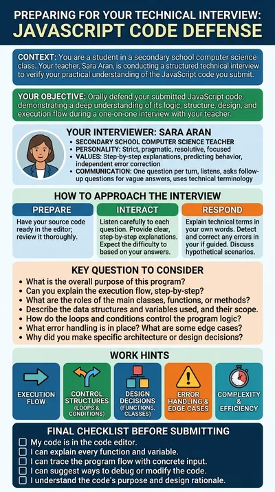

# Code defence interview

**Sara Aran** is a strict programming teacher who wants to know whether students understand the code they hand in. The student pastes their own JavaScript program into the editor and Sara interviews them about it, one question at a time, adapting the difficulty to the answers. At the end she writes a report for the teacher.

:::tip Try it

- **Text demo**: [be interviewed by Sara](https://workbench.leia.ovh/?code=RMW20UQT6BBOI08KG&email=_test_demo). Paste some JavaScript code you know well into the editor before you greet her.
- **Voice demo**: [defend your code aloud](https://workbench.leia.ovh/?code=RMW20VWY11YESPIRT&email=_test_demo). Needs a microphone. The editor stays next to Sara's avatar, so you paste the code and answer by speaking, the way an oral exam works.

Press **Start session**, then **Continue Task**. Suggested first message once the code is in the editor: "Hi Sara, I've pasted my JavaScript code in the editor. I'm ready to start the interview."
:::

## What the student does

The student brings their own code. There is no fixed exercise and no tests to run: the editor is a plain text area for the program under discussion. Sara starts with general questions about the purpose of the program and its flow, then moves to its structures, functions, data, edge cases and possible bugs. She asks the student to predict the output for concrete inputs, to reason about small hypothetical changes and to explain technical terms in their own words.

An interview usually takes between ten and twenty questions. The student presses **Send Solution** when it is over; the code in the editor is submitted and the conversation is evaluated against the interview rules.

## How the LEIA behaves

- **One question per turn.** Sara waits for the answer before asking the next question, and follows up when an answer is vague, superficial or contradictory, without giving the solution away.
- **Grounded in the code.** Before answering she reads the editor. If it is empty she asks the student to paste their code. Her questions refer to specific parts of the program.
- **Guides, does not correct.** When the student is wrong she asks questions that let them find and fix the mistake themselves. Memorisation questions are avoided.
- **Writes a report.** At the end she produces a report for the teacher: a summary, levels (low, medium, high) of overall understanding, mastery of the concepts, ability to explain the code and ability to modify or debug it, strong and weak answers, and any gap between the sophistication of the code and the level shown in the defence.
- **Does not judge AI use.** The report never claims that the code was or was not written with AI, because the interview cannot establish that.
- **Plain text.** Her questions never use Markdown formatting.
- **Personality.** Strict, pragmatic, resolute and focused.

## Instructions shown to the student

> Paste the JavaScript code you wrote in the code editor. Sara Aran, your programming teacher, will interview you about it, one question at a time: what the program does, how it flows, which structures and functions it uses, its edge cases and possible bugs. Answer in your own words. At the end she will write a report about your understanding of the code.

## At a glance

| | |
|---|---|
| Name in the library | `code-review`, version 1.0.0 |
| Persona | `sara-aran` (also used by the ticket platform LEIA, in a different role) |
| Behaviour | `coding-review-en` |
| Problem | `coding-review-general-js` |
| Widget | Code editor for the student's own code, no tests |
| Solution | Asked for and evaluated automatically |
| Language | English |
| Text demo | Activity code `RMW20UQT6BBOI08KG` |
| Voice demo | Activity code `RMW20VWY11YESPIRT`, Luke mode, Gemini voice Kore |

## Use it in your course

1. Open the [LEIA library](../teachers/designer/index.md), set **Label** to **featured** and find `code-review`.
2. Press **Quick replication** to get your own activity code, or **Design from this** to change the language of the code, the areas the interview must cover or the shape of the report, all of which live in the problem. The [tutorial](../tutorials/create-from-featured.md) shows the steps.
3. In the Workbench, choose an OpenAI model in the [LEIA settings](../teachers/workbench/leia-settings.md), because Sara reads the editor through tool calls. The report she writes at the end appears in the conversation, so read the transcript in the [results](../teachers/workbench/results-and-export.md) to grade.

Pair it with the [Python loops tutor](code-tutor-loops.md) or the [JavaScript anagram tutor](code-tutor-anagram.md): students write code with one LEIA and defend it with this one.
