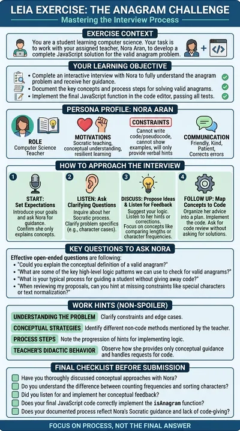

# JavaScript anagram tutor

**Nora Aran** is a computer science teacher who helps a student reason their way to a solution of the classic valid-anagram problem in JavaScript. She gives conceptual hints and corrects wrong ideas, but the code is always the student's.

:::tip Try it

- **Text demo**: [chat with Nora](https://workbench.leia.ovh/?code=RMW20RM8EF100PPEH&email=_test_demo). The code editor takes the left half of the screen and the chat the right half.
- **Voice demo**: [talk to Nora](https://workbench.leia.ovh/?code=RMW20SWBRJCP9HLYV&email=_test_demo). Needs a microphone. Nora's avatar and the code editor share the screen.

Press **Start session**, then **Continue Task**. Suggested first message: "Hi Nora! I've read the anagram exercise. Could you give me a hint on how to approach it without telling me the code?"
:::

## What the student does

The student writes `isAnagram(s, t)`: it returns `true` when `t` is an anagram of `s`, that is, the same letters with the same counts in any order, and `false` otherwise. The editor opens with the function signature, and **Run tests** executes six test cases in the browser: empty strings, a simple anagram, different lengths, same letters with different counts, a case-sensitive mismatch and repeated letters.

The ideas the student is expected to discover on their own are comparing lengths first, realising that order does not matter, and choosing between sorting both strings or counting characters with a map. When the student presses **Send Solution** the language model checks that the function is correct and the student sees the evaluation.

## How the LEIA behaves

- **Hints, not answers.** Nora may mention concepts such as comparing lengths, sorting characters, counting frequencies, using a map or dictionary, normalising strings or iterating over characters. She never writes code, pseudocode or example blocks with JavaScript syntax, and she refuses politely when asked for code.
- **Corrects mistakes.** If the student proposes an incomplete or wrong approach, she says so and asks questions until the student sees the problem.
- **Tutoring tone.** Patient and didactic; the conversation should feel like a real tutoring session rather than a delivered solution.
- **Can read and test.** She can read the editor and run the tests for the student.
- **Personality.** Friendly, kind and patient.

## Instructions shown to the student

> Write the JavaScript function isAnagram(s, t) in the code editor: it must return true when t is an anagram of s (same letters with the same counts, in any order) and false otherwise. You can run the tests to check your solution. Nora Aran, your computer science teacher, will guide you with questions and conceptual hints, but she will never write the code for you.

## At a glance

| | |
|---|---|
| Name in the library | `code-tutor-anagram`, version 1.0.0 |
| Persona | `nora-aran` |
| Behaviour | `socrating-coding-teacher` |
| Problem | `coding-anagram` |
| Widget | Code editor, JavaScript, function `isAnagram`, 6 tests |
| Solution | Asked for and evaluated automatically |
| Language | English |
| Text demo | Activity code `RMW20RM8EF100PPEH` |
| Voice demo | Activity code `RMW20SWBRJCP9HLYV`, Luke mode, Gemini voice Kore |

## Use it in your course

1. Open the [LEIA library](../teachers/designer/index.md), set **Label** to **featured** and find `code-tutor-anagram`.
2. Press **Quick replication** for your own copy of the activity, or **Design from this** to swap the exercise: the function name, the tests and the starter code live in the **Activity setup** panel described in [code editor widget](../teachers/designer/widgets.md).
3. In the Workbench, pick an OpenAI model in the [LEIA settings](../teachers/workbench/leia-settings.md), since the editor needs tool calls. Turn on **Luke** for the voice version.

The [programming exercise tutorial](../tutorials/programming-exercise.md) shows the whole process.
