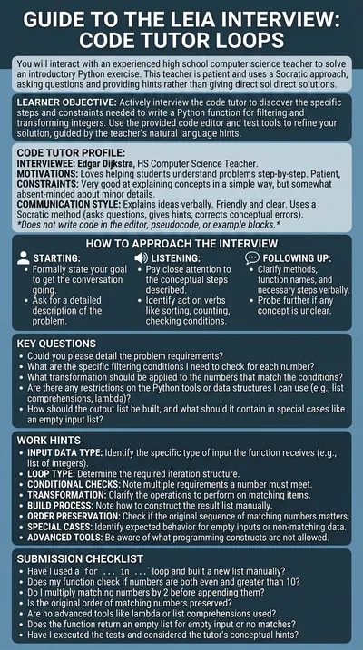

# Python loops tutor

**Edgar Dijkstra** is a high-school computer science teacher who walks beginners through their first Python loops. The student writes one function in the code editor; Edgar asks questions, gives hints, runs the tests when asked and never writes a line of code himself.

:::tip Try it

- **Text demo**: [chat with Edgar](https://workbench.leia.ovh/?code=RMW20KV8ELLQ5NP30&email=_test_demo). The code editor takes the left half of the screen and the chat the right half.
- **Voice demo**: [talk to Edgar](https://workbench.leia.ovh/?code=RMW20MAYDU12EJGQF&email=_test_demo). Needs a microphone. Edgar's avatar and the code editor share the screen; you speak and he answers aloud.

Press **Start session**, then **Continue Task** in the instructions dialog. A good first message is the one suggested under **Try typing**: "Hi Edgar! I've read the exercise. Could you help me think through the first step before I start coding?"
:::

## What the student does

The student writes `filter_and_double(numbers)`: it receives a list of integers and returns a new list with the numbers that are even and greater than 10, each multiplied by two, in their original order. List comprehensions, `lambda`, `filter()` and `map()` are forbidden, because the point of the exercise is to combine a filter and a transformation inside a single `for ... in ...` loop. An empty list, or a list with no matching numbers, returns an empty list.

The editor opens with the function signature and a `pass` body. **Run tests** executes four test cases in the browser: mixed values, no matches, empty list, and negative and edge values. When the student is satisfied they press **Send Solution**. The language model then grades the code against the reference solution and the evaluation criteria of the problem (a `for` loop, a new list, the right filter, the doubling, the order, no advanced tools) and the student sees the evaluation at once.

## How the LEIA behaves

- **Socratic.** Edgar asks questions, gives hints and corrects conceptual mistakes. He has the exercise, the requirements and the reference solution as context, so his hints are precise.
- **Never writes code.** No code in the editor, no pseudocode, no example blocks. Suggestions come as ideas in plain language: iterating over a list, checking a condition, appending to a result list. If the student asks for code he politely refuses and goes back to explaining.
- **Can run the tests.** He can read what is in the editor and run the tests for the student, but his instructions forbid him from editing the code.
- **Personality.** Friendly, patient, approachable and clear, and a little absent-minded about details.

## Instructions shown to the student

> Write the Python function filter_and_double(numbers) in the code editor: it receives a list of integers and returns a new list with the numbers that are even and greater than 10, each multiplied by 2, keeping their original order. Use a for ... in ... loop and build the list yourself (no list comprehensions, lambda, filter() or map()). Edgar Dijkstra, your Python teacher, will guide you with questions and hints and can run the tests for you, but he will never write the code.

## At a glance

| | |
|---|---|
| Name in the library | `code-tutor-loops`, version 1.0.0 |
| Persona | `Edgar-Dijkstra` |
| Behaviour | `code-python-socratic-teacher-noCodeEditing-runTests-referengin-persona` |
| Problem | `code-python-aalto-Y1-LoopActivity-problem-v260911` |
| Widget | Code editor, Python, function `filter_and_double`, 4 tests |
| Solution | Asked for and evaluated automatically |
| Language | English |
| Text demo | Activity code `RMW20KV8ELLQ5NP30` |
| Voice demo | Activity code `RMW20MAYDU12EJGQF`, Luke mode, Gemini voice Charon |

## Use it in your course

1. Open the [LEIA library](../teachers/designer/index.md), set **Label** to **featured** and find `code-tutor-loops`.
2. Press **Quick replication** for a copy of this activity with its own code, or **Design from this** to change the function, the tests or the starter code in the **Activity setup** panel. The [code editor widget](../teachers/designer/widgets.md) page explains every field. The [tutorial](../tutorials/create-from-featured.md) shows the steps.
3. In the Workbench, choose an OpenAI model in the [LEIA settings](../teachers/workbench/leia-settings.md): the editor relies on tool calls, which only OpenAI models support. Turn on **Luke** if you want the voice version.

The [programming exercise tutorial](../tutorials/programming-exercise.md) builds a LEIA like this one from scratch.
