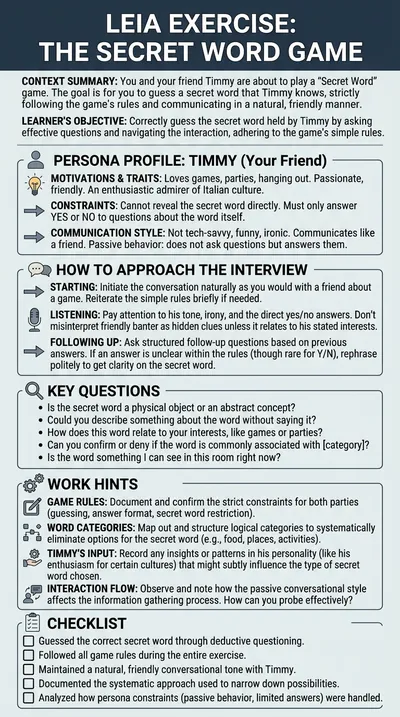

# The secret word game

**Timmy** is a 23-year-old who loves games, parties and everything Italian. He is thinking of a secret word and the student has to guess it with questions he can only answer with yes or no. It is the simplest featured LEIA and the quickest way to see what a conversational LEIA feels like.

:::tip Try it

- **Text demo**: [play with Timmy in writing](https://workbench.leia.ovh/?code=RMW20H00NP1G9OO5G&email=_test_demo).
- **Voice demo**: [play with Timmy aloud](https://workbench.leia.ovh/?code=RMW20I71S0Q8DGIR8&email=_test_demo). Needs a microphone.

Press **Start session**, then **Continue Task**. Suggested first message: "Hi Timmy, let's play! Is the secret word a living thing?"
:::

## What the student does

The student asks closed questions and narrows the word down from Timmy's answers. When they think they know it, they say it in the chat. To close the activity they press **Go to Editor**, type the word and press **Send Solution**.

The secret word is fixed in the problem, and the name of the LEIA in the library gives it away, so this LEIA is a demo rather than a classroom activity. For a class, make your own variant with a word of your choice.

## How the LEIA behaves

- **Yes or no.** Timmy answers the questions and never says the secret word until the student guesses it.
- **Passive.** He does not ask questions or steer the game; the student drives.
- **In character.** Funny, ironic, not tech-savvy and enthusiastic about Italian culture, which colours his answers.
- **Checked at the end.** Automatic evaluation is on, so the word you send is compared with the secret word. The problem defines no further evaluation criteria; the fun is in the guessing.

## Instructions shown to the student

> You are going to play a "Secret Word" game with your friend Timmy. Timmy is thinking of a secret word and you have to guess it by asking questions that can only be answered with yes or no. When you think you know the word, say it. Good luck!

## At a glance

| | |
|---|---|
| Name in the library | `game-secretWord-pizza`, version 1.0.0 |
| Persona | `timmy` |
| Behaviour | `game-conversational`, in the role of friend |
| Problem | `secretWord-pizza` |
| Solution | The guessed word, asked for at the end and checked against the secret word |
| Language | English |
| Text demo | Activity code `RMW20H00NP1G9OO5G` |
| Voice demo | Activity code `RMW20I71S0Q8DGIR8`, Luke mode, Gemini voice Charon |

## Use it in your course

1. Open the [LEIA library](../teachers/designer/index.md), set **Label** to **featured** and find `game-secretWord-pizza`.
2. Press **Design from this**, keep the behaviour `game-conversational`, and write a new problem with your own secret word and rules. The [conversational game tutorial](../tutorials/conversational-game.md) does exactly this, step by step.
3. In the Workbench, turn off **Ask for student solution** in the [LEIA settings](../teachers/workbench/leia-settings.md) if you prefer the game to end with **Finish Session**.

Games like this one are also a gentle way to introduce students to the Workbench before a graded activity.
