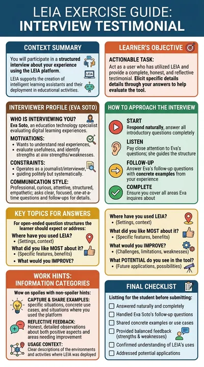

# An interview about your LEIA experience

**Eva Soto** is an education technology specialist who designs and evaluates digital learning experiences. She interviews students and instructors who have used LEIA about where they used it, what they liked, what they would improve and what potential they see. The LEIA team uses it to collect structured feedback; it also shows how a LEIA can run a reflective interview on any topic.

:::tip Try it

- **Text demo**: [talk to Eva in writing](https://workbench.leia.ovh/?code=RMW20XI4X7GGWUVXN&email=_test_demo).
- **Voice demo**: [talk to Eva aloud](https://workbench.leia.ovh/?code=RMW20YDDV6DLUVV29&email=_test_demo). Needs a microphone.

Press **Start session**, then **Continue Task**. Suggested first message: "Hi Eva, nice to meet you. I'm ready to tell you about my experience with LEIA."
:::

## What the student does

The person answers an interview about their experience with LEIA, as honestly and concretely as they can: the course or context where they used it, what they liked most, what they would change, what the tool could become, and real examples or situations. Eva asks follow-up questions whenever an answer stays general.

When the interview is over, the person presses **Go to Editor**, writes a short summary of their feedback and presses **Send Solution**. The language model checks that the four areas were covered and rewards concrete, relevant and reflective answers.

## How the LEIA behaves

- **Structured.** Eva covers the four areas systematically: where, what was good, what to improve, what potential.
- **One question at a time.** She asks clear, focused questions and follows up to get specific examples.
- **Does not solve anything.** Her role is to draw out a complete, honest reflection, not to give advice or defend the tool.
- **Tone.** Professional, friendly and curious.
- **Personality.** Professional, curious, attentive, structured and empathetic.

## Instructions shown to the student

> Eva Soto, an education technology specialist, will interview you about your experience with LEIA: where you used it, what you liked most, what you would improve and what potential you see in it. Answer honestly and give concrete examples; she will ask follow-up questions.

## At a glance

| | |
|---|---|
| Name in the library | `interview-leia-testimonial`, version 1.0.0 |
| Persona | `eva-soto` |
| Behaviour | `testimonial-learning-experience-v2`, in the role of interviewer |
| Problem | `testimonial-leia-experience-v2` |
| Solution | Free text, asked for and evaluated automatically |
| Language | English |
| Text demo | Activity code `RMW20XI4X7GGWUVXN` |
| Voice demo | Activity code `RMW20YDDV6DLUVV29`, Luke mode, Gemini voice Kore |

## Use it in your course

1. Open the [LEIA library](../teachers/designer/index.md), set **Label** to **featured** and find `interview-leia-testimonial`.
2. Press **Quick replication** to collect feedback about LEIA from your own students at the end of a course: share the code, then read the answers in [results and export](../teachers/workbench/results-and-export.md).
3. Or press **Design from this** and change the problem to interview students about any other experience: a project, an internship, a reading. The behaviour `testimonial-learning-experience-v2` only needs the topic and the areas to cover.
