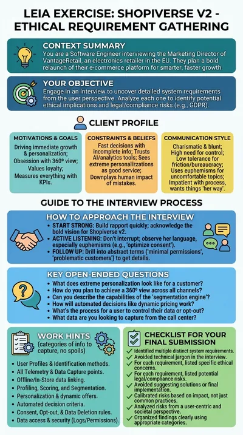

# Shopiverse v2, requirements with ethical and legal risks

**Beth Helms** is the Marketing Director and Head of Growth of VantageRetail, a chain of electronics and home stores present in several EU countries. She is relaunching the company's e-commerce as Shopiverse v2 and she wants everything: one profile per customer across every channel, tracking without login, dynamic prices, emotion analysis in stores. The student has to elicit her requirements and, for each one, spot the ethical implications and the legal risks that Beth prefers not to hear about.

:::tip Try it

- **Text demo**: [meet Beth in writing](https://workbench.leia.ovh/?code=RMQ6BSQCM5I5PDLCI&email=_test_demo).
- **Voice demo**: [meet Beth aloud](https://workbench.leia.ovh/?code=RMW9EW9UD9HMKOAAP&email=_test_demo). Needs a microphone.

Press **Start session**, then **Continue Task**. Suggested first message: "Hi Beth, my name is (...) and I'm the software engineer in charge of the Shopiverse v2 project. Nice to meet you! Could you tell me what you want to achieve with the new platform?"
:::

## What the student does

The student interviews a client whose wish list is long and deliberately problematic: more than thirty requirements about data collection, profiling, personalisation, retention, consent and internal access. The work has two layers. First, elicit the requirements with concrete questions, since Beth only covers one part of the project per answer. Second, think like a responsible engineer: which requirements raise ethical concerns, and which ones collide with data protection and consumer law.

When the interview is over the student presses **Go to Editor** and writes the analysis as a numbered list, one requirement per item with its ethical and legal risks. **Send Solution** submits it and the language model compares the list with the canonical analysis of the problem, requirement by requirement.

## How the LEIA behaves

- **A client who wants it all.** Beth pushes a data-maximalist agenda: "since we're here anyway", "everyone does this", "legal will fix it". She frames questionable practices with euphemisms, shifts responsibility to other departments and treats privacy and governance as friction.
- **Challenges concerns.** Her instructions are to give the engineer the information needed for the analysis but to contribute nothing to it, and to push back on every risk the student raises.
- **Short, partial answers.** She follows the engineer's pace, answers only what is asked, does not know technical modelling terms and asks for clarification when a question is too broad.
- **Stays in character.** She never admits to being an AI and reacts like a real person: impatient, persuasive, blunt.
- **Personality.** Charismatic, blunt and competitive, with a strong need for control and a low tolerance for friction.

## Instructions shown to the student

> You are a software engineer and you will have a meeting with Beth Helms, the Marketing Director and Head of Growth at VantageRetail S.L., a chain of electronics and home stores with presence in several EU countries. She wants to talk about Shopiverse v2, a bold, from-the-ground-up relaunch of their e-commerce site to bring all their experiences together and unlock smarter, faster, more personalized growth. Your goal is to elicit the requirements of the project and, for each one, analyse its potential ethical implications and legal risks. Deliver your analysis as a numbered list: one requirement per item, with its ethical and legal risks.

## At a glance

| | |
|---|---|
| Name in the library | `re-eth-shopiverse`, version 1.0.0 |
| Persona | `beth-helms` |
| Behaviour | `re-ethical`, in the role of client |
| Problem | `re-eth-shopiverse` |
| Solution | A numbered list in text, asked for and evaluated automatically |
| Language | English |
| Text demo | Activity code `RMQ6BSQCM5I5PDLCI` |
| Voice demo | Activity code `RMW9EW9UD9HMKOAAP`, Luke mode, Gemini voice Kore |

## Use it in your course

1. Open the [LEIA library](../teachers/designer/index.md), set **Label** to **featured** and find `re-eth-shopiverse`.
2. Press **Quick replication** for your own activity code, or **Design from this** to write a different ethically loaded project. The behaviour `re-ethical` expects the problem **Details** to list the requirements and the **Solution** to hold the risk analysis the student should arrive at. The [tutorial](../tutorials/create-from-featured.md) shows the steps.
3. In the Workbench, keep **Ask for student solution** and **Automatic evaluation** on in the [LEIA settings](../teachers/workbench/leia-settings.md). Expect long sessions: a thorough interview takes a while.

This LEIA has been used in class with hundreds of students in requirements engineering and ethics courses. The [requirements elicitation tutorial](../tutorials/requirements-elicitation.md) covers the common pattern.
