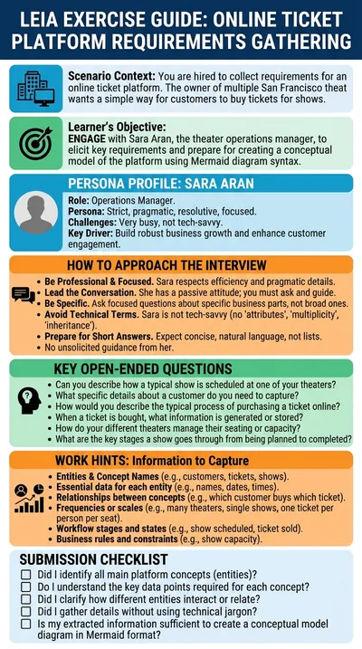

# Ticket platform requirements

**Sara Aran** runs a chain of theaters and wants an online platform where customers buy tickets for her shows. The student plays the software engineer who interviews her, gathers the requirements and turns them into a conceptual model. This is the original LEIA of the platform and the reference for every requirements elicitation exercise.

:::tip Try it

- **Text demo**: [interview Sara in writing](https://workbench.leia.ovh/?code=RMW1ZMJVYSGWUUZCD&email=_test_demo).
- **Voice demo**: [interview Sara aloud](https://workbench.leia.ovh/?code=RMW203MK1WB9WW18L&email=_test_demo). Needs a microphone. In this demo the transcript is hidden, so you only hear Sara, like a real meeting.

Press **Start session**, then **Continue Task**. Suggested first message: "Hi Sara, my name is (...) and I'm the software engineer in charge of the online ticket platform. Nice to meet you! Could you tell me how your theaters sell tickets today?"
:::

## What the student does

The student leads a client interview. Sara knows her business but nothing about software, so the questions have to be concrete and in her language: shows, theaters, seats, customers, payments. Broad questions get broad answers; the information comes out piece by piece.

When the student has enough, they press **Go to Editor** and write the conceptual model of the platform as a Mermaid class diagram, with a live preview next to the text. **Send Solution** submits it; the language model compares it with the reference model of the problem and the student sees the evaluation at once.

## How the LEIA behaves

- **A client, not an assistant.** Sara answers what she is asked and nothing more. She does not offer suggestions, does not guide the interview and does not end her messages with questions.
- **Not tech-savvy.** She does not understand terms such as "class", "attribute", "relationship" or "entity", so questions phrased that way lead nowhere.
- **Short answers.** She describes one part of the business per answer; asked something too broad she asks which part the engineer means, and vague questions get vague answers.
- **Stays in character.** She never reveals that she is an AI and keeps a professional, slightly impatient tone.
- **Personality.** Strict, pragmatic, resolute, focused and very busy.

## Instructions shown to the student

> You have been hired to gather the requirements for an online ticket platform. You need to obtain these requirements by conversing with Sara Aran, the theater owner of a company that owns many theaters. The ultimate goal is to create the conceptual model of this platform using mermaid diagram syntax.

## At a glance

| | |
|---|---|
| Name in the library | `re-inf-tickets`, version 1.0.0 |
| Persona | `sara-aran` (also used by the code defence interview, as a teacher) |
| Behaviour | `re-information`, in the role of theater owner |
| Problem | `tickets-test` |
| Solution | A Mermaid diagram, asked for and evaluated automatically |
| Language | English |
| Text demo | Activity code `RMW1ZMJVYSGWUUZCD` |
| Voice demo | Activity code `RMW203MK1WB9WW18L`, Luke mode, Gemini voice Kore, transcript hidden |

## Use it in your course

1. Open the [LEIA library](../teachers/designer/index.md), set **Label** to **featured** and find `re-inf-tickets`.
2. Press **Quick replication** for your own activity code, or **Design from this** to keep the client behaviour and describe a different business. The behaviour `re-information` is shared by many requirements LEIAs, so you only change the persona and the problem. The [tutorial](../tutorials/create-from-featured.md) shows the steps.
3. In the Workbench, decide whether students submit a model (**Ask for student solution**) and whether it is graded (**Automatic evaluation**) in the [LEIA settings](../teachers/workbench/leia-settings.md). Turn on **Luke** and **Hide audio transcription** for the spoken version.

The [requirements elicitation tutorial](../tutorials/requirements-elicitation.md) uses this LEIA as its starting point.
