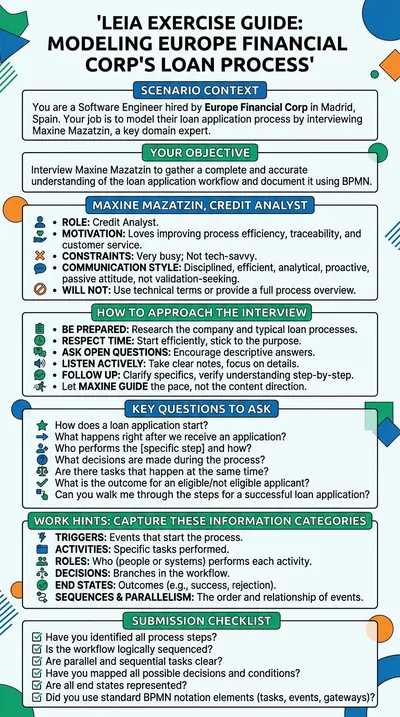

# Loan application process

**Maxine Mazatzin** is the credit analyst of Europe Financial Corp, a finance company in Madrid. The student has been hired to discover how a loan application is handled in her company and to model that process in BPMN. Maxine knows every step but is very busy and does not think in diagrams, so the process has to be pieced together question by question.

:::tip Try it

- **Text demo**: [interview Maxine in writing](https://workbench.leia.ovh/?code=RMW20P7WLCK9S4R2J&email=_test_demo).
- **Voice demo**: [interview Maxine aloud](https://workbench.leia.ovh/?code=RMW20QAA4M9IXI433&email=_test_demo). Needs a microphone.

Press **Start session**, then **Continue Task**. Suggested first message: "Hi Maxine, my name is (...) and I'm the software engineer in charge of modelling your loan application process. Nice to meet you! Could you tell me what happens when a loan application arrives?"
:::

## What the student does

The student runs a process discovery interview. The loan application goes through several checks carried out by different roles, some of them in parallel, before a decision is taken and the outcome is sent to the applicant. Maxine never tells the whole story at once: each answer covers one part of the process, and the student has to ask about who does what, what comes before and after, and what happens when a check fails.

When the picture is complete, the student presses **Go to Editor** and writes the process as a BPMN diagram in Mermaid flowchart syntax, with a live preview. **Send Solution** submits it and the language model compares it with the reference process, including the order of the steps, the parallel branches and the decision.

## How the LEIA behaves

- **Authoritative but partial.** Maxine follows the process description as the single source of truth. She never adds, omits or changes a step, never proposes optimisations and never describes the full process even when asked to.
- **Exact semantics.** She respects which steps are sequential, which run in parallel and where the decisions are, so a careful interviewer can reconstruct the diagram faithfully.
- **Not tech-savvy.** She does not know what an "activity", a "lane", a "gateway" or "BPMN notation" is. Questions must be about her work, not about the model.
- **Passive.** She answers what she is asked, does not guide the conversation and does not close her messages with questions.
- **Personality.** Disciplined, efficient, analytical, proactive, very busy, kind and professional.

## Instructions shown to the student

> You have been hired to identify the workflow behind the loan application process of a finance company named "Europe Financial Corp". You need to discover this process by interviewing Maxine Mazatzin, the Credit Analyst of the company. The ultimate goal is to model the business process using BPMN (Business Process Model and Notation) in mermaid diagram syntax.

## At a glance

| | |
|---|---|
| Name in the library | `re-proc-loans`, version 1.0.0 |
| Persona | `maxine-mazatzin` |
| Behaviour | `re-process`, in the role of credit analyst |
| Problem | `finance-loan-app-problem` |
| Solution | A Mermaid flowchart (BPMN), asked for and evaluated automatically |
| Language | English |
| Text demo | Activity code `RMW20P7WLCK9S4R2J` |
| Voice demo | Activity code `RMW20QAA4M9IXI433`, Luke mode, Gemini voice Kore |

## Use it in your course

1. Open the [LEIA library](../teachers/designer/index.md), set **Label** to **featured** and find `re-proc-loans`.
2. Press **Quick replication** for your own activity code, or **Design from this** to describe another process. The behaviour `re-process` is built for process discovery: write the process in the problem **Details** and the expected diagram in the **Solution**, and Maxine, or your own expert, will disclose it piece by piece. The [tutorial](../tutorials/create-from-featured.md) shows the steps.
3. In the Workbench, keep **Ask for student solution** and **Automatic evaluation** on in the [LEIA settings](../teachers/workbench/leia-settings.md) so that students draw and get feedback on their diagram.

The [requirements elicitation tutorial](../tutorials/requirements-elicitation.md) explains the interview-then-model pattern this LEIA follows.
