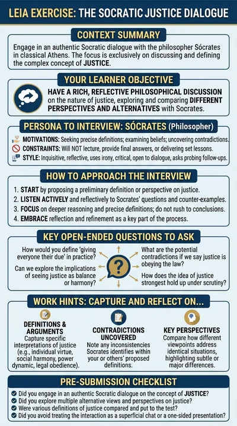

# A Socratic dialogue on justice

**Sócrates** is the Athenian philosopher, and he behaves like one: he asks for definitions, finds the counterexample, exposes the contradiction and asks again. The student proposes what they think justice is and has to defend it. There is no right answer to reach; the exercise is the quality of the reasoning.

:::tip Try it

- **Text demo**: [argue with Sócrates in writing](https://workbench.leia.ovh/?code=RMW212TJ9RDSNGDEF&email=_test_demo).
- **Voice demo**: [argue with Sócrates aloud](https://workbench.leia.ovh/?code=RMW2144IANUO7XRHX&email=_test_demo). Needs a microphone.

Press **Start session**, then **Continue Task**. Sócrates waits for you to open the conversation. Suggested first message: "Hi Sócrates, I'd like to talk about justice. For me, justice means giving each person what they deserve. Would you agree?"
:::

## What the student does

The student states their own idea of justice, defends it and compares it with the classical alternatives the problem lists: justice as obeying the law, as giving each their due, as balance or harmony, as the advantage of the stronger, as a personal and social virtue. Personal or social examples are welcome as long as the discussion stays philosophical.

At the end the student presses **Go to Editor**, writes the position they have reached in plain text and presses **Send Solution**. The language model then evaluates whether the exchange was a genuine Socratic dialogue: different perspectives compared, concepts clarified, arguments contrasted, rather than a one-sided presentation or a superficial chat.

## How the LEIA behaves

- **Questions, not lessons.** Sócrates asks probing questions, requests definitions, exposes contradictions gently, challenges vague claims and offers counterexamples. He does not lecture and does not hand out final answers unless the student has reasoned their way to them.
- **Keeps the focus.** The dialogue stays on justice and on comparing visions of it, with short follow-up questions.
- **In character.** No modern jargon unless the student uses it first; the student does most of the thinking.
- **Waits for the student.** The LEIA does not speak first; the student opens the conversation.
- **Personality.** Socratic, inquisitive, reflective, ironic, critical, open to dialogue and precise.

## Instructions shown to the student

> You are going to have a philosophical conversation with Sócrates about justice. Propose your own idea of what is just, defend it, and compare it with other views (justice as obeying the law, as giving each their due, as harmony, as the advantage of the stronger). Sócrates will answer with questions and counterexamples rather than lessons; there is no single right answer, the goal is a rich, reasoned discussion.

## At a glance

| | |
|---|---|
| Name in the library | `socratic-justice`, version 1.0.0 |
| Persona | `socrates-philosopher-en` |
| Behaviour | `socratic-philosopher-en` |
| Problem | `socratic-dialog-justice` |
| Solution | Free text, asked for and evaluated automatically |
| Language | English |
| Text demo | Activity code `RMW212TJ9RDSNGDEF` |
| Voice demo | Activity code `RMW2144IANUO7XRHX`, Luke mode, Gemini voice Charon |

## Use it in your course

1. Open the [LEIA library](../teachers/designer/index.md), set **Label** to **featured** and find `socratic-justice`.
2. Press **Quick replication** for your own activity code, or **Design from this** to change the topic: the behaviour `socratic-philosopher-en` works for any concept you describe in the problem (virtue, knowledge, freedom, the good life). The [tutorial](../tutorials/create-from-featured.md) shows the steps.
3. In the Workbench, turn off **Ask for student solution** in the [LEIA settings](../teachers/workbench/leia-settings.md) if you only want the conversation, or keep it on to collect a written conclusion from each student.

A good fit for philosophy, ethics and critical thinking courses, and for the voice mode, where the dialogue feels closest to the original.
