# How to Use LEIA

LEIA (Learning with an Educational Intelligent Assistant) is a platform that lets instructors design interactive simulations and lets students practise in realistic scenarios with AI support. A LEIA is an AI character with a role, a personality and an exercise behind it. Students talk to it, by text or by voice, and may hand in a solution that the platform grades.

This page gives the big picture. The [Teacher guide](../teachers/index.md) explains every screen, button and field, and the [Tutorials](../tutorials/create-leia/index.md) walk through complete examples.

---

## 1. General Workflow

The workflow of LEIA has five steps.

1. **The instructor designs the LEIA** in the Designer.
   - Describes the activity to an AI assistant or starts from an existing LEIA.
   - Chooses the process, either a requirements elicitation interview, a conversational game or any other role play.
   - Defines the problem, including the expected solution and how it is evaluated.
   - Chooses or customises the persona the students will talk to, with its personality traits.
2. **The instructor prepares an activity and a replication.**
   - Groups one or more LEIAs in an activity and publishes it.
   - Creates a replication in the Workbench with a join code and operational settings, time limit, repeatable sessions, language, model and voice.
   - Optionally enables the automatic evaluation and a supervisor that watches the conversations.
3. **Students join the activity** with the code and an email address, no account needed.
   - Each student gets a private session that can be resumed if it was not finished.
   - The instructor decides whether a student may repeat the activity.
4. **Submission and evaluation.**
   - Students write their solution in the editor, for example a UML class diagram in Mermaid syntax, or send the code from the editor widget.
   - The solution is graded automatically against the reference solution, and the instructor can adjust the score.
5. **Review of results.**
   - The instructor watches sessions live, reads the transcripts, the submissions, the evaluations and the supervisor flags, and downloads a CSV with every message.
   - The data supports grading, qualitative analysis and research.

### Workflow Diagram

---

## 2. Instructor Experience

### LEIA creation and design

Instructors work in the [LEIA Designer](https://designer.leia.ovh/). Its home page is the library of LEIAs that the instructor can see, test and reuse.

From the library an instructor can test any LEIA, start a new design from an existing one with **Design from this**, or press **New LEIA** and describe the activity to the AI assistant, which writes the persona, the behaviour and the problem.

Every component can be adjusted by hand. The problem editor holds the statement, the hidden details, the reference solution with a live preview, the solution format, the evaluation prompt and the optional code editor widget.

A LEIA can be tested from the Designer before any student sees it, and it stays private to the instructor until an administrator publishes it. The full walkthrough is in [Create a LEIA with the AI assistant](../teachers/designer/create-leia.md).

### Activities and replications

Published activities are replicated in the [LEIA Workbench](https://workbench.leia.ovh/). A replication has its own code, links and switches.

In the replication the instructor chooses, per LEIA, the language model and the key that pay for it, the voice mode, whether students must submit a solution and whether it is evaluated automatically. The details are in [Replication settings](../teachers/workbench/replication-settings.md) and [LEIA settings in a replication](../teachers/workbench/leia-settings.md).

### Workbench dashboard

The Workbench shows the sessions in progress with the supervisor flags, lets the instructor watch any conversation live, and lists every finished session with its transcript, evaluation and score. See [Live dashboard and spectating](../teachers/workbench/live-and-spectate.md) and [Results, grading and export](../teachers/workbench/results-and-export.md).

---

## 3. Student Experience

### Access

Students open the link shared by the instructor, or [workbench.leia.ovh](https://workbench.leia.ovh/), and type an email address and the replication code. The email is only an identifier. There is no password.

### Interaction with LEIA

Students read the instructions, then talk to the character. They can ask clarifying questions, gather requirements and refine their understanding. If the replication is repeatable they can start again later.

### Submissions and feedback

Students submit their solution in the format chosen by the instructor. When the automatic evaluation is enabled they get feedback at once, with a score and an explanation of what is missing, and they can compare their solution with the reference one.

The whole path is described in [What students see](../teachers/workbench/students.md).

---

## 4. Use Cases

- **Requirements elicitation training.** Simulate client interviews and model the requirements in UML. See the [scenario](../tutorials/requirements-elicitation.md).
- **Conversational games.** Guessing games, quizzes and role play with rules. See the [scenario](../tutorials/conversational-game.md).
- **Programming tutoring.** A tutor that reads the student's code and runs the tests. See the [scenario](../tutorials/programming-exercise.md).
- **Group simulations.** Several characters in one meeting. See the [scenario](../tutorials/multi-leia-simulation.md).
- **Iterative activities.** Repeatable sessions with feedback loops and a supervisor that coaches the student.
