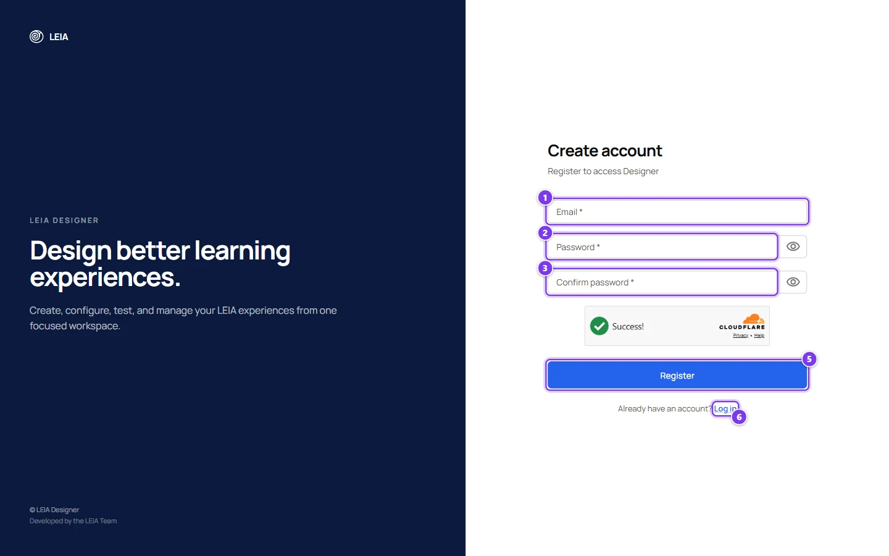
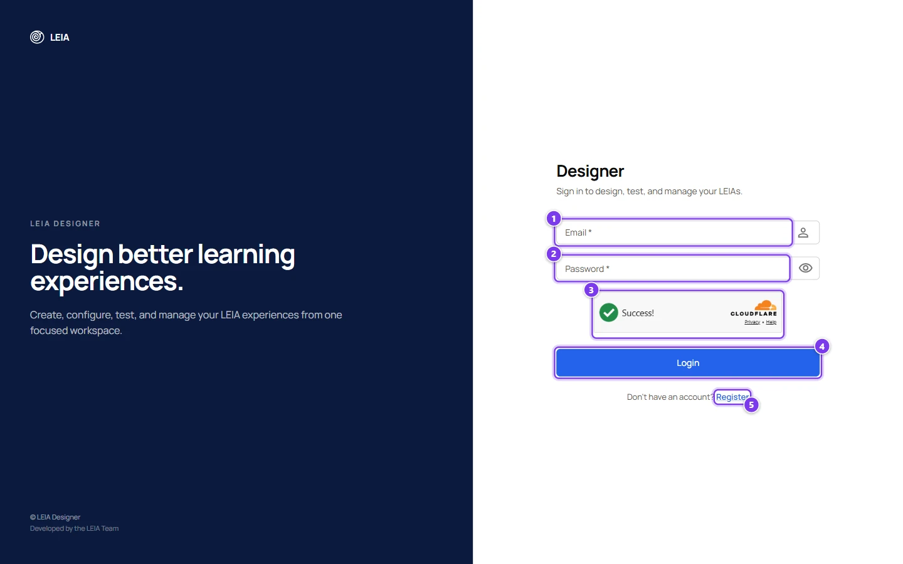
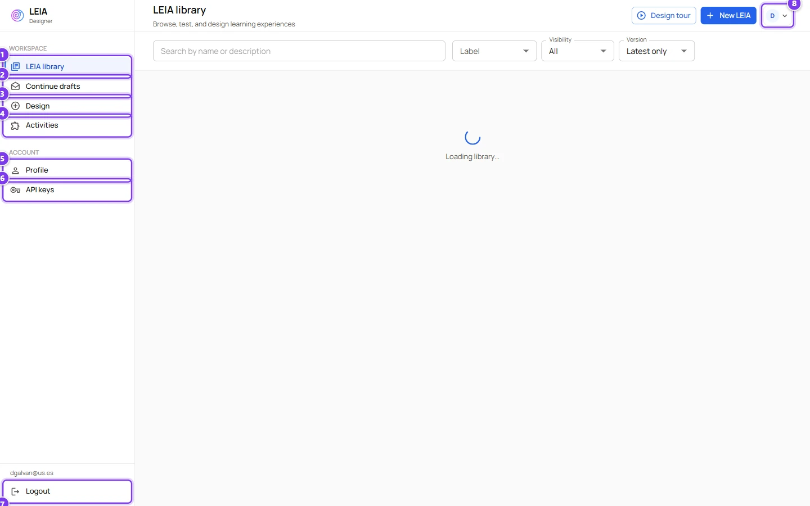
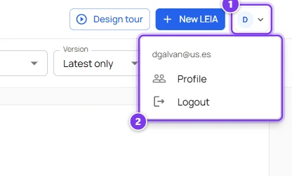
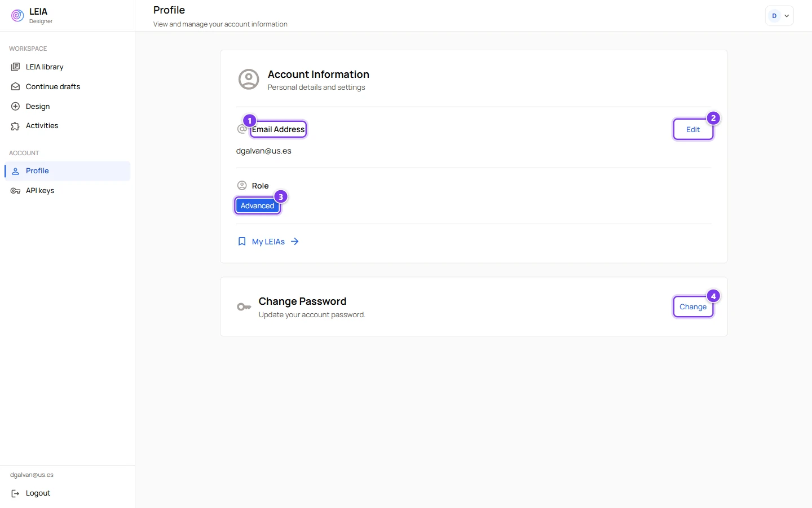

# Accounts and roles

:::info Who can do this
Anyone can register. What you can do afterwards depends on your role, so read the [roles table](#the-three-roles) before planning a class.
:::

## Register

Open [designer.leia.ovh/register](https://designer.leia.ovh/register). The same account is used by the Designer and the Workbench.

| # | Field or button | What it does |
|---|---|---|
| 1 | **Email** | Your login name. The Workbench and the Designer identify you by it, and students see it nowhere. |
| 2 | **Password** | At least 6 characters. |
| 3 | **Confirm password** | Must match the password. The eye icon shows or hides both fields at once. |
| 4 | Verification | A Cloudflare check that runs by itself. The **Register** button stays disabled until it passes. |
| 5 | **Register** | Creates the account and sends you to the login page. |
| 6 | **Log in** | Link for people who already have an account. |

The form validates in this order. Empty required fields, then the email format, then the password length, then the match between the two passwords, then the verification check. A new account always receives the **instructor** role.

## Log in

Open [designer.leia.ovh/login](https://designer.leia.ovh/login).

| # | Field or button | What it does |
|---|---|---|
| 1 | **Email** | The address you registered with. |
| 2 | **Password** | Your password. The eye icon reveals it. |
| 3 | Verification | The same automatic Cloudflare check as in the register form. |
| 4 | **Login** | Signs you in and opens the LEIA library. |
| 5 | **Register** | Link to the register form. |

If you open the Designer while a session is still valid you land directly in the library. The session is refreshed every five minutes and every time the browser window regains focus. When the server rejects an expired session you are sent back to the login page, and when it rejects your role you see an **Access Denied** page with a **Go to Home** button and a **Switch Account** button that logs you out.

The Workbench has its own sign-in page at [workbench.leia.ovh/login](https://workbench.leia.ovh/login) with the same email and password. It only admits the **advanced** and **admin** roles. An instructor sees the message "Instructors cannot access workbench administration." The student entrance of the Workbench is a different page and needs no account. See [What students see](workbench/students.md).

## Find your way around the Designer

| # | Item | Where it goes |
|---|---|---|
| 1 | **LEIA library** | The home page. Search, test and design LEIAs. See [The LEIA library](designer/index.md). |
| 2 | **Continue drafts** | LEIAs you started designing and did not finish. See [Drafts](designer/create-leia.md#drafts-and-autosave). |
| 3 | **Design** | Starts a new LEIA. See [Create a LEIA with the AI assistant](designer/create-leia.md). |
| 4 | **Activities** | Groups of LEIAs ready to be published. Only visible to the advanced and admin roles. See [Activities](designer/activities.md). |
| 5 | **Profile** | Your email, your role and the password change form. |
| 6 | **API keys** | Language model keys. See [API keys and models](api-keys.md). |
| 7 | **Logout** | Ends the session. |
| 8 | **Account menu** | The avatar at the top right. It repeats **Profile** and **Logout** and, for administrators, adds **Manage labels**. |

Administrators also see a **Users** entry in the sidebar that opens the user management page.

## Your profile

| # | Item | What it does |
|---|---|---|
| 1 | **Email Address** | The address you log in with. |
| 2 | **Edit** | Opens a field to type a new address. **Save** applies it, **Cancel** discards it. The new address must be different from the current one. |
| 3 | **Role** | Your current role. Only an administrator can change it. |
| 4 | **Change** | Opens the password form with **Current Password**, **New Password** (at least 6 characters) and **Confirm New Password**. |

The **My LEIAs** link currently returns to the library.

## The three roles

| What you can do | instructor | advanced | admin |
|---|---|---|---|
| Browse the library, test LEIAs, view their content | yes | yes | yes |
| Design LEIAs and create personas and problems | yes | yes | yes |
| Create or edit behaviours | no | yes | yes |
| Create LEIAs with the AI assistant | see note | yes | yes |
| Add labels to your own LEIAs | yes | yes | yes |
| Manage activities, add LEIAs to them, publish them | no | yes | yes |
| Quick replication from the library | no | yes | yes |
| Sign in to the Workbench, create replications, see results | no | yes | yes |
| Add your own API keys | yes | yes | yes |
| Make a LEIA or a component public | no | no | yes |
| See the behaviour text of other people's LEIAs | no | no | yes |
| Manage users, global labels and system keys | no | no | yes |

:::caution Instructors and the AI assistant
The AI assistant always writes a new behaviour together with the persona and the problem. Because only the advanced and admin roles may create behaviours, an instructor account gets an error on **Finish LEIA** when the behaviour is new. Instructors can still design LEIAs by starting from an existing one with **Design from this** and leaving the behaviour untouched. The [quick start](../tutorials/create-leia/index.md) follows that path.
:::

Everything you create is **private** by default. Other users only see it once an administrator publishes it. Write to the LEIA team at [team@leia.ovh](mailto:team@leia.ovh) to ask for the advanced role or to have a LEIA published.

## Log out

Use **Logout** at the bottom of the sidebar or in the account menu. Logging out of the Designer also ends the Workbench session, because both share the same login service.
