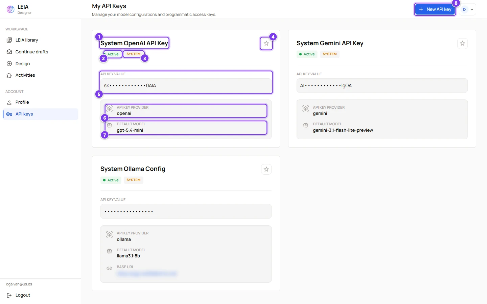
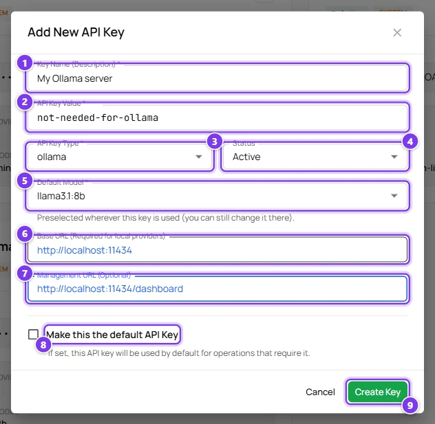

# API keys and models

:::info Who can do this
Every role can add and manage its own keys. Only administrators can create **system keys** that are shared with other users.
:::

## Why you need a key

LEIA does not run language models itself. Every conversation, every automatic evaluation and every AI feature of the Designer calls a provider such as OpenAI with a key, and the cost of those calls goes to the owner of the key. This is called **bring your own key**. You add the key once in the **API keys** page and then choose it wherever a model is needed.

Your administrator may have shared **system keys** with your account. They appear in your list with a **System** chip and you can use them straight away. In that case you can skip the rest of this page until you need a provider of your own.

## Supported providers

| Provider | Key type | What you get | Notes |
|---|---|---|---|
| **OpenAI** | `openai` | Text conversations, tool calls for widgets, the AI assistant of the Designer, the supervisor | Required for the AI assistant, the supervisor and any LEIA with widgets |
| **Google Gemini** | `gemini` | Text conversations and the avatar and infographic images of a LEIA | Required to regenerate images |
| **Ollama** | `ollama` | Open models served by an Ollama server you run yourself | Needs the **Base URL** of the server |
| **ALMA** | `alma` | Models served by the ALMA platform of the University of Seville | Needs a Base URL and an ALMA key |

The list of models offered for each provider is maintained by the platform, so it may change without any action on your part. Anthropic keys are accepted by the form but no model runs with them yet.

## Your keys

Open **API keys** in the sidebar of the Designer. The Workbench has the same page under **API Keys**, and both show the same list.

| # | Item | What it shows or does |
|---|---|---|
| 1 | Key name | The description you gave the key. |
| 2 | **Active** | An inactive key is kept but hidden from every model selector. |
| 3 | **System** | The key was created by an administrator and shared with you. You can use it but not edit or delete it. |
| 4 | Star | **Mark as Default**. The default key is preselected wherever a key is needed and is assigned automatically to new replications. Only one key can be the default. |
| 5 | **API Key Value** | The key, masked. Nobody can read a key back once it is saved. |
| 6 | **API Key Provider** | The provider of the key. |
| 7 | **Default Model** | The model preselected when this key is used. You can still pick another model of the same provider in each place. |
| 8 | **New API key** | Opens the form below. |

Keys of your own also show an **Edit** and a **Delete** icon.

## Add a key

| # | Field | What it does |
|---|---|---|
| 1 | **Key Name (Description)** | A name you will recognise later, for example "My OpenAI key for the autumn course". Required. |
| 2 | **API Key Value** | The secret issued by the provider. Required when creating. When editing, leave it blank to keep the current value. |
| 3 | **API Key Type** | The provider. Changing it clears the model, because models belong to a provider. Required. |
| 4 | **Status** | **Active** or **Inactive**. Inactive keys are kept but cannot be selected. |
| 5 | **Default Model** | The model preselected wherever this key is used. The list depends on the provider. Required. |
| 6 | **Base URL** | Where the provider lives. Only local or self-hosted providers such as Ollama and ALMA need it. |
| 7 | **Management URL** | Optional link to the provider's dashboard. The Workbench shows it as a **Dashboard** link next to the model selector so you can check your usage. |
| 8 | **Make this the default API Key** | Shown only when you already have at least one key. The new key becomes the default one. |
| 9 | **Create Key** | Saves the key. The provider checks the format of the value, so a key with a typo is rejected here. |

Administrators also see **Make this a System API Key**. A system key is available to every user whose account has system access enabled.

### Edit, disable and delete

- **Edit** opens the same form. The value field is empty and the current secret is kept unless you type a new one.
- To stop a key temporarily, edit it and set **Status** to **Inactive**. Replications that used it will show the model as unavailable until you pick another key.
- **Delete** asks for confirmation. Any replication still using the key stops working immediately, so change the model of those replications first.

### Which key is used where

| Feature | Provider | Where you choose the key |
|---|---|---|
| Testing a LEIA from the library | any active key | **Test settings** in the library, or the default key when you press **Test LEIA** |
| The AI assistant that writes LEIAs | OpenAI only | **Assistant settings** in the Design menu |
| The supervisor | OpenAI only | The supervisor card of the review step |
| Regenerating avatars and infographics | Gemini only | The **Regenerate** menu of the LEIA view |
| LEIAs with the code editor widget | OpenAI only | Automatically, because tool calls need an OpenAI model |
| A LEIA inside a replication | any active key | The **Runner** block of the LEIA in the Workbench |
| Voice modes and the transcription generator | the platform's own keys | Nothing to choose |

## Troubleshooting

- **The model list is empty in the Workbench.** The list only shows models of providers for which you have an active key. Add or activate a key for that provider.
- **"Configure an API key before testing a LEIA".** You have no active key at all. Add one or ask your administrator for a system key.
- **"This activity uses widgets, so its tool functions only run on a tool-capable provider".** The LEIA has a code editor. Only OpenAI models can call its tools, so choose an OpenAI key.
- **A replication refuses to activate.** Every LEIA in it needs a model and a key. Open the LEIA in the replication, pick them and press **Save**. See [LEIA settings in a replication](workbench/leia-settings.md).
