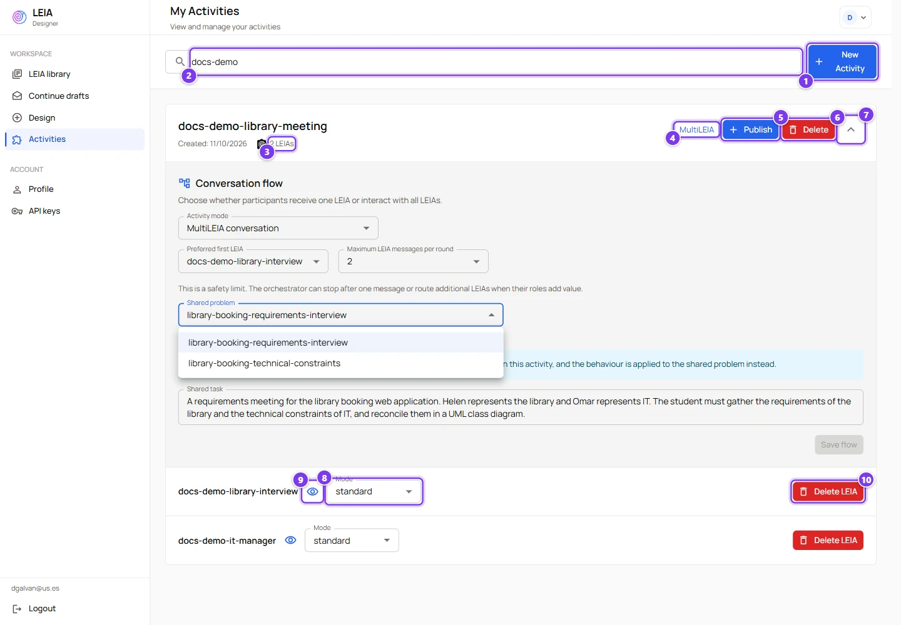
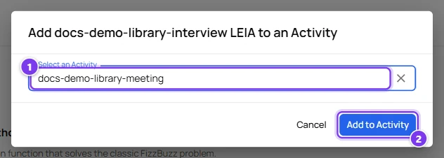
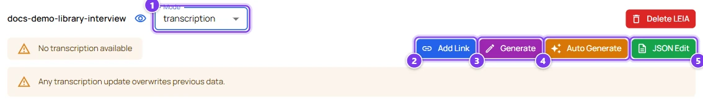
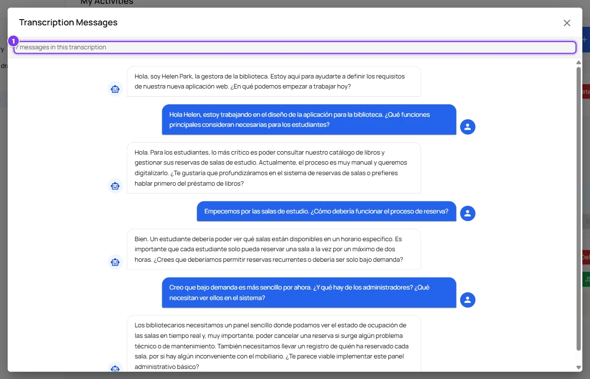
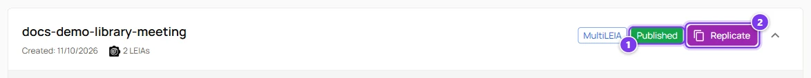

# Activities

:::info Who can do this
The **advanced** and **admin** roles. The **Activities** entry of the sidebar is hidden for instructors.
:::

An activity is the unit the Workbench runs. It groups one or more LEIAs, decides whether students get one LEIA each or talk to all of them at once, and once **published** it becomes available to the Workbench, where it is called an experiment.

The simplest activity has one LEIA. You get one for free with **Quick replication** in the library or with **Quick Replication** in the success dialog of the design screen. This page is for the cases where you want to prepare the activity yourself.

## The activities page

Open **Activities** in the sidebar.

| # | Control | What it does |
|---|---|---|
| 1 | **New Activity** | Asks for a name and creates an empty activity. Names are unique, "An activity with that name already exists" means you must choose another one. |
| 2 | Search | Filters the activities already loaded by name. The page loads more activities as you scroll down. |
| 3 | LEIA count | How many LEIAs the activity holds. A **MultiLEIA** chip appears next to it when the conversation flow is set to MultiLEIA, and a **Published** chip once the activity is published. |
| 4 | **Publish** | Makes the activity available to the Workbench. Only before publishing. |
| 5 | **Delete** | Deletes the activity immediately, without confirmation. Only before publishing. |
| 6 | Arrow | Expands or collapses the activity to show its conversation flow and its LEIAs. |
| 7 | Eye | Opens the read-only view of the LEIA. |
| 8 | **Mode** | **standard** or **transcription**. See [Mode](#mode). |
| 9 | **Delete LEIA** | Removes the LEIA from the activity, without confirmation. Only before publishing. |

## Add LEIAs

There is no add button inside the activity. LEIAs come from the library and from the design screen.

| # | Control | What it does |
|---|---|---|
| 1 | **Select an Activity** | Lists your unpublished activities. Type a new name to create an activity on the spot, the dialog says "New activity ... will be created on confirm". |
| 2 | **Add to Activity** | Adds the LEIA. |

The same dialog opens from the **Add to activity** button of a library row and from the **Add to Activity** button of the success dialog after finishing a LEIA.

## Each LEIA inside the activity

Expand the activity to see its LEIAs. Each one has the eye icon, the **Mode** selector and, before publishing, the **Delete LEIA** button described above.

### Mode

| Mode | Meaning |
|---|---|
| **standard** | The student talks to the LEIA. |
| **transcription** | The student reads a prepared conversation and cannot write. Good for analysis tasks such as "find the requirements in this interview". Not available in MultiLEIA activities. |

### Transcription mode

| # | Control | What it does |
|---|---|---|
| 1 | **Mode** | Set to **transcription**. A chip shows whether the transcript is an **External Link** or **Chat Messages**, or warns "No transcription available". |
| 2 | **Add Link** | Stores a URL. Students get an **Open Transcription** button that opens it in a new tab. |
| 3 | **Generate** | Opens the test chat so you write the conversation yourself with the LEIA, then press **Save Transcription**. |
| 4 | **Auto Generate** | Asks the platform to write a whole conversation from the behaviour. A preview opens and **Save Transcription** stores it. |
| 5 | **JSON Edit** | Paste or edit the messages as JSON. Each message has `text`, an ISO `timestamp` and `isLeia` set to true or false. |

Every update replaces the previous transcript, the page warns "Any transcription update overwrites previous data".

**Auto Generate** opens a **Transcription Preview** dialog while the platform writes the conversation. It shows the messages with the character on the left and the student on the right, and two buttons, **Save Transcription** and **Cancel**. On the development version the generator wrote in Spanish even for an English behaviour, so read the result before saving.

When you arrive in the chat from **Generate**, the header gains a **Save Transcription** button. Have the conversation you want students to read, then press it. On the development version this path currently fails with "Failed to create transcription session", so prefer **Auto Generate** or **JSON Edit** there.

Once a transcript is stored, the chip turns into **Chat Messages** and the eye icon next to it opens the viewer (1), which lists the messages students will read.

## Conversation flow

| # | Field | What it does |
|---|---|---|
| 1 | **Activity mode** | **Single LEIA assignment** gives each student one LEIA, chosen among those of the activity to balance the load. **MultiLEIA conversation** puts every LEIA in the same chat. |
| 2 | **Preferred first LEIA** | In MultiLEIA, the character that opens the conversation by default. |
| 3 | **Maximum LEIA messages per round** | How many LEIA messages may follow one student message, from 1 to 8. The default is 2. An orchestrator decides who speaks and may stop earlier. |
| 4 | **Shared problem** | In MultiLEIA, the problem every character plays. It supplies the scenario, the widgets, the solution and the evaluation. The problems of the other LEIAs are ignored. |
| 5 | **Shared task** | A paragraph every character knows, describing the common scenario and the objective. |
| 6 | **Save flow** | Saves the choices. Enabled only after a change. |

MultiLEIA needs at least two LEIAs, none in transcription mode, and every behaviour must have the same process as the shared problem. Otherwise the editor explains what is missing. Voice is not available in MultiLEIA replications.

:::tip Several LEIAs without MultiLEIA
With **Single LEIA assignment** and several LEIAs, each student is given the LEIA with the fewest sessions so far. Use it to spread a class across variants of the same exercise, for example two clients with different requirements.
:::

## Publish and replicate

| # | Control | What it does |
|---|---|---|
| 1 | **Published** | The activity is frozen. LEIAs, modes, transcripts and the conversation flow cannot change any more. |
| 2 | **Replicate** | Opens the activity in the Workbench, where you create a replication. See [Workbench overview](../workbench/index.md). |

:::caution Publishing cannot be undone
There is no confirmation dialog. Check the LEIAs and the flow before pressing **Publish**. To change a published activity, create a new one. A published activity cannot be deleted from the Designer either.
:::

Publishing needs at least one LEIA. The LEIAs of a published activity cannot be deleted from the library while the activity exists.
