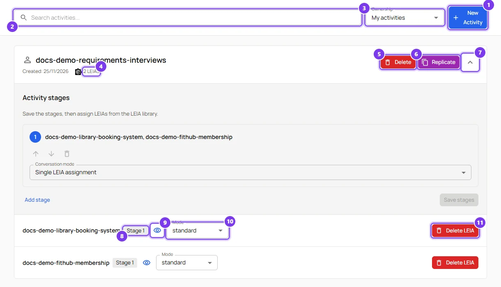
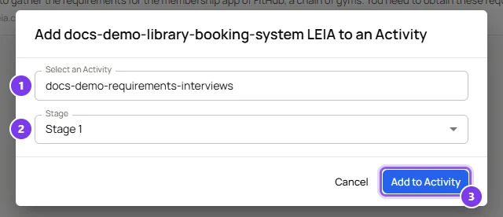
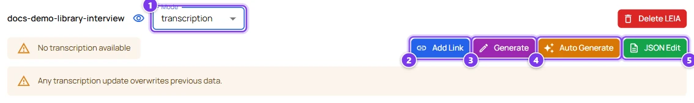
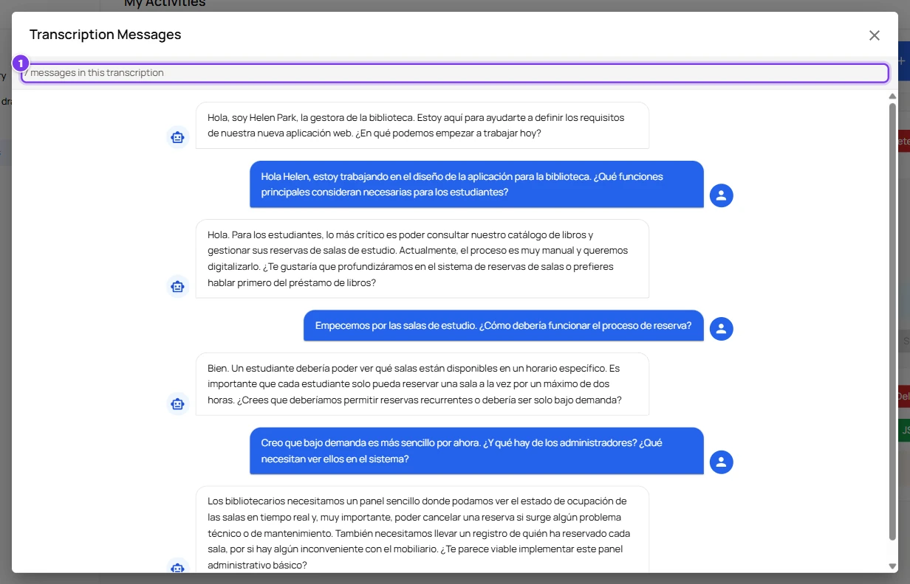
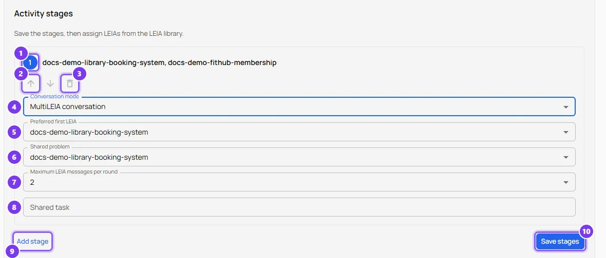
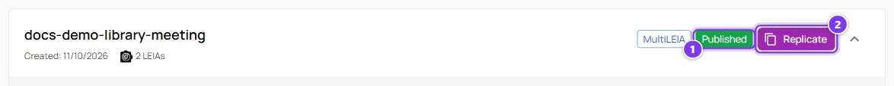

# Activities

:::info Who can do this
The **advanced** and **admin** roles. The **Activities** entry of the sidebar is hidden for instructors. Only administrators can **Publish** an activity. Advanced users replicate their own activities without publishing them.
:::

An activity is the unit the Workbench runs. It groups one or more LEIAs in one or more stages, and decides in each stage whether students get one LEIA each or talk to all of them at once. The Workbench creates replications from it, and there it is called an experiment.

The simplest activity has one LEIA. You get one for free with **Quick replication** in the library or with **Quick Replication** in the success dialog of the design screen. This page is for the cases where you want to prepare the activity yourself.

This video creates an activity, adds two LEIAs from the library and shows its stage and the mode of each LEIA (1.5 minutes, no sound). It was recorded with `demo-assistant@leia.com`, an advanced account made for this documentation, so the activity is not published.

<video
  controls
  muted
  playsInline
  preload="metadata"
  width="100%"
  poster={require('../../img/teachers/activities/create-activity-poster.webp').default}
  aria-label="Video: creating an activity and adding two LEIAs to it from the library">
  <source src={require('../../img/teachers/activities/create-activity.mp4').default} type="video/mp4" />
  Your browser cannot play this video. Follow the steps below.
</video>

## The activities page

Open **Activities** in the sidebar. The page lists your own activities and every published activity of other users. Nobody sees the unpublished activities of other users.

### Create an activity

1. Press **New Activity** (1).
2. Type the **Activity Name** in the **Create New Activity** dialog.
3. Press **Create Activity**.

The empty activity appears at the end of the list, with one stage. Names are unique across all users: `An item with the name "..." already exists` means you must choose another one.

### Remove a LEIA from an activity

1. Press the arrow (7) of the activity to expand it.
2. Press **Delete LEIA** (11) on the LEIA. It happens at once, without confirmation.

The LEIA disappears from the activity and stays in the library. If it leaves a MultiLEIA stage with a single LEIA, that stage goes back to **Single LEIA assignment**.

### Delete an activity

1. Find the activity in the list. The search box (2) and **Ownership** (3) help if you have many.
2. Press **Delete** (5). It happens at once, without confirmation.

The activity disappears from the list.

| # | Control | What it does |
|---|---|---|
| 1 | **New Activity** | Asks for a name and creates an empty activity with one stage. Names are unique across all users. |
| 2 | Search | Filters the activities by name. The page loads more activities as you scroll down. |
| 3 | **Ownership** | **All available activities** shows yours and every published activity of other users. **My activities** shows only yours. |
| 4 | LEIA count | How many LEIAs the activity holds. A **Published** chip appears next to it once the activity is published. |
| 5 | **Delete** | Deletes the activity immediately, without confirmation. Only on your own unpublished activities. |
| 6 | **Replicate** | Opens the activity in the Workbench to create a replication, published or not. See [Replicate an activity](#replicate-an-activity). |
| 7 | Arrow | Expands or collapses the activity to show its stages and its LEIAs. |
| 8 | **Stage** | The stage the LEIA belongs to. |
| 9 | Eye | Opens the read-only view of the LEIA. |
| 10 | **Mode** | **standard** or **transcription**. See [Mode](#mode). |
| 11 | **Delete LEIA** | Removes the LEIA from the activity, without confirmation. Only before publishing. |

Administrators also see a **Publish** button on their own unpublished activities. See [Publish an activity](#publish-an-activity).

## Add LEIAs

There is no add button inside the activity. LEIAs come from the library and from the design screen.

1. In the LEIA library, move the mouse over a row and press **Add to activity**. After finishing a LEIA you can press **Add to Activity** in the success dialog instead.
2. Choose an activity in **Select an Activity** (1), or type a new name to create one on the spot.
3. Choose the **Stage** (2). With a single stage it is already selected.
4. Press **Add to Activity** (3).
5. Repeat for each LEIA of the activity.

Open **Activities** and expand the activity to see its LEIAs. From the success dialog of the design screen, the Designer opens **Activities** for you.

| # | Control | What it does |
|---|---|---|
| 1 | **Select an Activity** | Lists your unpublished activities. Type a new name to create an activity on the spot, the dialog says "New activity “...” will be created on confirm". |
| 2 | **Stage** | The stage that receives the LEIA. It lists the saved stages of the activity. |
| 3 | **Add to Activity** | Adds the LEIA. |

A LEIA cannot change stage. To move it, remove it from the activity and add it again with the other stage.

## Each LEIA inside the activity

Expand the activity to see its LEIAs. Each one has its **Stage** chip, the eye icon, the **Mode** selector and, before publishing, the **Delete LEIA** button described above.

### Mode

| Mode | Meaning |
|---|---|
| **standard** | The student talks to the LEIA. |
| **transcription** | The student reads a prepared conversation and cannot write. Good for analysis tasks such as "find the requirements in this interview". |

**transcription** is disabled, with a tooltip that says why, in a MultiLEIA stage, for a LEIA that uses the output of an earlier stage, and in a stage whose conversation a later stage uses.

### Transcription mode

Expand the activity and set the **Mode** (1) of the LEIA to **transcription**. Then choose one of these four ways to supply the conversation.

**To link an external transcript.**

1. Press **Add Link** (2).
2. Type the **Transcription URL**.
3. Press **Add**.

The chip reads **External Link**.

**To let the platform write it.**

1. Press **Auto Generate** (4). The **Transcription Preview** dialog opens.
2. Read the result.
3. Press **Save Transcription**.

The chip reads **Chat Messages**.

**To write or paste it as JSON.**

1. Press **JSON Edit** (5).
2. Write or paste the messages.
3. Press **Save Changes**.

The chip reads **Chat Messages**.

**To write it by talking to the LEIA.**

1. Press **Generate** (3). The test chat opens.
2. Have the conversation you want students to read.
3. Press **Save Transcription** in the header.

The chip reads **Chat Messages**.

| # | Control | What it does |
|---|---|---|
| 1 | **Mode** | Set to **transcription**. A chip shows whether the transcript is an **External Link** or **Chat Messages**, or warns "No transcription available". |
| 2 | **Add Link** | Stores a URL. Students get an **Open Transcription** button that opens it in a new tab. |
| 3 | **Generate** | Opens the test chat so you write the conversation yourself with the LEIA, then press **Save Transcription**. |
| 4 | **Auto Generate** | Asks the platform to write a whole conversation from the behaviour. A preview opens and **Save Transcription** stores it. |
| 5 | **JSON Edit** | Paste or edit the messages as JSON. Each message has `text`, an ISO `timestamp` and `isLeia` set to true or false. |

Every update replaces the previous transcript, the page warns "Any transcription update overwrites previous data".

**Auto Generate** opens a **Transcription Preview** dialog while the platform writes the conversation. It shows the messages with the character on the left and the student on the right, and two buttons, **Save Transcription** and **Cancel**. On the development version the generator wrote in Spanish even for an English behaviour, so read the result before saving.

When you arrive in the chat from **Generate**, the header gains a **Save Transcription** button. Have the conversation you want students to read, then press it. On the development version this path currently fails with "Failed to create transcription session", so prefer **Auto Generate** or **JSON Edit** there.

Once a transcript is stored, the chip turns into **Chat Messages** and the eye icon next to it opens the viewer (1), which lists the messages students will read.

## Conversation flow

An activity is a list of stages, shown under **Activity stages** when you expand it. Students go through the stages in order and move on with **Continue to next stage** in the Workbench. A new activity has one stage, which is all most classes need. Each stage has its own **Conversation mode**.

### Add, move or remove stages

1. Expand the activity.
2. Press **Add stage** (9). The new stage goes at the end.
3. Change the order with **Move up** and **Move down** (2). **Remove stage** (3) deletes a stage; it is disabled while the stage has LEIAs and when it is the only one.
4. Press **Save stages** (10).

Nothing is kept until you press **Save stages**. There is no discard button: reload the page to throw your changes away. Save a new stage before adding LEIAs to it, because **Add to activity** only offers saved stages.

### Give each student one LEIA

1. Expand the activity.
2. Set the **Conversation mode** (4) of the stage to **Single LEIA assignment**. It is the default.
3. Press **Save stages** (10) if you changed it.

Each new student receives the LEIA of the stage with the fewest sessions so far.

### Put every LEIA in one conversation

1. Check that the stage has at least two LEIAs, none in transcription mode, and that every behaviour has the same process as the shared problem.
2. Expand the activity.
3. Set the **Conversation mode** (4) of the stage to **MultiLEIA conversation**. The option stays disabled while the stage has fewer than two LEIAs or one in transcription mode.
4. Choose the **Preferred first LEIA** (5).
5. Choose the **Shared problem** (6).
6. Set the **Maximum LEIA messages per round** (7).
7. Write the **Shared task** (8).
8. Press **Save stages** (10).

| # | Field | What it does |
|---|---|---|
| 1 | Stage number | The position of the stage, followed by the names of its LEIAs, or "No LEIAs assigned". |
| 2 | **Move up** / **Move down** | Change the order of the stages. |
| 3 | **Remove stage** | Deletes the stage. Disabled while it has LEIAs or when it is the only stage. |
| 4 | **Conversation mode** | **Single LEIA assignment** gives each student one LEIA of the stage, chosen to balance the load. **MultiLEIA conversation** puts every LEIA of the stage in the same chat. |
| 5 | **Preferred first LEIA** | In MultiLEIA, the character that opens the conversation by default. |
| 6 | **Shared problem** | In MultiLEIA, the LEIA whose problem every character plays. It supplies the scenario, the widgets, the solution and the evaluation. The problems of the other LEIAs are ignored. The list shows LEIA names. |
| 7 | **Maximum LEIA messages per round** | How many LEIA messages may follow one student message, from 1 to 8. The default is 2. An orchestrator decides who speaks and may stop earlier. |
| 8 | **Shared task** | A paragraph every character knows, describing the common scenario and the objective. |
| 9 | **Add stage** | Adds a stage at the end. |
| 10 | **Save stages** | Saves the stages. Enabled only after a change. |

In a MultiLEIA stage, conversation dynamics such as **LEIA Speaks First** and the stopping condition, and the widgets of the problem, are ignored; the editor warns about it when one of the LEIAs uses them. Voice is not available in MultiLEIA replications.

:::tip Several LEIAs without MultiLEIA
With **Single LEIA assignment** and several LEIAs in a stage, each student is given the LEIA with the fewest sessions so far. Use it to spread a class across variants of the same exercise, for example two clients with different requirements.
:::

### Use the output of an earlier stage

A behaviour can quote what happened in an earlier stage with `{{previousStage.outputs.conversation}}`, the conversation, or `{{previousStage.outputs.submitedSolution}}`, the solution the student submitted. When a LEIA of stage 2 or later uses one of them, its stage shows **Source of conversation output** or **Source of submitted solution output**.

1. Choose the earlier stage the output comes from.
2. Press **Save stages** (10).

A LEIA in the first stage cannot use them: the editor says "Move this stage after its source stage." Saving without a source is allowed, publishing is not, which is what "Choose an earlier stage before publishing the activity." means. A stage whose conversation a later stage uses cannot hold LEIAs in transcription mode.

## Publish and replicate

### Publish an activity

Only administrators publish, and only their own activities.

1. Expand the activity and check its stages, its LEIAs and their modes. They cannot change afterwards.
2. Press **Publish**. There is no confirmation dialog.

A **Published** chip (1) appears. Every advanced user now finds the activity under **All available activities** and can replicate it.

Publishing needs at least one LEIA in every stage, every LEIA published, a source for every output an earlier stage must supply, and valid MultiLEIA stages. Otherwise the page shows what is missing.

| # | Control | What it does |
|---|---|---|
| 1 | **Published** | The activity is frozen. Its stages, LEIAs, modes and transcripts cannot change any more. |
| 2 | **Replicate** | Opens the activity in the Workbench, where you create a replication. See [Workbench overview](../workbench/index.md). |

:::caution Publishing cannot be undone
There is no confirmation dialog. Check the stages and the LEIAs before pressing **Publish**. To change a published activity, create a new one. A published activity cannot be deleted from the Designer either.
:::

### Replicate an activity

Advanced users do not publish. They replicate their own activities directly, and so can administrators before publishing.

1. Press **Replicate** (6 in the activities page above). The Workbench opens the activity in a new tab, on the **Experiment preview** page.
2. Press **Create Replication**.
3. Type the **Replication Name** and press **Create**. The new replication opens.

See [Create a replication](../workbench/index.md#create-a-replication) for the rest.

The replication is a copy of the activity at that moment: later changes to the activity do not reach it. Replication names are unique across all users and the field starts with the name of the activity. If a replication with that name already exists, as it does after a **Quick replication**, **Create** does nothing visible, so type another name. An unpublished activity is not checked the way publishing checks it, so a missing LEIA or source shows up in the Workbench when the replication starts.

A LEIA cannot be deleted from the library while it belongs to any activity, published or not. The library says "Cannot delete LEIA: it is being used in N activity/activities." Remove it from those activities first.
