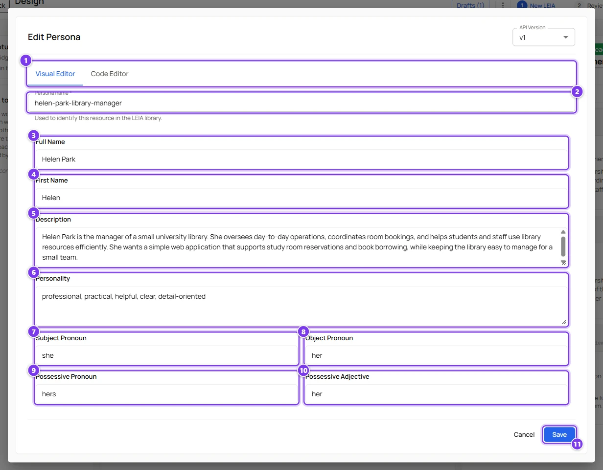
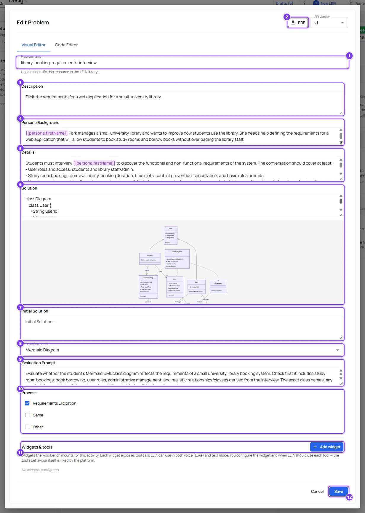
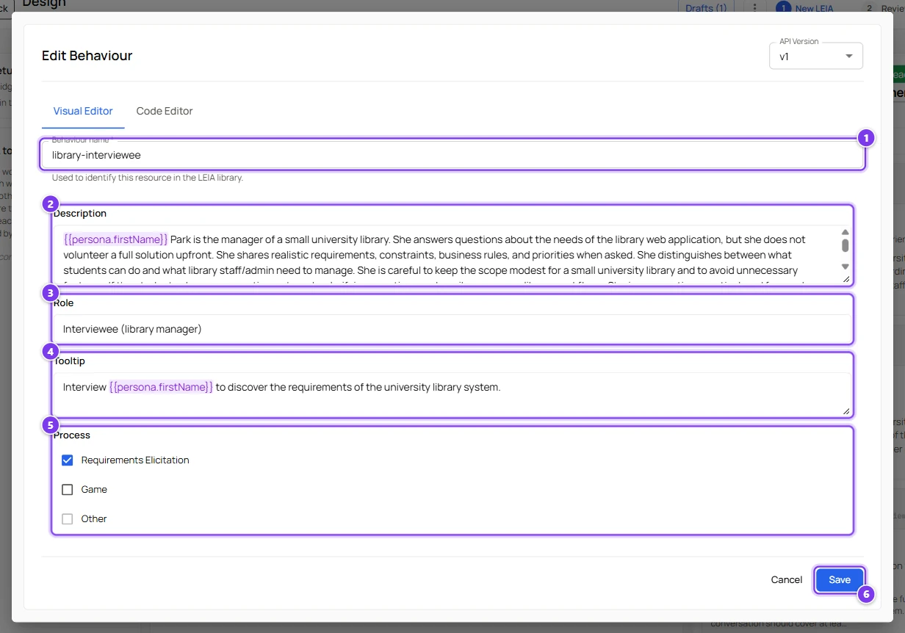
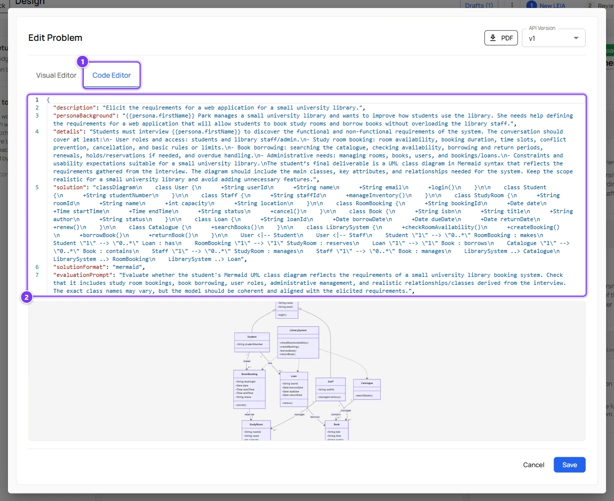

# Persona, Problem and Behaviour fields

:::info Who can do this
Every role can edit personas and problems. Editing a behaviour is reserved to the advanced and admin roles.
:::

This page is the reference for the three editors that open when you click a component card in the design screen. Each editor has the same frame.

- **API Version** is always `v1`.
- The **Visual Editor** tab shows the fields described below. The **Code Editor** tab shows the same component as JSON, which is the only place where the advanced keys of the problem can be edited.
- The **name** field at the top identifies the component in the library of components. A component is immutable once saved, so a change creates a new component when you finish the LEIA.
- **Cancel** closes without changes. **Save** keeps the changes in the draft. Nothing reaches the server until you press **Finish LEIA**.

Text between double braces, such as `{{persona.firstName}}`, is a placeholder that is filled in when the three components are combined. Placeholders are highlighted in purple in the editors. See [Placeholders](#placeholders).

## Persona

The persona is the character. Everything here is about who the character is, not about the exercise.



| # | Field | What it does |
|---|---|---|
| 1 | **Visual Editor** / **Code Editor** | Form view or JSON view of the same persona. |
| 2 | **Persona name** | The identifier shown in the library of components. Lowercase words separated by hyphens work well. |
| 3 | **Full Name** | The name the character uses to introduce itself. |
| 4 | **First Name** | Used by placeholders such as `{{persona.firstName}}` and by the voice settings of the Workbench. |
| 5 | **Description** | Who the character is, what they do, what they want. The language model reads this as part of its instructions. |
| 6 | **Personality** | Adjectives or short phrases, for example `professional, practical, detail-oriented`. |
| 7 | **Subject Pronoun** | `she`, `he` or `they`. The Workbench uses it to propose matching voices. |
| 8 | **Object Pronoun** | `her`, `him`, `them`. |
| 9 | **Possessive Pronoun** | `hers`, `his`, `theirs`. |
| 10 | **Possessive Adjective** | `her`, `his`, `their`. |
| 11 | **Save** | Keeps the changes in the draft. |

In the JSON view the pronoun fields are spelled `subjectPronoum`, `objectPronoum`, `possesivePronoum` and `possesiveAdjective`. Keep those spellings, they are the names the platform expects.

## Problem

The problem is the exercise. It holds what the student sees, what the LEIA knows, how the solution must be written and how it is graded.



| # | Field | What it does |
|---|---|---|
| 1 | **Problem name** | The identifier of the problem. |
| 2 | **PDF** | Downloads the statement as an A4 PDF with the description, the context, the details, the process and the initial solution. The solution and the evaluation prompt are left out, so the file can be handed to students. |
| 3 | **Description** | The statement students see in the **Instructions** panel of the chat. Keep it short and self-contained. |
| 4 | **Persona Background** | Context that connects the character with this exercise, for instance why Helen needs a booking system. The LEIA knows it, students do not see it. |
| 5 | **Details** | Everything the LEIA must know to play the exercise well. Facts to reveal when asked, facts to keep secret, the rules of a game. Students never see this field. |
| 6 | **Solution** | The reference answer used by the automatic evaluation. For a Mermaid format a live preview of the diagram appears under the field. |
| 7 | **Initial Solution** | Text that is preloaded in the student's editor, for example a skeleton of the expected diagram or document. It must not be empty, see the caution below. |
| 8 | **Solution Format** | How the student writes the solution. See [the formats](#solution-formats). |
| 9 | **Evaluation Prompt** | Instructions for the grader. Say what matters, what is optional and how strict to be. Without it the grader simply compares the submission with the solution. |
| 10 | **Process** | The kind of activity. See [the processes](#processes). |
| 11 | **Widgets & tools** | Extra panels for the student, such as the code editor. See [Code editor widget](widgets.md). |
| 12 | **Save** | Keeps the changes in the draft. |

:::caution Empty Initial Solution
The server refuses a problem whose **Initial Solution** is an empty text. If **Finish LEIA** fails with "Failed to create problem resource", open the problem and write something in the field, a skeleton or a one-line instruction. Removing the `initialSolution` line in the **Code Editor** tab is not enough, the visual editor sends the field as empty text anyway.
:::

### Solution formats

| Format | The student writes | The preview shows |
|---|---|---|
| **Plain Text** | Free text | The text |
| **Mermaid Diagram** | A diagram in [Mermaid](https://mermaid.js.org) syntax, for example a class diagram | The rendered diagram, with zoom |
| **YAML** | A YAML document (tabs are refused) | The document with syntax colours |
| **Markdown** | Markdown | The rendered page |
| **HTML** | HTML | The rendered page |
| **JSON** | A JSON document | The document with syntax colours |
| **XML** | An XML document | The document with syntax colours |

The format applies to the student's solution editor in the Workbench, to your own test editor and to the way the automatic evaluation reads the submission.

### Processes

| Process | Use it for | Notes |
|---|---|---|
| **Requirements Elicitation** | Interviews where the student extracts information from the character | The default for client simulations |
| **Game** | Guessing games, quizzes, role play with rules | |
| **Other** | Anything else | Cannot be combined with the other two |

The process of the problem always wins over the process of the behaviour. When you pick a behaviour whose process does not match, the behaviour is adapted to the problem. In a MultiLEIA activity every behaviour must share the process of the shared problem.

### Advanced keys in the Code Editor

Three keys of the problem have no field in the visual editor. They let a problem customise or restrict the persona and the behaviour it is combined with.

```json
{
  "spec": {
    "extends": {
      "persona": { "spec": { "personality": ["mysterious", "pirate"] } }
    },
    "overrides": {
      "behaviour": { "spec": { "tooltip": "Ask Helen about the library" } }
    },
    "constrainedTo": {
      "behaviour": { "spec": { "process": ["requirements-elicitation"] } }
    }
  }
}
```

| Key | Effect |
|---|---|
| `extends` | Adds to the field of the other component. Text is appended after a space, lists are concatenated. |
| `overrides` | Replaces the field of the other component. |
| `constrainedTo` | Requires the other component to have exactly this value. For `process` it is enough that one value is shared. A LEIA whose constraint is not met cannot be saved and the preview shows "Constraint not met". |

The keys must point at `persona.spec.*`, `behaviour.spec.*` or `problem.spec.*`. Anything else is ignored.

## Behaviour

The behaviour tells the language model how to act. Its **Description** becomes the system prompt of the conversation, together with an instruction about the language of the replication.



| # | Field | What it does |
|---|---|---|
| 1 | **Behaviour name** | The identifier of the behaviour. |
| 2 | **Description** | The instructions. Write them to the character. Say how to answer, what to hold back, when to give hints, how long answers should be. Placeholders let one behaviour serve many personas and problems. |
| 3 | **Role** | A short label of the role the character plays, for example `Interviewee (library manager)`. |
| 4 | **Tooltip** | The first thing students see in the chat under "Try typing". A good opening line lowers the barrier to the first message. |
| 5 | **Process** | Informative here. The problem decides the final process. |
| 6 | **Save** | Keeps the changes in the draft. |

Behaviours written by the AI assistant are already placeholder based, so they can be reused with other personas.

## Placeholders

A placeholder is `{{component.field}}` where the component is `persona`, `problem` or `behaviour` and the field is any field of that component. Placeholders are resolved in this order, problem first, then persona, then behaviour, so the behaviour can use values from the other two.

| Placeholder | Value |
|---|---|
| `{{persona.fullName}}`, `{{persona.firstName}}` | The names of the character |
| `{{persona.description}}`, `{{persona.personality}}` | The character sheet |
| `{{persona.subjectPronoum}}`, `{{persona.objectPronoum}}`, `{{persona.possesivePronoum}}`, `{{persona.possesiveAdjective}}` | The pronouns |
| `{{problem.description}}`, `{{problem.details}}`, `{{problem.personaBackground}}`, `{{problem.solution}}` | The exercise |
| `{{behaviour.role}}`, `{{behaviour.process}}` | The role and the process |

A placeholder that stands alone in a field takes the whole value, even when it is a list. An unknown placeholder is left as it is, so check the preview when you type one by hand.

## The code view



| # | Control | What it does |
|---|---|---|
| 1 | **Code Editor** | Switches to the JSON view. |
| 2 | Editor | The full component. **Save** refuses invalid JSON with the message "Cannot save: Invalid JSON format". |

Use this view to add the advanced keys, to paste a component from another LEIA or to remove a field entirely.
