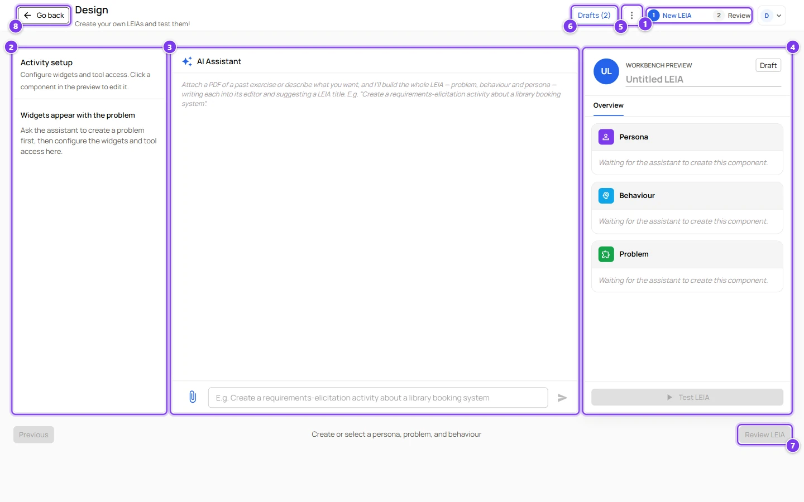
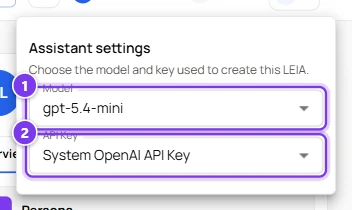
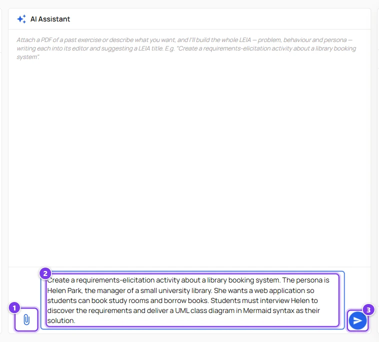
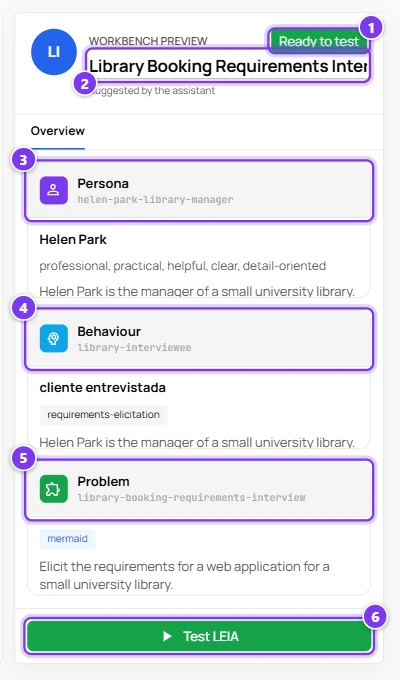
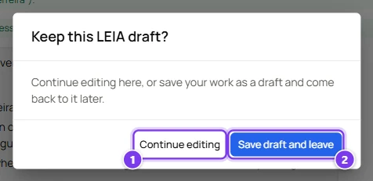
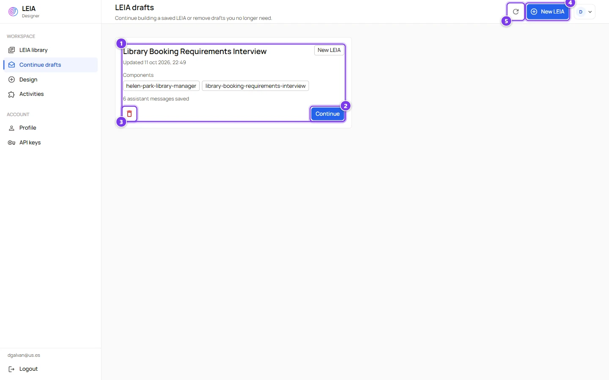
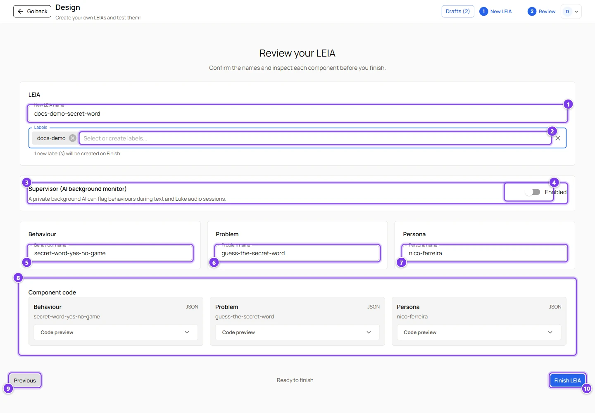
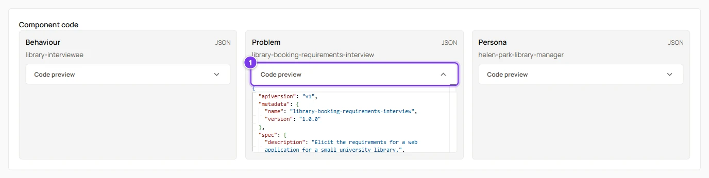
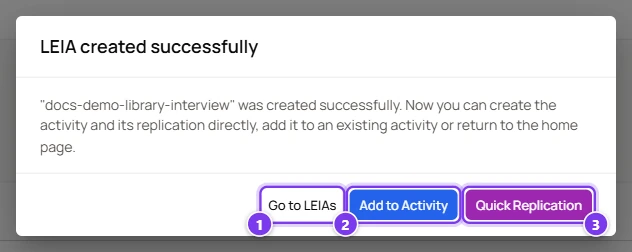

# Create a LEIA with the AI assistant

:::info Who can do this
The **advanced** and **admin** roles. An instructor can follow every step but **Finish LEIA** will be refused, because the assistant creates a new behaviour and instructors cannot create behaviours. Instructors should use the [quick start](../../tutorials/create-leia/index.md) instead.
:::

This page follows the creation of a complete LEIA from a one-paragraph description, and explains every control of the design screen on the way. The example is a requirements interview with Helen Park, the manager of a small university library. Expect fifteen minutes the first time.

## Before you start

- You need an **OpenAI** key, yours or a system key. The assistant and the supervisor only work with OpenAI. See [API keys and models](../api-keys.md).
- Decide the scenario in one paragraph. Who the character is, what the student must obtain, what the student must deliver and in which format.
- Optionally prepare a PDF with a past exercise. The assistant reads it and builds the LEIA from it.

## Step 1, the workspace

Press **Design** in the sidebar or **New LEIA** in the library.

| # | Area | What it is for |
|---|---|---|
| 1 | Step indicator | **1 New LEIA** is where you build. **2 Review** is where you name and finish. |
| 2 | **Activity setup** | The widgets of the problem. It stays empty until a problem exists. See [Code editor widget](widgets.md). |
| 3 | **AI Assistant** | The chat where you describe what you want. The assistant writes the persona, the behaviour and the problem for you. |
| 4 | **Workbench preview** | A summary of the LEIA being built. Click a card to edit that component. The **Test LEIA** button lives here. |
| 5 | **Design menu** | The three dots. **Assistant settings** chooses the model and key the assistant uses. Administrators also find **Components** here, a manual picker of existing personas, problems and behaviours. |
| 6 | **Drafts** | Your saved drafts. The number counts them. |
| 7 | **Review LEIA** | Goes to step 2. Enabled once the three components exist and combine without errors. |
| 8 | **Go back** | Leaves the screen. If you have unsaved work it asks whether to keep a draft. |

### Assistant settings

| # | Field | What it does |
|---|---|---|
| 1 | **Model** | The OpenAI model that writes the components. |
| 2 | **API Key** | The OpenAI key that pays for it. System keys appear here too. |

Changing either value starts a new assistant conversation on the server. The settings are remembered with the draft.

## Describe the activity

| # | Control | What it does |
|---|---|---|
| 1 | **Attach a PDF** | Attaches one or more PDF files, up to 10 MB each. Other formats are refused. The attached files show as chips above the box. |
| 2 | Message box | Your brief. Enter sends, Shift+Enter adds a line. |
| 3 | **Send message** | Sends the brief. |

The brief used in this example was

> Create a requirements-elicitation activity about a library booking system. The persona is Helen Park, the manager of a small university library. She wants a web application so students can book study rooms and borrow books. Students must interview Helen to discover the requirements and deliver a UML class diagram in Mermaid syntax as their solution.

A good brief names the character, the goal of the student, the deliverable and its format. The assistant does the rest. It can also read the current components, reuse an existing persona from the library and suggest a title.

## Watch the assistant work

| # | Item | Meaning |
|---|---|---|
| 1 | Confirmation lines | A green line appears for each component the assistant wrote, with the name it chose. **✓ Problem applied**, **✓ Behaviour applied**, **✓ Persona applied** and **✓ LEIA title suggested**. |
| 2 | **Ready to test** | The chip in the preview turns from **Draft** to **Ready to test** when the three components combine without errors. |
| 3 | Title | The title suggested by the assistant. Edit it freely. Once you type your own title the assistant stops suggesting. |
| 4 | **Add widget** | Appears in **Activity setup** as soon as a problem exists. |
| 5 | **Test LEIA** | Starts a test conversation. The draft is saved first. |
| 6 | **Review LEIA** | Goes to step 2. |

:::caution A new problem clears the behaviour
Each time the assistant applies a new problem, the current behaviour is removed, because a behaviour must match its problem. If the assistant writes the behaviour before the problem, the preview shows the behaviour card empty and the buttons stay disabled. Simply ask "Apply the behaviour again for this problem" and the assistant rewrites it.
:::

### The preview panel

| # | Item | What it does |
|---|---|---|
| 1 | Status chip | **Draft** or **Ready to test**. |
| 2 | Title | The name proposed for the LEIA. You confirm or change it in step 2. |
| 3 | **Persona** card | Full name, personality and description. Click to open the persona editor. |
| 4 | **Behaviour** card | Role, process and description. Click to open the behaviour editor. |
| 5 | **Problem** card | Solution format, number of widgets, description and details. Click to open the problem editor. |
| 6 | **Test LEIA** | Opens the test chat with the current components. |

Every field of the three editors is explained in [Persona, Problem and Behaviour fields](components-reference.md). If a component cannot be combined with the others, a red message under the title explains why, for example a constraint of the problem that the behaviour does not satisfy.

## Refine with the assistant or by hand

You can keep talking to the assistant. "Make Helen more reluctant to give details", "add a non-functional requirement about accessibility", "change the solution format to plain text". Each request rewrites the component concerned and the preview updates.

You can also click a card and edit the fields yourself. Edited components are marked as new, so a new persona, problem or behaviour is created when you finish, even if the assistant reused an existing one.

## Test before saving

Press **Test LEIA** in the preview panel. The chat opens with your components and you come back with **Continue Configuration**. See [Test a LEIA](test-leia.md).

## Drafts and autosave

Everything you do on this screen is saved as a draft on the server about one second after each change. The draft holds the components, the names, the labels, the assistant conversation, its settings and the supervisor settings.

When you press **Go back** the dialog **Keep this LEIA draft?** offers two choices.

| # | Button | What it does |
|---|---|---|
| 1 | **Continue editing** | Stays on the screen. |
| 2 | **Save draft and leave** | Saves and returns to the library. |

Closing the browser tab shows the browser's own "leave page" warning. The draft is already saved, so leaving is safe.

The **Continue drafts** page lists every draft.

| # | Item | What it does |
|---|---|---|
| 1 | Draft card | Title, last update, the step you were in (**New LEIA** or **Review**), the components already created and the number of assistant messages saved. |
| 2 | **Continue** | Reopens the design screen exactly where you left it. |
| 3 | Delete | Removes the draft after a confirmation. |
| 4 | **New LEIA** | Starts a fresh LEIA. |
| 5 | Refresh | Reloads the list. |

The **Drafts** button of the design screen opens the same list in a dialog, with **Continue** and **Delete** on each entry. Deleting the draft you are editing clears the workspace.

## Step 2, review and finish

Press **Review LEIA**.

| # | Field | What it does |
|---|---|---|
| 1 | **New LEIA name** | The name of the LEIA in the library. It must be unique. The screenshot shows another LEIA of this guide, `docs-demo-secret-word`. |
| 2 | **Labels** | Pick existing labels or type a new name and press Enter. A new label opens a small dialog with its colours and is created when you finish. |
| 3 | **Supervisor (AI background monitor)** | The second AI that watches the conversation. Off by default. See [The supervisor](supervisor.md). |
| 4 | **Enabled** | Turns the supervisor on and reveals its settings. |
| 5 | **Behaviour name** | The name of the behaviour component. Prefilled by the assistant. |
| 6 | **Problem name** | The name of the problem component. |
| 7 | **Persona name** | The name of the persona component. |
| 8 | **Component code** | A read-only JSON preview of each component, for a last check. |
| 9 | **Previous** | Back to step 1. |
| 10 | **Finish LEIA** | Creates everything. |

Administrators see two more controls, a **LEIA visibility** selector that makes the LEIA public and a **Visibility** selector on each component.

The **Code preview** accordion of each component shows the exact JSON that will be saved.

### What Finish does

1. Checks that the LEIA name and the names of new components do not exist yet. "Name already exists" means you must change that name.
2. Creates the pending labels.
3. Creates every component that is new or edited. Unchanged components taken from the library are reused.
4. Creates the LEIA with version 1.0.0 and the supervisor settings if enabled.

:::caution If Finish fails with "Failed to create problem resource"
The server refuses a problem whose **Initial Solution** is empty text, and the assistant sometimes leaves it empty. Go back to step 1, open the problem, write something in **Initial Solution**, save and finish again. Removing the `initialSolution` line in the **Code Editor** tab is not enough, the visual editor sends the field as empty text anyway. Your work is kept in the draft.
:::

| # | Button | What it does |
|---|---|---|
| 1 | **Go to LEIAs** | Returns to the library. |
| 2 | **Add to Activity** | Adds the new LEIA to an unpublished activity, or to a new one. See [Activities](activities.md). |
| 3 | **Quick Replication** | Creates an activity and a Workbench replication with the new LEIA and opens the replication in a new tab. |

Instructors only see **Go to LEIAs**.

## What to do next

- Test the LEIA from the library with the model your students will use. See [Test a LEIA](test-leia.md).
- Put it in an activity and publish it. See [Activities](activities.md).
- Open the Workbench and create a replication. See [Workbench overview](../workbench/index.md).
