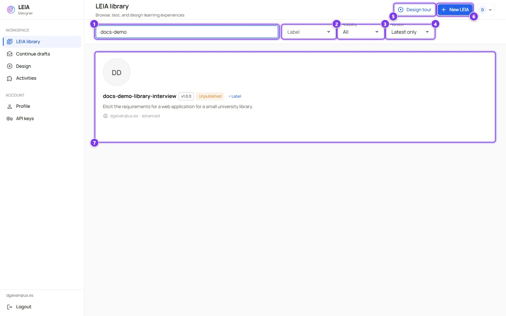
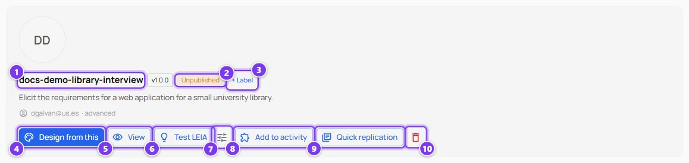
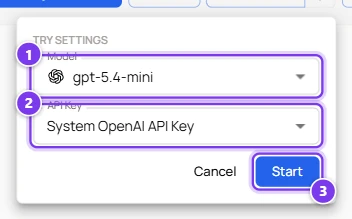
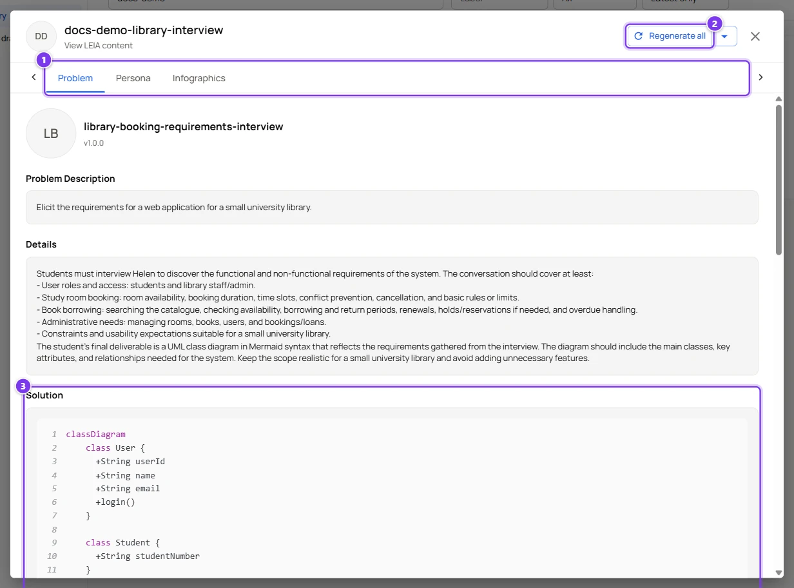
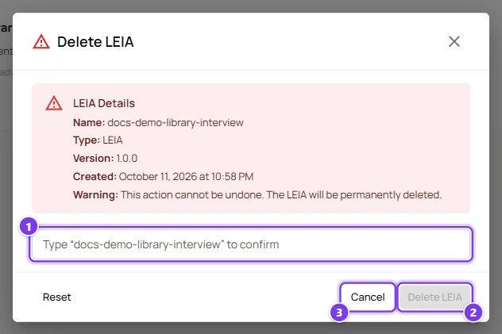

# The LEIA library

:::info Who can do this
Every role can browse, test and design from the library. **Add to activity** and **Quick replication** appear only for the advanced and admin roles. Deleting is reserved to the owner of the LEIA and to administrators.
:::

The library is the home page of the Designer. It lists every LEIA you are allowed to see, which means the public ones plus your own. Each row is a LEIA, and the buttons on the row cover everything you can do with it without opening it.

| # | Control | What it does |
|---|---|---|
| 1 | **Search by name or description** | Filters the list as you type, on the name of the LEIA and on the description of its problem. The list refreshes a moment after you stop typing. |
| 2 | **Label** | Shows only the LEIAs that carry the chosen label. **All labels** removes the filter. |
| 3 | **Visibility** | **All**, **Private** (your own unpublished LEIAs) or **Public** (published by an administrator). |
| 4 | **Version** | **Latest only** hides older versions of a LEIA that has several. **All versions** shows them all. |
| 5 | **Design tour** | A guided tour of the library and the design screen. It skips the steps your role cannot use. |
| 6 | **New LEIA** | Opens the design screen with an empty workspace. See [Create a LEIA with the AI assistant](create-leia.md). |
| 7 | A LEIA row | The avatar, the name, the version chip, the publication state, the labels, the first lines of the problem description and the email and role of the owner. |

:::tip Finding your own work quickly
Combine **Visibility** set to **Private** with a label of your own. The library of a busy server holds hundreds of public LEIAs.
:::

## What you can do with a row

Move the mouse over a row to reveal its buttons.

| # | Control | What it does |
|---|---|---|
| 1 | Name and version | The name you gave the LEIA and its version. Every LEIA created from the Designer is version 1.0.0. |
| 2 | **Published** or **Unpublished** | Published LEIAs are visible to everyone. Only an administrator can publish. |
| 3 | **+ Label** | Attach existing labels or create a new one. Shown on your own LEIAs. See [Labels](#labels). |
| 4 | **Design from this** | Opens the design screen with this persona, behaviour and problem already loaded, so you can change what you want and save a new LEIA. Nothing is copied until you finish. This is the path of the [quick start](../../tutorials/create-leia/index.md). |
| 5 | **View** | Opens a read-only view of the problem, the persona and the images. See [below](#view-a-leia). |
| 6 | **Test LEIA** | Starts a test conversation immediately with your default key and its model. See [Test a LEIA](test-leia.md). |
| 7 | **Test settings** | Lets you choose the model and the key before testing. Hidden when you have no active key. |
| 8 | **Add to activity** | Adds the LEIA to one of your unpublished activities, or to a new one you name on the spot. See [Activities](activities.md). |
| 9 | **Quick replication** | Creates an activity with this single LEIA, publishes it, creates a replication in the Workbench and opens that replication in a new tab. The activity and the replication get the name of the LEIA. The fastest way from a LEIA to a class. |
| 10 | **Delete** | Removes the LEIA after you type its name. Refused while an activity uses it. |

If a quick replication fails because an activity with that name already exists, a dialog named **Replicate activity** proposes the same name with the suffix `-v2`. Change it if you like and press **Replicate**.

### Test settings

| # | Control | What it does |
|---|---|---|
| 1 | **Model** | The model that will play the LEIA during the test. The icon shows the provider. |
| 2 | **API Key** | The key that pays for the test. Only active keys of the selected model's provider are listed. |
| 3 | **Start** | Opens the chat. |

When the LEIA has a code editor widget the popover adds the note "This activity uses widgets, so its tool functions only run on a tool-capable provider" and lists OpenAI models only.

## View a LEIA

| # | Control | What it does |
|---|---|---|
| 1 | Tabs | **Problem** shows the description, the details, the solution, the initial solution, the evaluation prompt and the process. **Persona** shows the character sheet. **Infographics** shows the two generated images. Administrators also see a **Behaviour** tab. |
| 2 | **Regenerate all** | Creates new avatar and infographic images with a Gemini key. The arrow next to it lets you choose which images to regenerate. |
| 3 | Content | Everything is read only. To change something, use **Design from this** and save a new LEIA. |

The two infographics are a summary of the exercise for students and a version with the solution for you. In the Workbench you decide whether students may open the student version during the activity. See [LEIA settings in a replication](../workbench/leia-settings.md).

## Labels

Labels are coloured tags. Press **+ Label** on one of your LEIAs to open the **Manage labels** dialog.

- **Current labels** lists the labels already attached. Each chip has a cross to remove it.
- **Add label** searches the labels you can use and attaches the one you click.
- **Create new label** needs a name, a background colour and a text colour. The preview chip shows the result. **Save label** creates it immediately.
- **Save changes** applies the attachments.

Your labels are private. Administrators can also create **global** labels that everyone can use, and they can rename, merge and delete labels from **Manage labels** in the account menu.

## Delete a LEIA

| # | Control | What it does |
|---|---|---|
| 1 | Confirmation field | Type the exact name of the LEIA. The dialog repeats it above the field. |
| 2 | **Delete LEIA** | Enabled only when the name matches. The deletion cannot be undone. |
| 3 | **Cancel** | Closes the dialog. **Reset** clears the field. |

A LEIA that belongs to an activity cannot be deleted. The error lists the activities, so remove the LEIA from them first or delete those activities. The persona, behaviour and problem of a deleted LEIA remain in the library of components and can be reused by other LEIAs.
