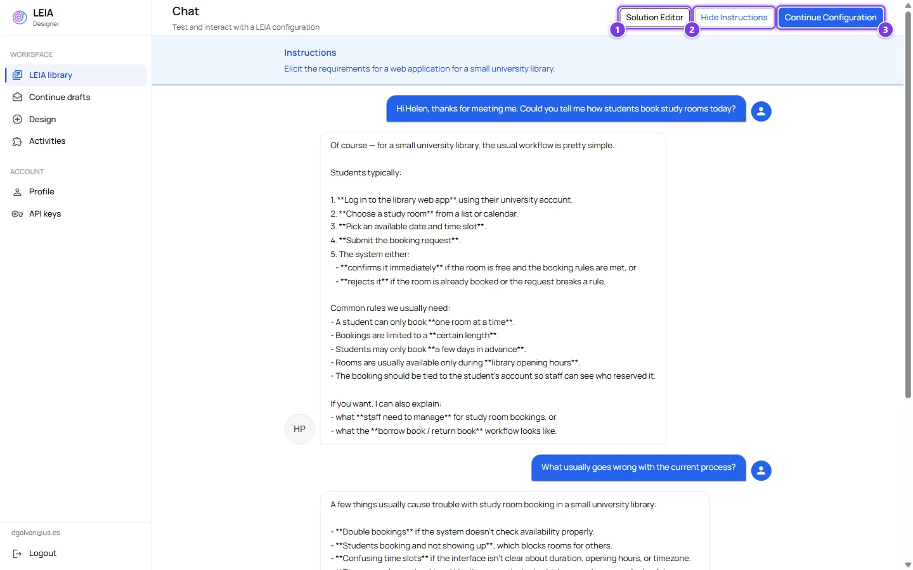
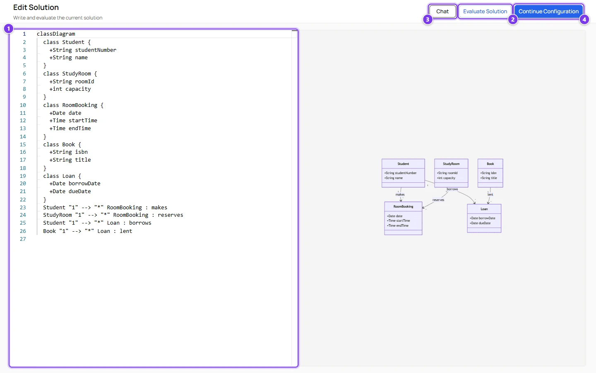
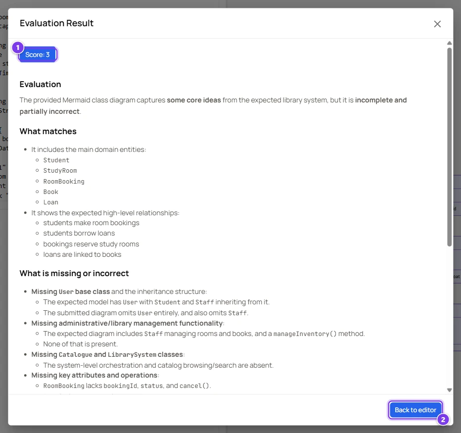

# Test a LEIA

:::info Who can do this
Every role can test any LEIA it can see, with its own keys or with the system keys.
:::

Testing means talking to the LEIA yourself, submitting a solution and reading the automatic evaluation, exactly as a student would but without leaving the Designer. Test sessions are private and never appear in the Workbench results.

## Start a test

There are three ways to start.

| From | How | Model and key used |
|---|---|---|
| The library | **Test LEIA** on a row | Your default key and its default model. If you have no default key, the first active key. |
| The library | **Test settings** on a row, then **Start** | The model and key you pick in the popover. See [Test settings](index.md#test-settings). |
| The design screen | **Test LEIA** in the preview panel | The key chosen in **Assistant settings**, otherwise your default key. The draft is saved first so nothing is lost. |

If the LEIA has a code editor widget only OpenAI models are offered, because the widget's tools need them.

## The chat screen

| # | Control | What it does |
|---|---|---|
| 1 | **Solution Editor** | Opens the editor where you write and evaluate a solution. See [below](#the-solution-editor). |
| 2 | **Instructions** | Shows or hides the problem description at the top of the chat. The label changes to **Hide Instructions** while it is open. |
| 3 | **Continue Configuration** | Returns to the design screen with everything as you left it, if you came from there. From the library it simply goes back. |
| 4 | Message box | Type and press Enter to send. Shift+Enter adds a line. |
| 5 | **Send** | Sends the message. |

The LEIA answers in the language of the replication when it runs in the Workbench. During a test it follows the language you write in.

If an answer takes too long a LEIA bubble offers **Retry**. The messages of a test stay in your browser only, so refreshing the page keeps them but another computer will not show them.

When the problem has widgets the right half of the screen shows them. The widget you configured in the **Left** slot appears on top. See [Code editor widget](widgets.md).

### Transcription mode

When you open this screen from the **Generate** button of a LEIA in transcription mode inside an activity, an extra **Save Transcription** button appears. It stores the conversation you just had as the transcript students will read. See [Activities](activities.md#transcription-mode).

## The solution editor

| # | Control | What it does |
|---|---|---|
| 1 | Editor | Where the solution is written. The language follows the **Solution Format** of the problem, Mermaid in this example. It starts with the problem's **Initial Solution**, or with a sample class diagram when there is none. |
| 2 | **Evaluate Solution** | Sends the text to the automatic evaluation. Disabled while the text has a syntax error. |
| 3 | **Chat** | Goes back to the conversation. The editor keeps its content. |
| 4 | **Continue Configuration** | Back to the design screen. |

The right half is a live preview. Mermaid diagrams are drawn and can be zoomed, Markdown and HTML are rendered, and JSON, YAML, XML and plain text are shown with syntax colours. The divider between the two halves can be dragged.

The editor checks the format as you type. JSON, YAML and XML errors are shown under the editor, and YAML refuses tabs.

## Read the evaluation

| # | Item | What it is |
|---|---|---|
| 1 | **Score** | A number from 0 to 10 given by the language model after comparing your text with the problem's **Solution**. |
| 2 | **Back to editor** | Closes the dialog so you can improve the text and evaluate again. |

The evaluation text explains what matches the reference solution and what is missing or wrong. It is produced by the model of the key you are testing with, following the problem's **Evaluation Prompt** if there is one. The example above scored 3 because the diagram left out several classes and relationships of the reference solution.

:::tip Test the evaluation, not only the chat
Submit a deliberately incomplete solution and a complete one. If both get similar scores, make the **Solution** and the **Evaluation Prompt** of the problem more precise before students use the LEIA. See [Persona, Problem and Behaviour fields](components-reference.md#problem).
:::

## What to check before a class

- The character stays in role and does not reveal the solution when asked directly.
- The first message students see makes sense. Students get a **Try typing** hint taken from the behaviour's **Tooltip**.
- The solution format is the one you expect students to use.
- The evaluation rewards the right things.
- If you plan a time limit, the conversation fits in it.
