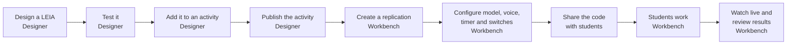

# LEIA for teachers

This guide explains every screen, button and field that a teacher meets while designing a LEIA, running it with students and reviewing the results. Read this page first. It introduces the vocabulary and the two applications, and it tells you which page of the guide answers each task.

:::info Which version is described
Due to updates some features may suffer minor changes.
:::

## What a LEIA is

A LEIA is an AI assistant that plays a role in a learning activity. It can be the client you interview to discover requirements, the opponent in a guessing game, a tutor that watches you code, or any other character a teacher imagines. Students talk to it in writing or by voice, and at the end they may submit a solution that LEIA grades.

Every LEIA is assembled from three reusable components.

| Component | What it holds | Example |
|---|---|---|
| **Persona** | Who the character is. Name, description, personality and pronouns. | Helen Park, the manager of a small university library |
| **Behaviour** | How the character acts during the conversation. This text becomes the instructions the language model follows. | An interviewee who answers questions but never volunteers a full solution |
| **Problem** | The learning task. The statement the student sees, hidden details, the reference solution, the solution format and the evaluation instructions. | Discover the requirements of a room booking system and model them as a UML class diagram |

A **LEIA** is the combination of one persona, one behaviour and one problem, saved under a name and a version. The same persona can appear in many LEIAs, and the same problem can be played by different characters.

## The two applications

| Application | URL | Who uses it | What you do there |
|---|---|---|---|
| **Designer** | [designer.leia.ovh](https://designer.leia.ovh) | Teachers | Design and test LEIAs, group them into activities, manage API keys and labels |
| **Workbench** | [workbench.leia.ovh](https://workbench.leia.ovh) | Teachers and students | Teachers create replications, configure how each LEIA runs, watch live sessions and review results. Students join with a code and talk to the LEIA |

The same account works in both applications. Students never need an account. They enter the Workbench with an email address and the code of the replication.

## More vocabulary

| Term | Meaning |
|---|---|
| **Activity** | A group of one or more LEIAs prepared in the Designer for a class. The Workbench calls activities **experiments**. An activity must be **published** before the Workbench can see it, and a published activity cannot be changed any more. |
| **Replication** | One run of an activity in the Workbench. It has its own join code, its own switches (active, repeatable, time limit, language) and its own results. You can create as many replications of a published activity as you need, one per class group for instance. |
| **Session** | One student working on one replication. A session has a transcript, an optional submitted solution, an evaluation and a score. |
| **Label** | A coloured tag you attach to LEIAs to find them later in the library. |
| **Widget** | An extra panel the student sees next to the chat, such as a code editor that LEIA can read, edit and test. Widgets are part of the problem. |
| **Supervisor** | A second, private AI that watches the conversation and flags behaviours you asked it to watch for. It can also send a short nudge to the student. |
| **Transcription mode** | A LEIA inside an activity that shows a pre-written conversation instead of letting the student talk. Useful for analysis exercises. |
| **MultiLEIA** | An activity where several LEIAs take part in the same conversation, for example a client and an IT manager in one meeting. |

## The life of a LEIA

1. **Design.** Describe the activity to the AI assistant or start from an existing LEIA. Adjust the persona, behaviour and problem. See [Create a LEIA with the AI assistant](designer/create-leia.md).
2. **Test.** Chat with your LEIA and try the solution editor before any student sees it. See [Test a LEIA](designer/test-leia.md).
3. **Group and publish.** Put the LEIA in an activity, optionally with other LEIAs, and publish it. See [Activities](designer/activities.md).
4. **Replicate.** In the Workbench, create a replication of the published activity and configure it. See [Workbench overview](workbench/index.md) and [Replication settings](workbench/replication-settings.md).
5. **Run.** Activate the replication and give students the code or the link. See [What students see](workbench/students.md).
6. **Follow and grade.** Watch sessions live, read transcripts, check the automatic evaluation and download a CSV. See [Live dashboard and spectating](workbench/live-and-spectate.md) and [Results, grading and export](workbench/results-and-export.md).

## Which page do I need

| I want to | Go to |
|---|---|
| Create an account or understand what my role allows | [Accounts and roles](accounts-and-roles.md) |
| Add an OpenAI, Gemini, Ollama or ALMA key | [API keys and models](api-keys.md) |
| Find, test, duplicate or delete a LEIA | [The LEIA library](designer/index.md) |
| Build a LEIA from a description or a PDF | [Create a LEIA with the AI assistant](designer/create-leia.md) |
| Know what every field of a persona, problem or behaviour does | [Persona, Problem and Behaviour fields](designer/components-reference.md) |
| Add a code editor the student and LEIA share | [Code editor widget](designer/widgets.md) |
| Let a second AI watch the conversation | [The supervisor](designer/supervisor.md) |
| Prepare several LEIAs for the same class, or a group simulation | [Activities](designer/activities.md) |
| Open an activity to students | [Workbench overview](workbench/index.md) and [Replication settings](workbench/replication-settings.md) |
| Choose the model, the voice or the automatic evaluation | [LEIA settings in a replication](workbench/leia-settings.md) |
| See the activity through the eyes of a student | [What students see](workbench/students.md) |
| Watch a session while it happens | [Live dashboard and spectating](workbench/live-and-spectate.md) |
| Read transcripts, change a score or download the data | [Results, grading and export](workbench/results-and-export.md) |
| Check a limitation before planning a class | [Limitations and FAQ](faq.md) |

## Before you start

- An account in the Designer. Anyone can register, but new accounts get the **instructor** role, which cannot create behaviours nor enter the Workbench. Ask the LEIA team for the **advanced** role before you plan a class. The details are in [Accounts and roles](accounts-and-roles.md).
- A language model key. The AI assistant that builds LEIAs, the supervisor and the code editor widget all need an **OpenAI** key. Your administrator may have shared system keys with you already. See [API keys and models](api-keys.md).
- A modern browser. Voice modes need a microphone and permission to use it.

If you prefer to learn by doing, start with the [quick start](../tutorials/create-leia/index.md), which creates a LEIA from an existing one in about ten minutes.
