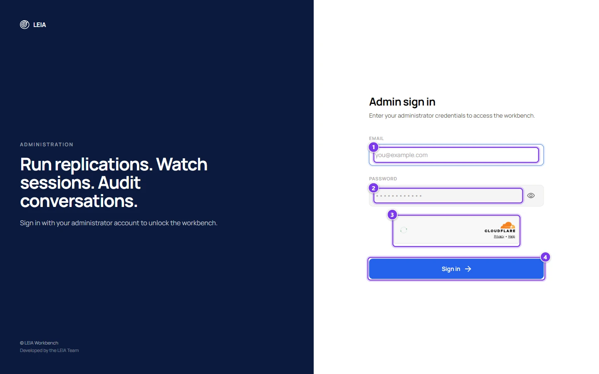
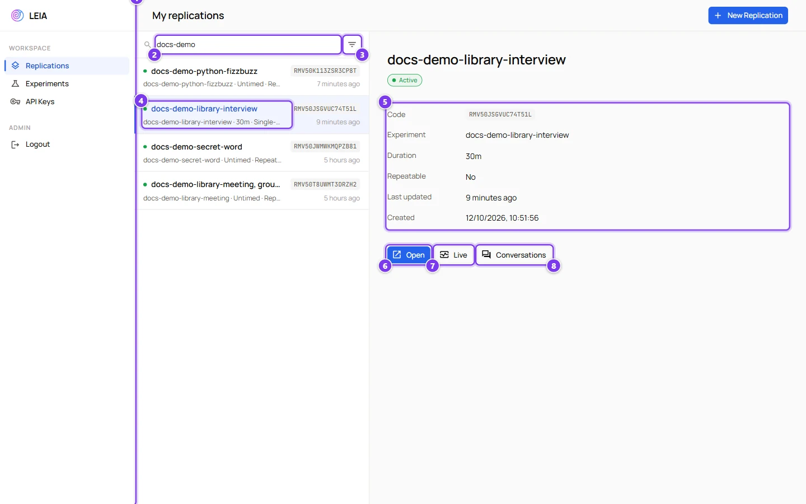
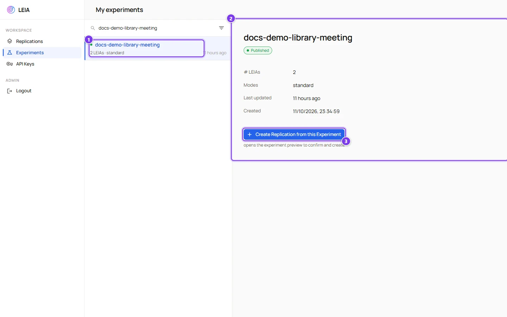
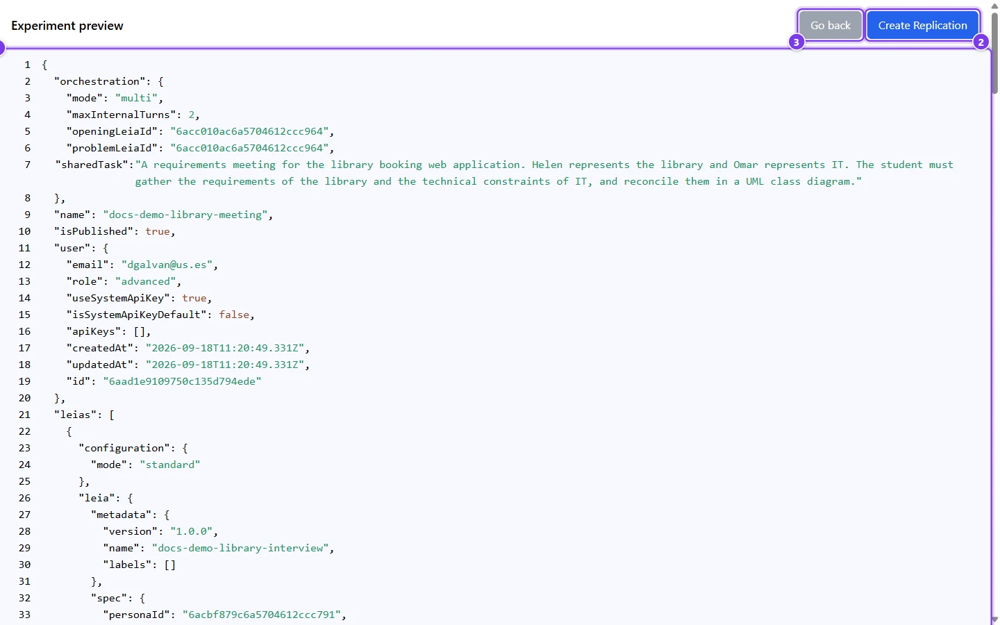

# Workbench overview and your first replication

:::info Who can do this
The **advanced** and **admin** roles. Instructors are refused at the Workbench sign-in with "Instructors cannot access workbench administration."
:::

The Workbench is where activities meet students. You create a **replication** of a published activity, configure how it runs, share its code, follow the sessions and read the results. Students use the same site through a different door, the student login at the root of [workbench.leia.ovh](https://workbench.leia.ovh).

## Sign in

Open [workbench.leia.ovh/login](https://workbench.leia.ovh/login) with the same email and password as the Designer.

| # | Field or button | What it does |
|---|---|---|
| 1 | **Email** | Your Designer account. |
| 2 | **Password** | Your password. The eye icon reveals it. |
| 3 | Verification | The automatic Cloudflare check. **Sign in** waits for it. |
| 4 | **Sign in** | Opens the replications list. |

If you came from a link such as **Replicate** in the Designer, you are sent to that page after signing in.

## Find your way around

| # | Control | What it does |
|---|---|---|
| 1 | Sidebar | **Replications**, **Experiments** and **API Keys** under Workspace, **Logout** under Admin. |
| 2 | **Search replications** | Filters by name and code. |
| 3 | **Filters** | Status (**Active** or **Inactive**), **Repeatable** or **Single-run**, **Has time limit** or **Untimed**. |
| 4 | Sort | **Name**, **Last updated** (the default), **Created**, **Code** or **Status**, ascending or descending. |
| 5 | A replication | A green dot means students can join. The line shows the experiment, the time limit and whether it is repeatable, then the code and the time of the last change. |
| 6 | Detail panel | The code, click to copy, the experiment, the duration, the repeatable flag and the dates. |
| 7 | **Open**, **Live**, **Conversations** | The replication workspace, the live dashboard and the results of the selected replication. |

Administrators see every replication with the email of its owner. Advanced users see only their own, under the title **My replications**. The list panel can be widened by dragging its edge.

**New Replication** at the top right goes to the experiments list.

## Experiments

Experiments are the activities published in the Designer. The Workbench does not edit them, it copies them into replications.

| # | Control | What it does |
|---|---|---|
| 1 | An experiment | The name, the number of LEIAs and the modes they use. A green dot means published. |
| 2 | Detail panel | Owner, number of LEIAs, modes and dates. |
| 3 | **Create Replication from this Experiment** | Opens the preview to confirm. |

The filters offer **Published** or **Unpublished** and the modes found in the list. Unpublished activities appear but cannot be replicated.

## Create a replication

| # | Control | What it does |
|---|---|---|
| 1 | Preview | The activity as the Designer stored it, in JSON. Scroll it to check the LEIAs and the conversation flow before you replicate. |
| 2 | **Create Replication** | Opens the naming dialog. |
| 3 | **Replication Name** | A unique name. It is prefilled with the name of the experiment. Add the group or the date, for example `Library interview, group B, 14 October`. |
| 4 | **Create** | Creates the replication and opens its workspace. |

A replication starts **inactive**, **not repeatable**, **untimed** and in English. Its LEIAs are preconfigured with your default API key and its model, if you have one. Everything is adjustable in the workspace.

:::tip The short way
**Quick replication** in the Designer library does all of this for a single LEIA in one click, including publishing an activity named after the LEIA. Use the Workbench route when an activity has several LEIAs or when you want several replications of the same activity.
:::

## The replication workspace

Each replication has a sub-menu on the left.

| Section | What you find there | Page |
|---|---|---|
| **General** | The student link, the code, the name, the language, the **Active** and **Repeatable** switches and the time limit | [Replication settings](replication-settings.md) |
| **LEIAs** | One entry per LEIA with the solution and evaluation switches, the infographic options and the model, key and voice | [LEIA settings in a replication](leia-settings.md) |
| **Settings** | The external form shown after the activity | [Replication settings](replication-settings.md#settings) |
| **Data Usage** | Consent and automatic removal of conversations | [Replication settings](replication-settings.md#data-usage) |
| **Conversations** | Transcripts, submissions, evaluations, scores and the CSV export | [Results, grading and export](results-and-export.md) |
| **Live** | Sessions in progress, supervisor flags and spectate links | [Live dashboard and spectating](live-and-spectate.md) |

## Checklist before students arrive

1. Every LEIA has a **Model** and an **API key** saved in its **Runner** block. Without them the replication refuses to activate.
2. **Ask for student solution** and **Automatic evaluation** are set the way you want for each LEIA.
3. The **Language** is the language of your class.
4. The **Duration** is set, or deliberately left without limit.
5. You tried the activity with **Test session** or with the **Demo / test link**.
6. **Active** is on.
7. You copied the **Student link** or the code into your course page.
