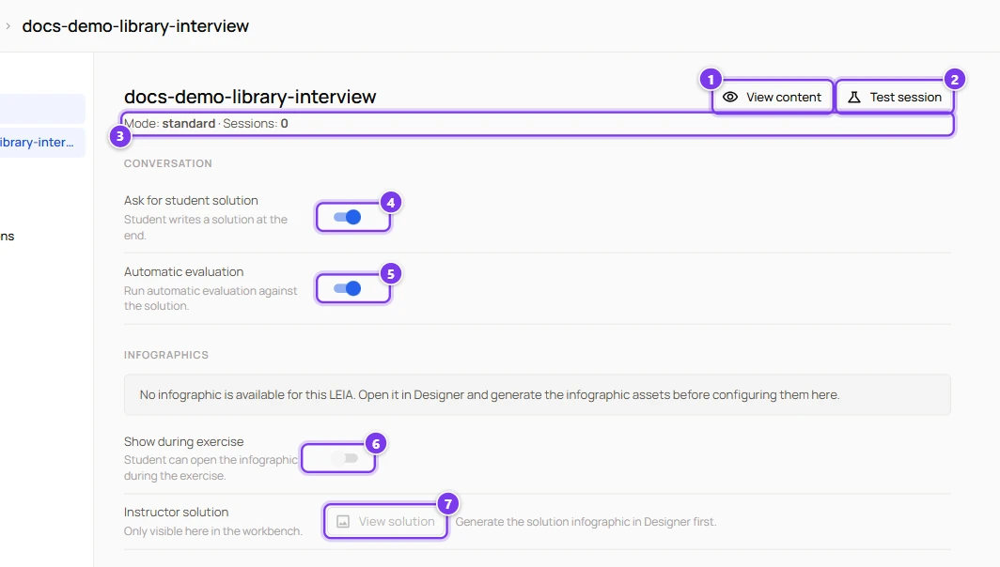
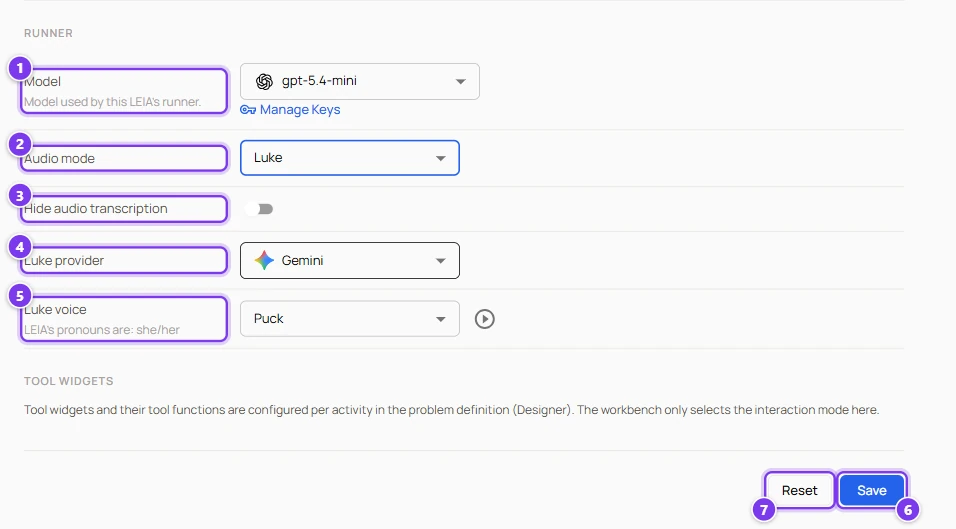

# LEIA settings in a replication

:::info Who can do this
The owner of the replication, administrators and anyone with its share link.
:::

The **LEIAs** section of a replication lists every LEIA of the activity. Each one has its own page with the switches that decide what the student does at the end, which model plays the character and whether the student talks or types. Changes to the two **Conversation** switches and to the infographic options are saved at once. Changes in the **Runner** block need the **Save** button.

## The LEIA page

| # | Control | What it does |
|---|---|---|
| 1 | **View content** | Opens a drawer with the persona, the behaviour and the problem of the LEIA, and a **Raw JSON** tab. |
| 2 | **Test session** | Starts a session for you with this LEIA, in a new tab. Test sessions skip the consent dialog and never appear in the results. If the runner block has unsaved changes you are asked to save first. |
| 3 | **Mode** and **Sessions** | The mode of the LEIA in the activity (**standard** or **transcription**) and how many sessions it has run. |
| 4 | **Ask for student solution** | When on, the student's main button becomes **Go to Editor** (or **Send Solution** with a code widget) and the session ends with a submission. When off, the student simply presses **Finish Session**. |
| 5 | **Automatic evaluation** | When on, the submission is graded by the language model against the problem's solution and the student sees the evaluation at once. Requires the previous switch. |
| 6 | **Show during exercise** | Lets the student open the student infographic from a **Guidance** button in the chat. Disabled when the LEIA has no infographic. |
| 7 | **Instructor solution** | **View solution** opens the infographic with the solution, for you only. |

The infographics are generated in the Designer, from the **View** dialog of the library. When they are missing the page says "No infographic is available for this LEIA. Open it in Designer and generate the infographic assets before configuring them here."

In a MultiLEIA activity a banner **MultiLEIA activity** summarises the flow and offers **Test MultiLEIA**, which starts a session with every LEIA at once.

## Runner

| # | Control | What it does |
|---|---|---|
| 1 | **Model** | The language model that plays this LEIA. The list only contains models of providers for which you have an active key. The icon shows the provider. A model that is no longer available is marked and must be replaced. |
| 2 | **API key** | The key that pays for the conversations. Shown only when more than one key fits the chosen model, otherwise the only compatible key is used. The default key is marked **(Default)**. |
| 3 | **Audio mode** | **None** for a written chat, **Legacy (OpenAI Realtime)** or **Luke** for a spoken conversation. See [Voice](#voice). |
| 4 | **Hide audio transcription** | In voice modes, hides the text of the conversation from the student. The transcript is still saved for you. |
| 5 | **Luke provider** and **Luke voice** | The engine and the voice of the Luke mode, with a play button to hear a sample. The voices are filtered by the pronouns of the persona. |
| 6 | **Save** | Writes the runner block. "Please select a valid model and API key" means a field is missing. |
| 7 | **Reset** | Discards the unsaved changes. |

Next to **Model** two links appear, **Dashboard** when the key has a management URL and **Manage Keys**, which opens the API keys page.

When the activity has widgets the block warns "This activity uses widgets, so its tool functions require a tool-capable provider. Currently, only OpenAI models are available." and the model list shrinks accordingly.

If you leave the page with unsaved runner changes, or press **Test session** or the **Active** switch, a dialog **Unsaved Changes** asks whether to save first. If a saved model disappears from the catalogue, a dialog **Model not available** lists the LEIAs to fix.

## Voice

| Mode | Engine | Voices | Notes |
|---|---|---|---|
| **Legacy (OpenAI Realtime)** | OpenAI Realtime over WebRTC | Alloy, Coral, Marin, Sage, Shimmer, Ash, Ballad, Cedar, Echo, Verse. The list follows the persona's pronouns, **Show all voices** lifts the filter. | The student gets a floating card with a mute button and a visualiser. Widgets are not available. |
| **Luke** | OpenAI or Gemini, chosen with **Luke provider** | OpenAI voices alloy, ash, ballad, coral, echo, sage, shimmer, verse. Gemini voices Puck, Charon, Kore, Fenrir, Aoede. | A full-screen stage with the avatar, a mute button and a transcript panel. Widgets stay available. |

Voice conversations use the platform's own provider keys, not yours. The persona answers in the language of the replication. Voice is not available in MultiLEIA activities.

## Which model to choose

- The model used while you tested the LEIA in the Designer is the safest choice. Behaviours tuned for one model can behave differently on another.
- Only OpenAI models can use the code editor widget and the supervisor.
- Small, fast models keep the conversation lively. Reserve larger models for LEIAs that must reason about a complex solution.
- A replication cannot be activated while any LEIA lacks a model or a key.
