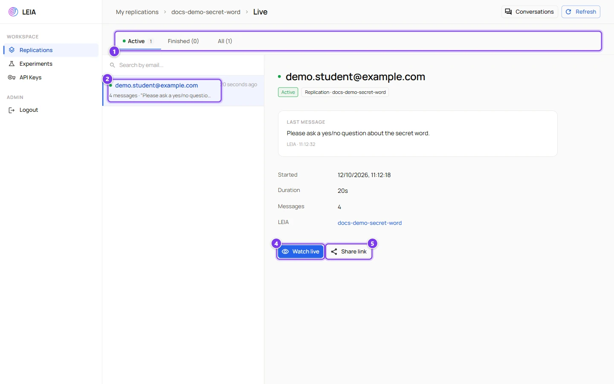

# Live dashboard and spectating

:::info Who can do this
The owner of the replication and administrators. The spectate links themselves work for anyone who has them, without an account, for one hour.
:::

The **Live** section of a replication shows the sessions as they happen. You see who has joined, how far each conversation has gone, the flags raised by the supervisor, and you can open any conversation in a read-only window that updates in real time. Nothing you do here changes a session. There is no button to pause, nudge or close a student.

## The dashboard

Open a replication and choose **Live** in its sub-menu, then **Open live dashboard**, or press **Live** on the replications list or on the Conversations page.

:::caution Advanced accounts and the dashboard
In the development version the dashboard only sends the login token for administrator accounts. An advanced account that opens it directly is sent back to the replications list. The workaround is the share link. Turn on **Shared access** in the **General** section, press **Copy share link**, and open that link, which carries a token the dashboard accepts. The link keeps working for the Live and Conversations pages of that replication.
:::

| # | Control | What it shows or does |
|---|---|---|
| 1 | Tabs | **Active** lists the sessions in progress, with a pulsing dot and a counter. **Finished** and **All** list the others. |
| 2 | A session | The email of the student, or **Anonymous**, the number of messages and the last message, the start time, and a red flag counter when the supervisor raised flags. |
| 3 | **Watch live** | Opens the spectator view of the selected session in a new tab. |
| 4 | **Share link** | Shows a spectate link valid for one hour, with **Copy to clipboard**. Give it to a colleague or show it on the projector. |

The detail panel shows the last message, the start and end times, the duration, the message count and the LEIA, which opens the LEIA preview drawer when clicked. When the supervisor raises a flag while you watch, a **Supervisor flags** block appears under it with the category, the severity, the note of the supervisor and the quoted message. See [The supervisor](../designer/supervisor.md). **Refresh** reloads the list, and the search box filters by email.

:::note Flags raised before you opened the dashboard
In the development version the dashboard only shows the flags it receives while it is open. The flags of a session are always listed in the Conversations page. See [Results, grading and export](results-and-export.md#a-session-in-detail).
:::

The dashboard receives new messages, session ends and supervisor flags live, through a websocket. If the connection drops, a red message says "WebSocket connection error" and **Refresh** brings the list up to date.

## The spectator view

The spectator page opens in a new tab. Its header reads **Spectator Mode** and shows whether the session is **Active** or **Finished**, the mode of the LEIA, the elapsed time, the number of messages and a **Copy Link** button that copies the address of the view. Below it, the transcript updates as messages arrive, and the footer reminds the viewer that the page is read only.

:::caution Not working on the development version
On the development version **Watch live** and **Share link** fail silently, because the server refuses to create the spectate token. The dashboard itself works. Production is not affected.
:::

The view works with the token in its address, so the link can be opened on any device. After one hour the link expires with "Spectate token is required" or "Failed to load session", and a new one must be created from the dashboard.

Students who finish a session with a submitted solution also receive a spectate link to their own conversation, valid for one year. See [What students see](students.md#after-submitting).

## Ideas for the classroom

- Keep the dashboard open on a second screen during a practical session. The message counter shows at a glance who is stuck.
- Open the conversation of a student who asked for help with **Watch live** before walking to their desk, so you know what the LEIA already told them.
- Share a spectate link on the projector to discuss one conversation with the whole class, with the student's permission.
- Supervisor flags are the fastest way to spot students who try to make the LEIA do the work.
