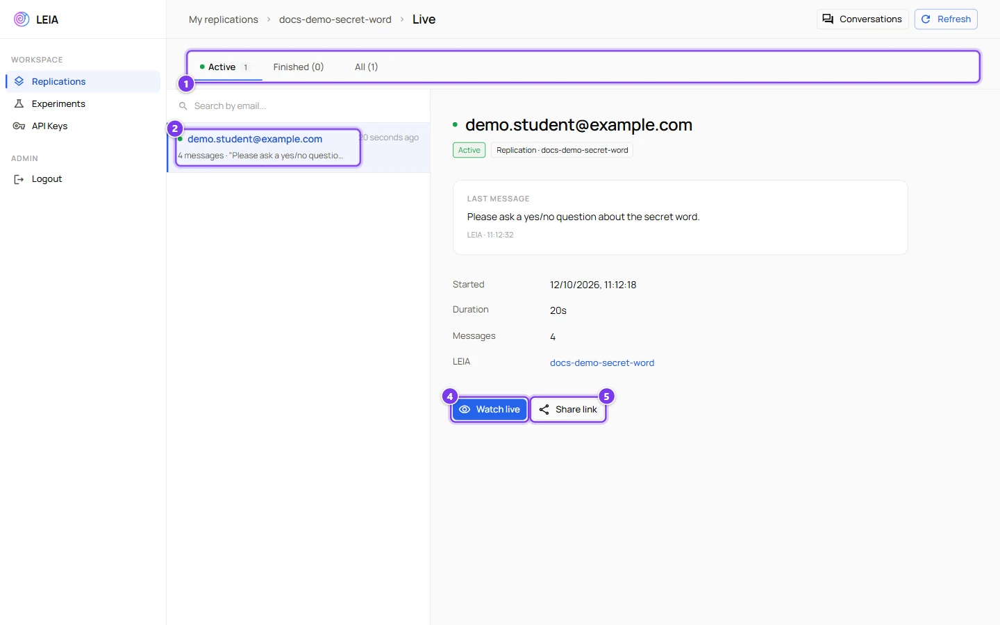

# Live dashboard and spectating

:::info Who can do this
Administrators, and anyone with the share link of the replication. An advanced account needs the share link even for its own replications, see [Open the dashboard](#open-the-dashboard).
:::

The **Live** section of a replication shows the sessions as they happen. You see who has joined, how far each conversation has gone and the flags raised by the supervisor. **Watch live** and **Share link** are meant to open any conversation in a read-only window that updates in real time, but they fail at the moment, see [Watch a session as it happens](#watch-a-session-as-it-happens). Nothing you do here changes a session. There is no button to pause, nudge or close a student.

## The dashboard

### Open the dashboard

1. Open a replication and choose **Live** in its sub-menu.
2. Press **Open live dashboard**.

**Live** on the replications list and on the Conversations page opens it too.

:::caution Advanced accounts and the dashboard
The dashboard only sends the login token for administrator accounts. An advanced account that opens it directly is sent back to the replications list, even for its own replication. The workaround is the share link. Turn on **Shared access** in the **General** section, press **Copy share link**, and open that link, which carries a token the dashboard accepts. The link keeps working for the Live and Conversations pages of that replication.
:::

### Follow a session

1. Choose a tab (1). **Active** lists the sessions in progress.
2. Type an email in the search box if you are looking for one student.
3. Click a session (2). The detail panel shows its last message, its times and its flags.
4. Press **Refresh** if the list stops updating.

### Watch a session as it happens

:::caution Not working at the moment
**Watch live** and **Share link** fail for every account, with or without a share link, because the server looks for a replication with the identifier of the session and answers that it does not exist. You get the message "Failed to generate spectate link", and **Watch live** also leaves a blank tab. Close the tab and read the conversation in [Conversations](results-and-export.md), which lists sessions in progress too. The steps below describe what the buttons are meant to do.
:::

1. Click a session (2).
2. Press **Watch live** (3). The spectator view opens in a new tab.

### Share a spectate link

This fails at the moment too, see [the caution above](#watch-a-session-as-it-happens).

1. Click a session (2).
2. Press **Share link** (4). The **Spectate link** dialog opens.
3. Press **Copy to clipboard**.
4. Send the link or open it on the projector. It works for one hour.

| # | Control | What it shows or does |
|---|---|---|
| 1 | Tabs | **Active** lists the sessions in progress, with a pulsing dot and a counter. **Finished** and **All** list the others. |
| 2 | A session | The email of the student, or **Anonymous**, the number of messages and the last message, the start time, and a red flag counter when the supervisor raised flags. |
| 3 | **Watch live** | Meant to open the spectator view of the selected session in a new tab. Fails at the moment. |
| 4 | **Share link** | Meant to show a spectate link valid for one hour, with **Copy to clipboard**, to give to a colleague or show on the projector. Fails at the moment. |

The detail panel shows the last message, the start and end times, the duration, the message count and the LEIA, which opens the LEIA preview drawer when clicked. When the supervisor raises a flag while you watch, a **Supervisor flags** block appears under it with the category, the severity, the note of the supervisor and the quoted message. See [The supervisor](../designer/supervisor.md). **Refresh** reloads the list, and the search box filters by email.

:::note Flags raised before you opened the dashboard
The dashboard only shows the flags it receives while it is open. The flags of a session are always listed in the Conversations page. See [Results, grading and export](results-and-export.md#a-session-in-detail).
:::

The dashboard receives new messages, session ends and supervisor flags live, through a websocket. If the connection drops, a red message says "WebSocket connection error" and **Refresh** brings the list up to date.

## The spectator view

The spectator page opens in a new tab. Its header reads **Spectator Mode** and shows whether the session is **Active** or **Finished**, the mode of the LEIA, the elapsed time, the number of messages and a **Copy Link** button that copies the address of the view. Below it, the transcript updates as messages arrive, and the footer reminds the viewer that the page is read only.

:::caution Links from the dashboard
The dashboard cannot create spectate links at the moment, see [Watch a session as it happens](#watch-a-session-as-it-happens). The view itself still works with the links students receive after submitting.
:::

The view works with the token in its address, so the link can be opened on any device. After one hour a link from the dashboard expires with "Spectate token is required" or "Failed to load session", and a new one is needed.

Students who finish a session with a submitted solution also receive a spectate link to their own conversation, valid for one year. See [What students see](students.md#after-submitting).

## Ideas for the classroom

- Keep the dashboard open on a second screen during a practical session. The message counter shows at a glance who is stuck.
- Read the conversation of a student who asked for help in [Conversations](results-and-export.md) before walking to their desk, so you know what the LEIA already told them.
- Show one conversation from [Conversations](results-and-export.md) on the projector to discuss it with the whole class, with the student's permission.
- Supervisor flags are the fastest way to spot students who try to make the LEIA do the work.
