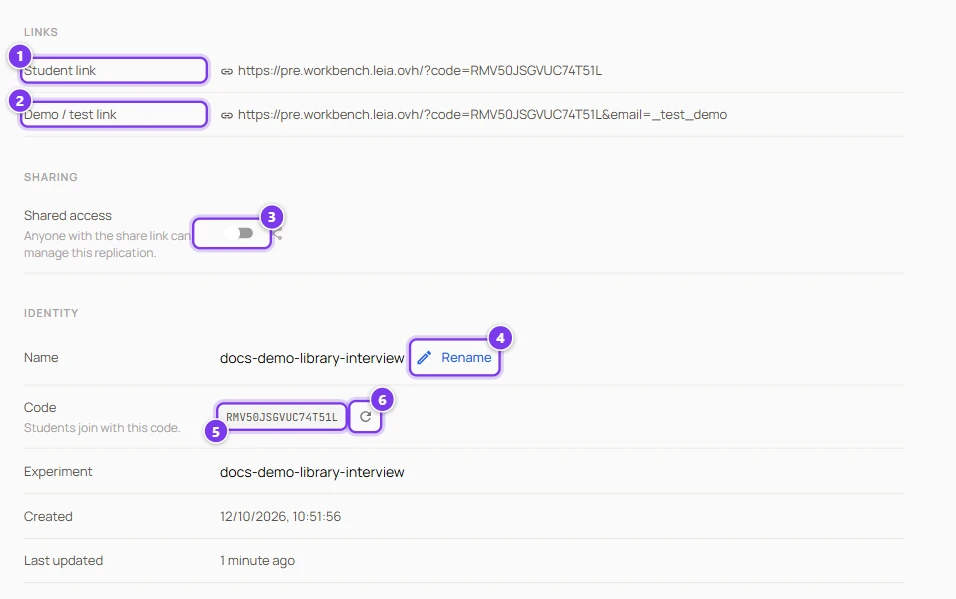
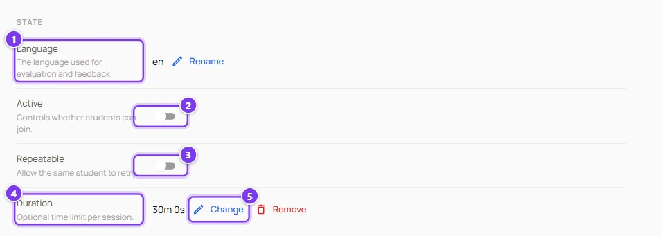
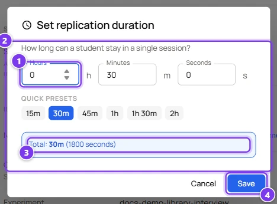
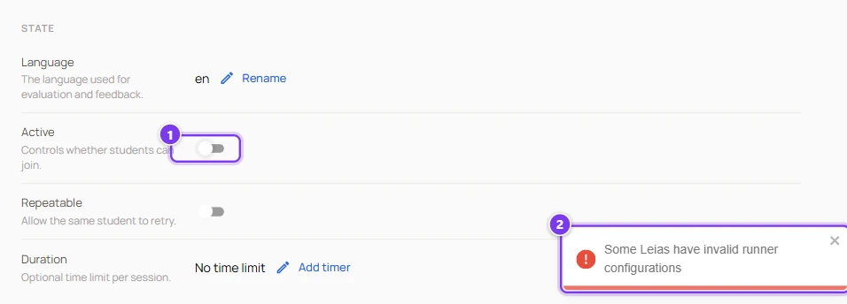
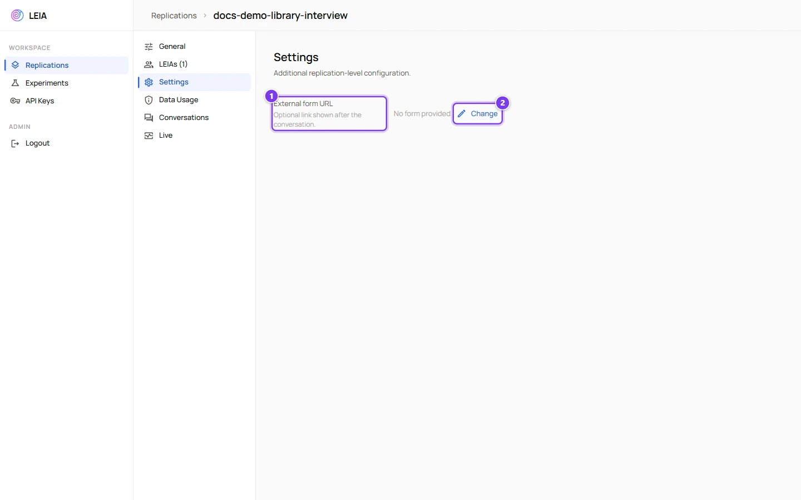
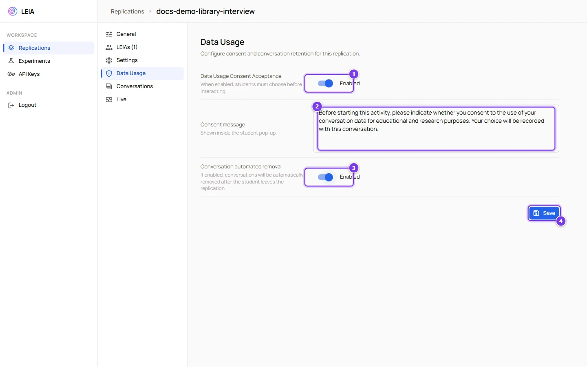

# Replication settings

:::info Who can do this
The owner of the replication and administrators. People who received a **share link** can change the switches and regenerate the code but not rename the replication, change its language or manage sharing.
:::

A replication has three sections of settings that apply to every LEIA in it. **General** holds the links, the code and the switches that decide when and how students can join. **Settings** holds the external form. **Data Usage** holds the consent options. The per-LEIA settings, such as the model and the automatic evaluation, are on the [LEIA settings page](leia-settings.md).

## General

### Share the activity with students

1. Choose **General** in the sub-menu of the replication.
2. Click the **Student link** (1) to copy it, or click the **Code** (5) to copy the code.
3. Paste it in your course page or in a message to your students.

Students can join as soon as **Active** is on.

### Try the activity yourself

1. Click the **Demo / test link** (2) to copy it.
2. Open it in a new private browser window.

Each visit creates a fresh test student that never appears in the results.

### Let a colleague manage the replication

1. Turn on **Shared access** (3). The **Share token** chip appears.
2. Press **Copy share link**.
3. Send the link to your colleague.

To cancel the access, press **Regenerate** next to the chip. The previous link stops working.

### Rename the replication

1. Press **Rename** (4).
2. Type the new name. Names are unique.
3. Press **Save**.

### Regenerate the code

1. Press **Regenerate code** (6).
2. Give the new **Code** (5) to your students. The old one stops working for new students, and sessions already started continue.

| # | Control | What it does |
|---|---|---|
| 1 | **Student link** | The address to give students. It opens the Workbench with the code already filled in. Click to copy. |
| 2 | **Demo / test link** | The same address with a throwaway identity. Each visit creates a fresh test student, and test sessions never appear in the results. Use it to try the activity yourself or to demonstrate it in class. |
| 3 | **Shared access** | When on, anyone with the share link can manage this replication without an account. A **Share token** chip appears with **Copy share link** and **Regenerate**. Regenerating invalidates the previous link. |
| 4 | **Rename** | Changes the name of the replication in your list. Names are unique. |
| 5 | **Code** | The code students type. Click to copy. |
| 6 | **Regenerate code** | Gives a new code. The old one stops working for new students, sessions already started continue. |

Below the identity block, **Experiment**, **Created** and **Last updated** are read only.

### Change the language

1. Press the button next to **Language** (1).
2. Type the language in the dialog, for example `Spanish` or `es`.
3. Press **Save**.

### Open or close the replication

1. Give every LEIA a model and a key. See [Runner](leia-settings.md#runner).
2. Turn on **Active** (2).

Students can join. If the switch stays off, see [Activation errors](#activation-errors). To close the replication after the class, turn **Active** (2) off. New students cannot join and sessions in progress continue.

### Let students repeat the activity

1. Turn on **Repeatable** (3).
2. Tell students to enter the code again with the same email when they finish.

A student who finished starts a fresh session.

| # | Control | What it does |
|---|---|---|
| 1 | **Language** | The language of the conversation, the evaluation and the feedback. Free text, for example `Spanish` or `es`. The edit button is labelled **Rename**. The LEIA may still switch language if a student clearly writes in another one. |
| 2 | **Active** | Whether students can join. A new replication starts inactive. Activation checks that every LEIA has a model and a key, and refuses with a list of the LEIAs to fix otherwise. Turning it off stops new joins but does not interrupt sessions in progress. |
| 3 | **Repeatable** | Whether a student who finished may start again with the same email. When off, a finished student gets "Session Already Completed". An unfinished session is always resumed, repeatable or not. |
| 4 | **Duration** | The time limit per session. **No time limit** by default. |
| 5 | **Change** | Opens the dialog below. The button reads **Add timer** while there is no limit, and **Remove** next to it clears the limit. |

### Set a time limit

1. Press **Add timer** (5 in the switches above). The button reads **Change** when a limit already exists.
2. Type the **Hours**, **Minutes** and **Seconds** (1), or press one of the **Quick presets** (2).
3. Check the **Total** (3).
4. Press **Save** (4).

**Duration** shows the limit. To clear it, press **Remove** next to **Change**.

| # | Control | What it does |
|---|---|---|
| 1 | **Hours**, **Minutes**, **Seconds** | The limit, from one second up to 23 hours. |
| 2 | **Quick presets** | **15m**, **30m**, **45m**, **1h**, **1h 30m**, **2h**. |
| 3 | **Total** | The resulting limit. |
| 4 | **Save** | Applies the limit. It needs a total above zero. |

:::caution The timer lives in the student's browser
The countdown is shown and enforced by the student's browser. The server does not close sessions on its own, so a student who reloads at the right moment or disables the timer may continue. Use the **Started** and **Finished** times of the results to check, and treat the limit as guidance rather than as a hard wall. When the time runs out while the student is in the solution editor, the session closes without submitting.
:::

### Activation errors

When a LEIA has no model or no key, the **Active** switch stays off, a message lists the LEIAs concerned and the **Model** field of each one is outlined in red. A MultiLEIA replication also needs at least two LEIAs, no audio mode and the same process on every LEIA.

1. Choose **LEIAs** in the sub-menu and open a LEIA of the message.
2. Pick a **Model** and an **API key**.
3. Press **Save**.
4. Repeat with the other LEIAs of the message.
5. Choose **General** in the sub-menu and turn on **Active** again.

## Settings

1. Choose **Settings** in the sub-menu.
2. Press **Change** (2).
3. Type the address, starting with `http` or `https`.
4. Press **Save**.

**External form URL** (1) shows the link and students get an **Open Form** button when they finish. To clear it, press **Delete** (2).

| # | Control | What it does |
|---|---|---|
| 1 | **External form URL** | An optional link, for example a questionnaire, that students get as an **Open Form** button when they finish. Only addresses starting with `http` or `https` are offered to students. |
| 2 | **Change** and **Delete** | Set or clear the link. |

## Data Usage

1. Choose **Data Usage** in the sub-menu.
2. Enable **Data Usage Consent Acceptance** (1).
3. Replace the **Consent message** (2) with the wording your institution requires.
4. Enable **Conversation automated removal** (3) if the conversations of students who decline must be deleted.
5. Press **Save** (4).

If **Save** returns an error, leave consent off and collect consent outside LEIA.

| # | Control | What it does |
|---|---|---|
| 1 | **Data Usage Consent Acceptance** | When enabled, every student must accept or decline before the first message. The choice is stored with the session and shown in the results. |
| 2 | **Consent message** | The text of the dialog. A default text about educational and research purposes is provided, replace it with the wording your institution requires. |
| 3 | **Conversation automated removal** | When enabled, the conversation of a student who **declined** is deleted after the session ends. Only the metadata of the session is kept. Available only while consent is enabled. |
| 4 | **Save** | Writes the three settings together. Disabled while consent is on and the message is empty. |

:::caution Availability
Consent and automatic removal are present in the Workbench interface of the development version but the matching server support has not reached that version yet, so **Save** may fail there. The production version supports them. If **Save** returns an error, leave consent off and collect consent outside LEIA.
:::

Test sessions started with the **Demo / test link** or with **Test session** skip the consent dialog.

## A checklist for a class session

1. **Language** set, **Duration** decided.
2. Every LEIA has a model and a key, and **Ask for student solution** and **Automatic evaluation** match your intentions.
3. **Repeatable** on for practice, off for assessed work.
4. **External form URL** if you want feedback.
5. **Active** on, then share the **Student link** or the **Code**.
6. After the class, **Active** off, so late joiners do not create new sessions.
