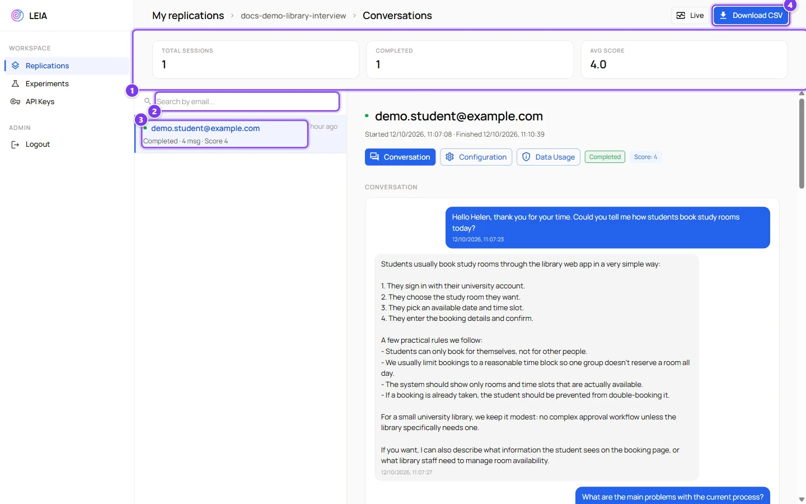
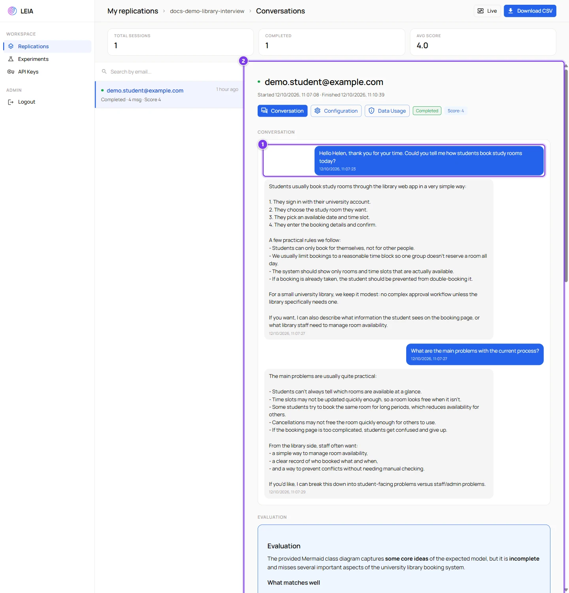
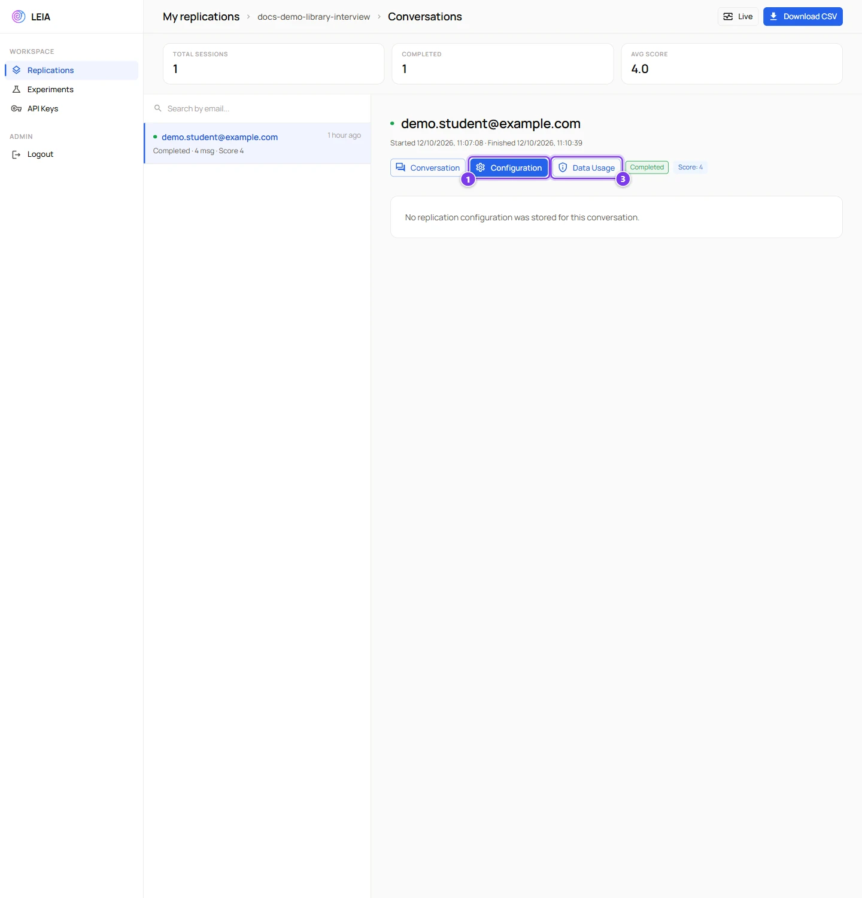

# Results, grading and export

:::info Who can do this
The owner of the replication, administrators and anyone with its share link. Editing a score is reserved to administrators in the current interface.
:::

The **Conversations** section of a replication is where you read what happened, check the automatic evaluation, change a score and download everything. Test sessions, those started with **Test session** or with the **Demo / test link**, are not listed and are not exported.

## The conversations page

| # | Control | What it shows or does |
|---|---|---|
| 1 | Counters | **Total sessions**, **Completed** and **Avg score**, the average of the sessions that have a score. |
| 2 | **Search by email** | Filters the list by the student identifier. |
| 3 | A session | A green dot for finished sessions and an amber one for sessions in progress, the email or **Anonymous**, the number of messages, the score and the start time. |
| 4 | **Download CSV** | Downloads every session of the replication as one file named after the replication. See [The CSV file](#the-csv-file). |

**Live** in the header jumps to the live dashboard.

## A session in detail

| # | Item | What it is |
|---|---|---|
| 1 | Transcript | Every message with its time. In MultiLEIA sessions each message carries the name of the character. When the student declined consent and automatic removal was on, the panel explains that no conversation is available. |
| 2 | **Evaluation** | The text produced by the automatic evaluation, when it was enabled. |
| 3 | **Supervisor flags** | The flags raised during the session, each with its severity, category, note and quoted message. See [The supervisor](../designer/supervisor.md). |
| 4 | **Submitted result** | The solution sent by the student. Mermaid diagrams are drawn, other formats are shown as text. |

Three buttons switch the detail view.

| View | Content |
|---|---|
| **Conversation** | The transcript, the evaluation, the flags and the submission described above. |
| **Configuration** | A snapshot of how the replication and the LEIA were configured when the session ran. Name, duration, repeatable, form, mode, the solution switches, the solution format, the provider, the model and the audio settings. Useful when you change settings between groups. |
| **Data Usage** | Whether consent was required, what the student answered and when, and whether the conversation was removed. |

| # | Control | What it shows |
|---|---|---|
| 1 | **Configuration** | Switches to the snapshot view. In the development version the snapshot is not stored yet and the view reads "No replication configuration was stored for this conversation". |
| 3 | **Data Usage** | Switches to the consent view. |

## Scores

Each session shows a **Score** chip. The automatic evaluation returns a score from **0 to 10** and stores it there. Administrators can click the chip to type a manual score from **0 to 100** with one decimal, which replaces the automatic one. The field refuses values outside that range with "Please enter a valid score between 0 and 100", the tick saves and the cross discards. Advanced accounts see the chip but cannot edit it.

:::caution Two scales
Automatic scores use 0 to 10, manual scores accept 0 to 100. Decide one scale for your course before you start grading, otherwise the average counter mixes both.
:::

## The CSV file

**Download CSV** produces one row per message, so a session with twenty messages occupies twenty rows that share the session columns.

| Column | Content |
|---|---|
| Session ID | The identifier of the session. Use it to group rows. |
| User | The email the student typed, or **Anonymous**. |
| Started At, Finished At | Timestamps of the session. |
| Message | The text of the message. |
| Is LEIA | `true` for messages written by the LEIA, `false` for the student. |
| Timestamp | When the message was sent. |
| Score | The score of the session, repeated on every row. |
| Evaluation | The evaluation text, repeated on every row. |

The submitted solution, the supervisor flags and the configuration snapshot are not in the file. Read them in the detail panel. The production version of the Workbench adds columns with the replication configuration and the consent status.

In a spreadsheet, filter on **Is LEIA** equal to `false` to count student messages, or build a pivot table on **Session ID** to get one line per student with the score and the number of messages.

## Suggested grading routine

1. Sort the list by score and open the lowest ones first. A very low score often means an empty or malformed submission rather than a bad interview.
2. Read the transcript before the evaluation. The evaluation only sees the submission and the reference solution, not the conversation.
3. Check the supervisor flags for students who asked the character for the answer.
4. Adjust the score when you disagree with the model, or keep your own grades outside LEIA and use the CSV as evidence.
5. Download the CSV at the end of the course and keep it with your records, the replication can be deleted later.
