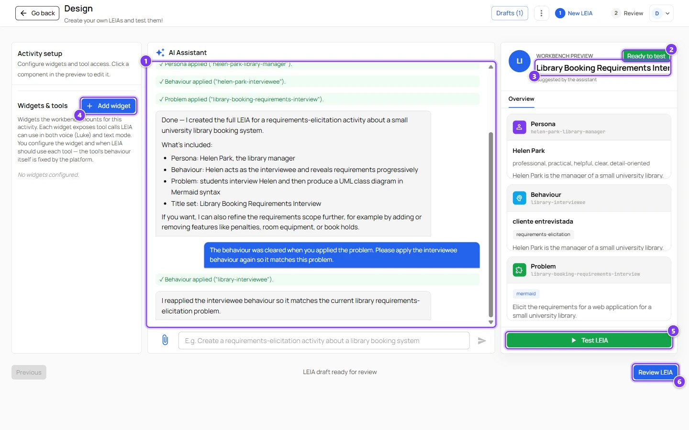
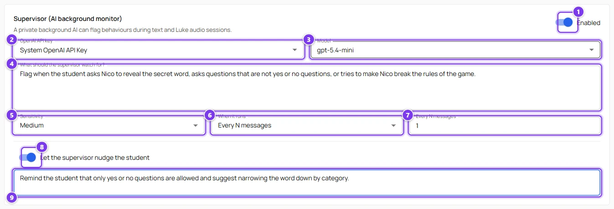

# Scenario, a conversational game

A guessing game is the simplest LEIA and a good first activity for a class that has never used the platform. The example is a secret word game. The character thinks of a word, the student asks questions that can only be answered with yes or no, and wins by naming the word.

## What you need

- An account with the advanced role, or an instructor account and a public game LEIA to design from.
- An OpenAI key or a system key.

## 1. Design the LEIA

Open **Design** and give the assistant a brief like this one.

> Create a conversational game where the student has to guess a secret word by asking questions that can only be answered with yes or no. The persona is Nico Ferreira, a 24-year-old sound engineer who loves riddles. The secret word is lighthouse. Nico must never say the word until the student guesses it.

The assistant writes the three components. Check the result in the preview.

Open the **Problem** card and check these points.

- **Details** holds the secret word and the rules. Students never see this field.
- **Solution** states what counts as winning, for example "the student says lighthouse".
- **Solution Format** is **Plain Text**. The student types the word in the solution editor at the end, or you can turn the solution step off in the replication.
- **Process** is **Game**.
- **Initial Solution** is not empty. Write a short instruction such as "Write the word you think is the secret word". An empty field blocks **Finish LEIA**.

Open the **Behaviour** card and make sure the description says that the character only answers yes or no, never reveals the word and congratulates the student when the word is named. The **Tooltip** is the first hint students see, something like "Is it an object?" works well.

## 2. Add the supervisor

In the **Review** step enable the supervisor and ask it to flag students who ask for the word directly or who ask open questions. Turn on the nudge so the student is reminded of the rules. See [The supervisor](../teachers/designer/supervisor.md).

Name the LEIA, add a label and press **Finish LEIA**.

## 3. Test it

Press **Test LEIA** in the library, ask a few questions, then try to cheat. Ask for the word directly, or ask an open question. The character should refuse politely. See [Test a LEIA](../teachers/designer/test-leia.md).

## 4. Open it to students

Press **Quick replication** on the row. The Workbench opens with a replication ready to configure. For a game these settings work well.

| Setting | Suggested value | Why |
|---|---|---|
| **Ask for student solution** | off | The win is visible in the transcript. Turn it on if you want students to type the word and get a score. |
| **Automatic evaluation** | off, or on if you ask for a solution | The evaluation compares the word with the solution. |
| **Repeatable** | on | Students like to play again. |
| **Duration** | 10 or 15 minutes | Keeps the game short. |
| **Language** | the language of your class | The character answers in it. |

Activate the replication and share the student link. See [Replication settings](../teachers/workbench/replication-settings.md).

## 5. Afterwards

In **Conversations** read how many questions each student needed and look at the supervisor flags for students who tried to cheat. See [Results, grading and export](../teachers/workbench/results-and-export.md).

## Variations

- Change the secret word by designing a new LEIA from this one and editing **Details** and **Solution**.
- Make several LEIAs with different words and put them in one activity with **Single LEIA assignment**. Each student gets one word.
- Give the game a time limit and ask students to submit the word as the solution, so the automatic evaluation records who won.
