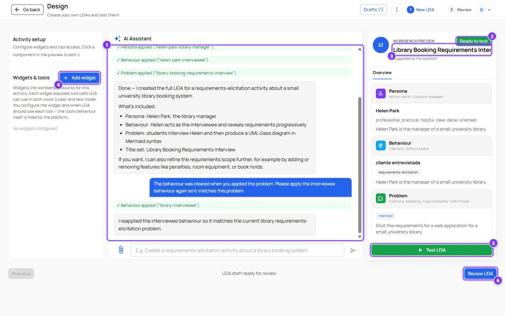
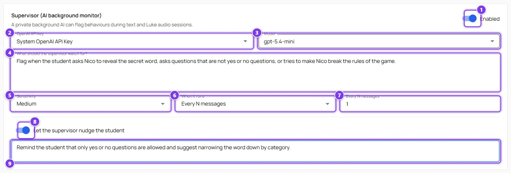

# Scenario, a conversational game

A guessing game is the simplest LEIA and a good first activity for a class that has never used the platform. The example is a secret word game. The character thinks of a word, the student asks questions that can only be answered with yes or no, and wins by naming the word.

## What you need

- An account with the advanced role, or an instructor account and a public game LEIA to design from.
- An OpenAI key or a system key.

## 1. Design the LEIA

1. Press **Design** in the sidebar of the Designer.
2. Type a brief in the message box and press **Send message**. For example

   > Create a conversational game where the student has to guess a secret word by asking questions that can only be answered with yes or no. The persona is Nico Ferreira, a 24-year-old sound engineer who loves riddles. The secret word is lighthouse. Nico must never say the word until the student guesses it.

3. Wait for the assistant to write the three components and check the result in the preview.
4. Click the **Problem** card.
5. Check that **Details** holds the secret word and the rules. Students never see this field.
6. Check that **Solution** states what counts as winning, for example "the student says lighthouse".
7. Check that **Solution Format** is **Plain Text**. The student types the word in the solution editor at the end, or you can turn the solution step off in the replication.
8. Check that **Process** is **Game**.
9. Write a short instruction in **Initial Solution**, such as "Write the word you think is the secret word".
10. Press **Save**.
11. Click the **Behaviour** card and make sure **Description** says that the character only answers yes or no, never reveals the word and congratulates the student when the word is named.
12. Write the first hint students see in **Tooltip**. Something like "Is it an object?" works well. Press **Save**.

## 2. Add the supervisor

1. Press **Review LEIA**.
2. Turn on **Enabled** (1) in the supervisor card.
3. Choose an **OpenAI API key** (2) and a **Model** (3).
4. In **What should the supervisor watch for?** (4) ask it to flag students who ask for the word directly or who ask open questions.
5. Turn on **Let the supervisor nudge the student** (8) and ask it, in the coaching instructions (9), to remind the student of the rules.
6. Type the **New LEIA name**, add a label in **Labels** and press **Finish LEIA**.

See [The supervisor](../teachers/designer/supervisor.md).

## 3. Test it

1. Press **Go to LEIAs** in the success dialog.
2. Move the mouse over the row of your LEIA and press **Test LEIA**.
3. Ask a few yes or no questions.
4. Try to cheat. Ask for the word directly, or ask an open question.

The character should refuse politely. See [Test a LEIA](../teachers/designer/test-leia.md).

## 4. Open it to students

1. Press **Quick replication** on the row. The Workbench opens in a new tab with a replication ready to configure.
2. Choose **LEIAs** in the sub-menu of the replication and open your LEIA.
3. Check that **Model** and **API key** are set. If you change them, press **Save**.
4. Set **Ask for student solution** and **Automatic evaluation** with the values below.
5. Choose **General** in the sub-menu and set **Repeatable**, **Duration** and **Language** with the values below.
6. Turn on **Active**.
7. Copy the **Student link** and give it to your students.

For a game these settings work well.

| Setting | Suggested value | Why |
|---|---|---|
| **Ask for student solution** | off | The win is visible in the transcript. Turn it on if you want students to type the word and get a score. |
| **Automatic evaluation** | off, or on if you ask for a solution | The evaluation compares the word with the solution. |
| **Repeatable** | on | Students like to play again. |
| **Duration** | 10 or 15 minutes | Keeps the game short. |
| **Language** | the language of your class | The character answers in it. |

See [Replication settings](../teachers/workbench/replication-settings.md).

## 5. Afterwards

1. Choose **Conversations** in the sub-menu of the replication and press **Open conversations**.
2. Click a session and read how many questions the student needed.
3. Look at the **Supervisor flags** under the transcript to find students who tried to cheat.

See [Results, grading and export](../teachers/workbench/results-and-export.md).

## Variations

- Change the secret word by designing a new LEIA from this one and editing **Details** and **Solution**.
- Make several LEIAs with different words and put them in one activity with **Single LEIA assignment**. Each student gets one word.
- Give the game a time limit and ask students to submit the word as the solution, so the automatic evaluation records who won.
