# Your own LEIA from a featured one

:::info Who can do this
Every role, including **instructor**. You reuse the behaviour of the featured LEIA and only create a persona and a problem, so no behaviour is created.
:::

The [featured LEIAs](../featured-leias/index.md) are the nine LEIAs the LEIA team maintains as examples: client interviews, a process discovery, a Socratic dialogue, a guessing game, coding tutors. When the exercise you have in mind looks like one of them, the fastest path to your own LEIA is **Design from this**: open the featured LEIA on the design screen, replace the character and the exercise, keep the behaviour, and save the result under a new name.

This tutorial does it end to end. It starts from the [ticket platform requirements](../featured-leias/re-inf-tickets.md) LEIA, where students interview a theater owner, and turns it into an interview with the owner of a gym chain about a membership app. Every screenshot comes from that run.

## Which featured LEIA to start from

Keep the behaviour: it is the part that tells the language model how to act, and the featured behaviours have been tuned in class. Change the persona and the problem, or only the problem.

| You want | Start from | Change |
|---|---|---|
| A client interview that ends in a conceptual model | [Ticket platform requirements](../featured-leias/re-inf-tickets.md) | Persona; problem (description, details, Mermaid solution) and its overrides. This tutorial. |
| A process discovery interview that ends in BPMN | [Loan application process](../featured-leias/re-proc-loans.md) | Persona; problem with the process in **Details** and the BPMN flowchart in **Solution**. |
| A requirements interview with an ethical and legal analysis | [Shopiverse v2](../featured-leias/re-eth-shopiverse.md) | Persona; problem with the requirements in **Details** and the risk analysis in **Solution**. |
| A Socratic dialogue on another concept | [A Socratic dialogue on justice](../featured-leias/socratic-justice.md) | Only the problem. Sócrates stays. |
| A guessing game with another word or other rules | [The secret word game](../featured-leias/game-secret-word.md) | Only the problem: the word and the rules go in **Details** and **Solution**. The persona if you want another friend. |
| A reflective interview about another experience | [An interview about your LEIA experience](../featured-leias/interview-leia-testimonial.md) | The problem: topic and areas to cover. The persona if you want another interviewer. |
| A coding tutor for another exercise | [Python loops tutor](../featured-leias/code-tutor-loops.md) or [JavaScript anagram tutor](../featured-leias/code-tutor-anagram.md) | The problem, plus the editor widget in **Activity setup**: function name, language, starter code and tests. See [code editor widget](../teachers/designer/widgets.md). |
| An oral defence of code in another language | [Code defence interview](../featured-leias/code-review.md) | The problem: the editor language and the areas the interview must cover. |

## 1. Find the featured LEIA

1. Open the [LEIA library](../teachers/designer/index.md).
2. Set **Label** to **featured**. The nine featured LEIAs are the only rows left.
3. Move the mouse over the row of `re-inf-tickets`. Its buttons appear.
4. Press **View** if you want to read the persona and the problem first. Then press **Design from this**.

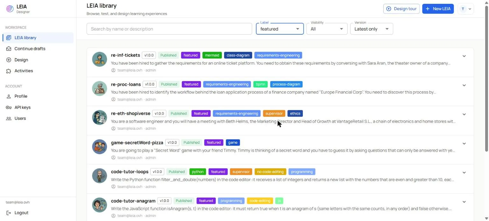

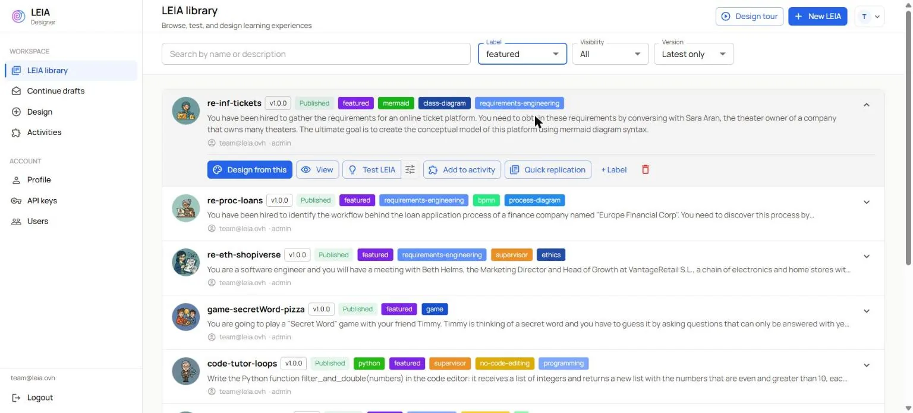

## 2. The design screen

The design screen opens with the three cards of the original LEIA under **Workbench preview**: the persona `sara-aran`, the behaviour `re-information` in the role of theater owner, and the problem. The title is a suggestion and the chip says **Ready to test**. Nothing has been copied yet: the cards point at the library components until you finish.

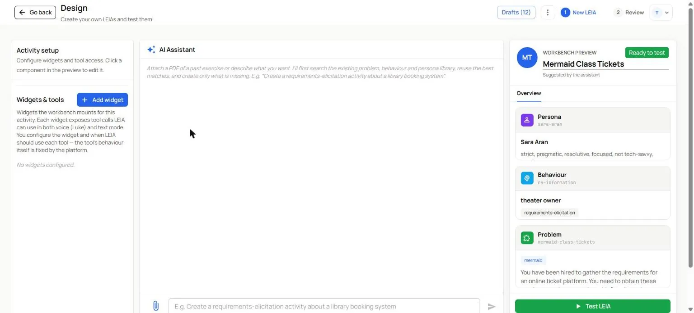

:::note Names can differ
The cards show the current library names of the components, which are not always the names you saw on the featured page. The problem of `re-inf-tickets` appears as `mermaid-class-tickets`.
:::

## 3. Replace the character

Click the **Persona** card. **Edit Persona** opens on the **Visual Editor** tab.

1. **Persona name**: a new identifier, `docs-demo-gym-owner`. A name that already exists in the library is refused when you finish.
2. **Full Name** and **First Name**: `Laura Benítez` and `Laura`.
3. **Description**: who she is and what she wants. In this run: owner of FitHub, a chain of five gyms in Seville, former personal trainer, knows her members by name and cares more about keeping them than about technology.
4. **Personality**: a few adjectives, `direct, busy, practical, warm, not tech-savvy`.
5. The four pronoun fields if they change. Sara and Laura share `she, her, hers, her`.
6. Press **Save**.

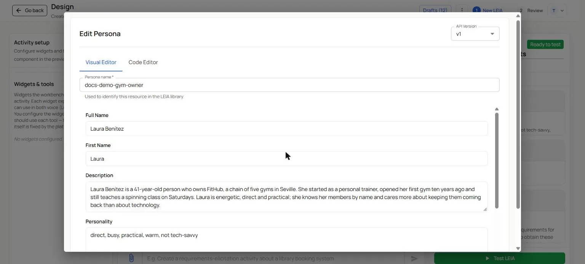

The persona card in the preview now shows Laura. Its personality line has two extra traits, `not tech-savvy, very busy`: they come from the problem, which extends the persona. The next step shows where.

## 4. Replace the exercise

Click the **Problem** card. **Edit Problem** opens on the **Visual Editor** tab.

1. **Problem name**: `docs-demo-gym-membership`.
2. **Description**, what the student reads in the **Instructions** dialog. Keep the placeholders of the original: `{{persona.fullName}}` and `{{behaviour.role}}` are replaced by your persona's name and the role you set below, so the text follows the character. In this run: "You have been hired to gather the requirements for the membership app of FitHub, a chain of gyms. You need to obtain these requirements by conversing with `{{persona.fullName}}`, the `{{behaviour.role}}` of the chain. The ultimate goal is to create the conceptual model of this app using mermaid diagram syntax."
3. **Persona Background**: the character's situation in this exercise, also with placeholders.
4. **Details**: what only the character knows and the student must discover. Members, plans, classes with a trainer and a room, bookings, payments, freezes, check-ins.
5. **Solution**: the reference conceptual model as a Mermaid class diagram. The preview under the editor renders it, so a syntax error shows at once.
6. **Evaluation Prompt**: what the grader should look at.
7. Leave **Process** on **Requirements Elicitation**: the behaviour you reuse expects it.

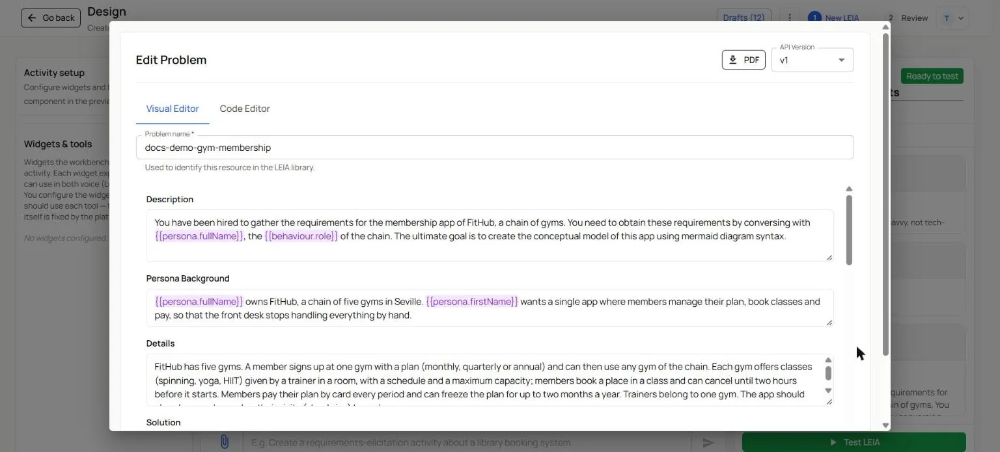

### The overrides, in the Code Editor

The ticket problem does two things that the visual editor does not show. It **extends** the persona with the traits you saw in step 3, and it **overrides** two fields of the shared behaviour: the **role**, which is `theater owner`, and the **tooltip**, the opening line students see under **Try typing**. Both still talk about theaters.

1. Switch to the **Code Editor** tab.
2. In the `overrides` block, change `"role"` to `gym chain owner`.
3. Change `"tooltip"` to an opening line for the new client, keeping `{{persona.firstName}}`: "Hi `{{persona.firstName}}`, my name is (...) and I'm the software engineer in charge of the FitHub membership app. Nice to meet you! Could you tell me how your members sign up and book classes today?"
4. Leave `extends` and `constrainedTo` as they are, and press **Save**.

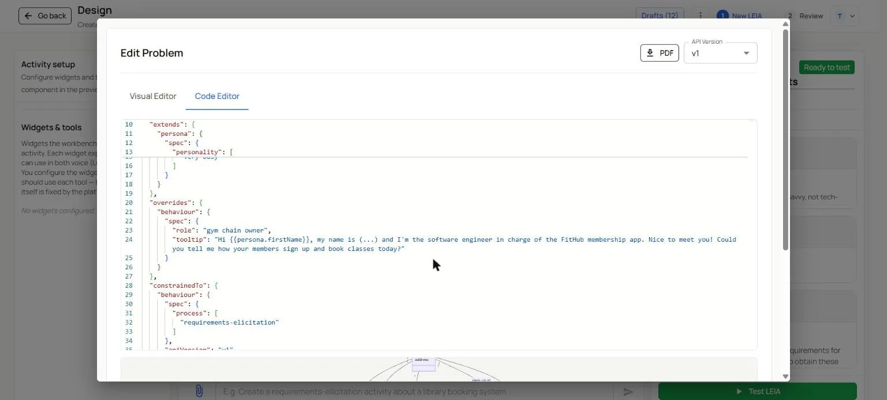

The behaviour card now reads `gym chain owner`, and the problem card shows the new description. The behaviour itself has not changed: the role and the tooltip live in your problem. See [extends and overrides](../teachers/designer/components-reference.md) for the fields a problem can adjust.

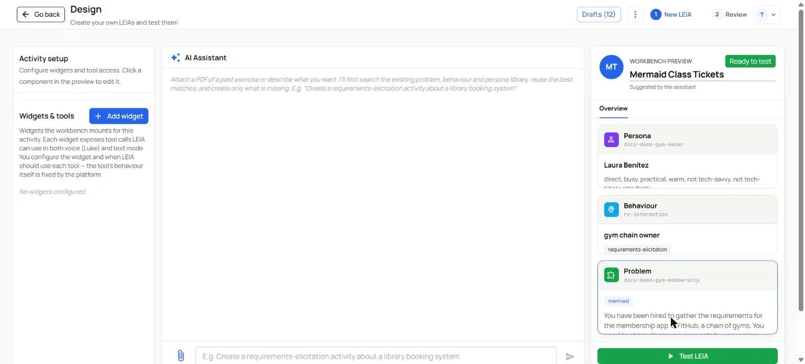

:::tip Give the LEIA a title
Type a title in the **Workbench preview** panel, for example `FitHub membership interview`. The review step proposes it as the LEIA name.
:::

## 5. Test it

Press **Test LEIA**. The draft is saved and the chat opens with the **Instructions** already resolved: "conversing with Laura Benítez, the gym chain owner of the chain". Send the opening line and check that the character answers in role and only with what she knows. **Continue Configuration** brings you back to the design screen.

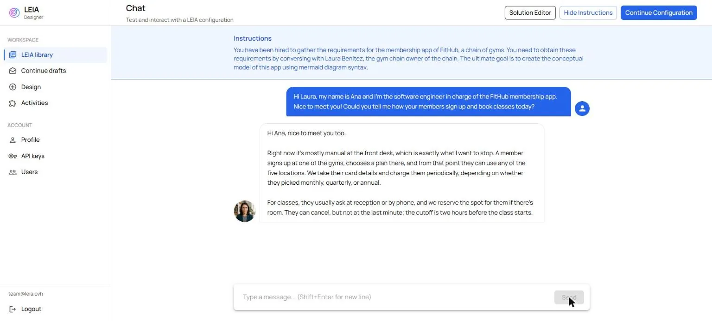

## 6. Name it and finish

Press **Review LEIA**. The **Review your LEIA** step lists what will be created.

1. **New LEIA name**: a unique name, `docs-demo-gym-membership` in this run.
2. **Labels**, optional, to find it later.
3. **LEIA visibility**: **Private** keeps it in your account; **Public** publishes it to every user. Administrators get **Public** by default, so check it.
4. The **Supervisor** switch, off for this exercise.
5. The three component cards. **Behaviour name** stays `re-information`, with no change: it is reused, not copied. **Problem name** and **Persona name** are the new identifiers, each with its own **Visibility**.
6. Press **Finish LEIA**.

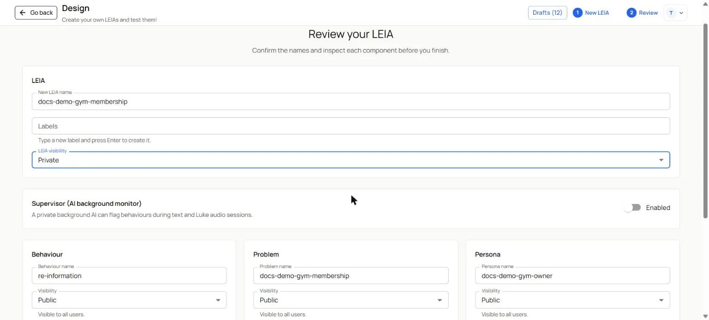

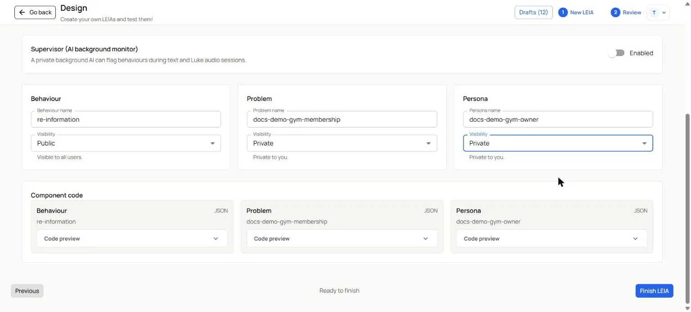

The **LEIA created successfully** dialog offers three ways out: **Go to LEIAs**, **Add to Activity** and **Quick Replication**.

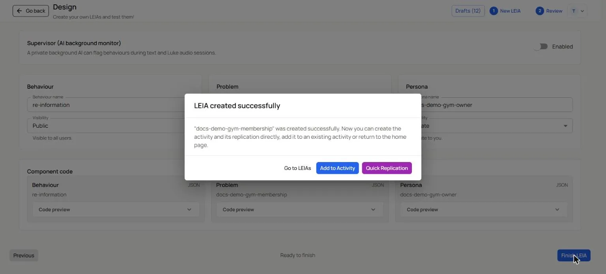

## 7. Open it to students

Press **Quick Replication**. It creates an activity and a Workbench replication with the name of the LEIA and opens the replication in a new tab, on its **General** page: the **Student link**, the **Demo / test link** and the **Code** are ready, with **Active** still off.

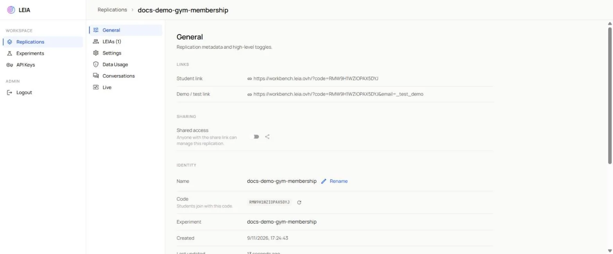

1. Turn on **Active** when you want students to join, and **Repeatable** if they may retry. See [replication settings](../teachers/workbench/replication-settings.md).
2. Open **LEIAs** and check the model, **Ask for student solution**, **Automatic evaluation** and the audio mode. See [LEIA settings](../teachers/workbench/leia-settings.md).
3. Try the **Demo / test link** yourself before the class. [What students see](../teachers/workbench/students.md) describes the rest of their path.

Instructor accounts do not see **Quick Replication**. Press **Go to LEIAs** instead; the LEIA is in your library with **Test LEIA** ready, and a colleague with the advanced role can replicate it, or you can ask the LEIA team at [team@leia.ovh](mailto:team@leia.ovh) for the role.

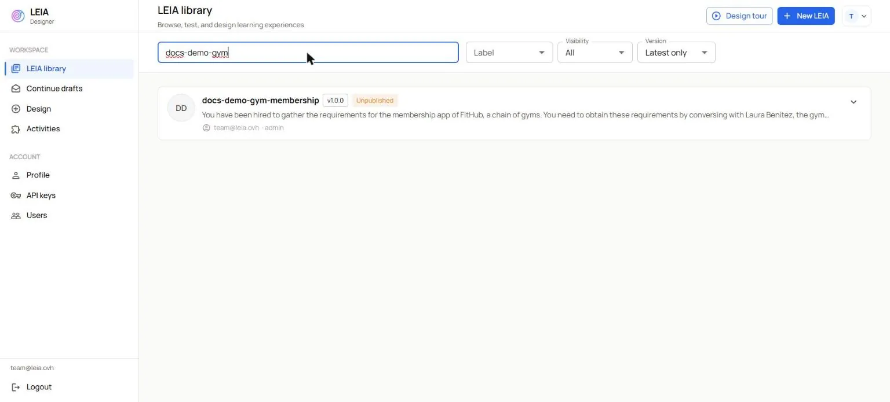

## What you created

- A LEIA `docs-demo-gym-membership`, version 1.0.0, in your library.
- A persona `docs-demo-gym-owner` and a problem `docs-demo-gym-membership`, both yours.
- Nothing else changed: the behaviour `re-information` and the featured LEIA `re-inf-tickets` are exactly as they were.

## What next

- Browse the other [featured LEIAs](../featured-leias/index.md) for the exercise closest to your course; each page says what to keep and what to change.
- To build a LEIA from scratch with the AI assistant, including a new behaviour, follow [Create a LEIA with the AI assistant](../teachers/designer/create-leia.md).
- The scenario tutorials go deeper into one kind of exercise each: [requirements elicitation](requirements-elicitation.md), [conversational game](conversational-game.md), [programming exercise](programming-exercise.md), [group simulation](multi-leia-simulation.md).
