# A LEIA by hand, without the assistant

:::info Who can do this
The **admin** role. This path writes a behaviour, which instructors cannot create, and it relies on the **Components** picker of the design screen, which only administrators see. Advanced accounts get a behaviour of their own through the [AI assistant](../teachers/designer/create-leia.md) and then edit it by hand.
:::

:::info Start from a featured LEIA
If you want a new exercise similar to one that already exists, start from a [featured LEIA](../featured-leias/index.md) with **Design from this**. The tutorial [Your own LEIA from a featured one](create-from-featured.md) shows every step.
:::

Sometimes you already know exactly what the three components must say and you want to type them yourself: no assistant, no copy of another LEIA. The design screen has no blank component, so the trick is to load any three existing components as a canvas with **Components**, replace every field, and finish. Every edited component is saved as a new one under the name you give it; the originals are not touched.

This tutorial builds a customer-service role-play for a hospitality course: the student is the receptionist of a hotel, the LEIA is Marco Rossi, a guest who did not sleep because of building work, and the deliverable is the follow-up email the receptionist would send him. Every screenshot comes from that run.

## Before you start, sketch the three components

Write these down before you open the Designer. The editors ask for them in this order.

| Component | Decide |
|---|---|
| **Behaviour** | How the character behaves with the student: what it knows, how it reacts, what it never does, how the conversation ends. Which **Process** it belongs to. The **Tooltip**, the first line students see under **Try typing**. |
| **Persona** | Who the character is: name, a short biography, a few personality adjectives, pronouns. |
| **Problem** | What the student reads (**Description**), what only the character knows (**Details**), the reference answer (**Solution**) and its format, and what the grader should look at (**Evaluation Prompt**). |

Behaviours are written for the language model, not for the student. The [Persona, Problem and Behaviour fields](../teachers/designer/components-reference.md) page lists every field and the placeholders, such as `{{persona.fullName}}` or `{{problem.details}}`, that pull text from the other two components into the behaviour.

## 1. Open an empty workspace

Press **Design** in the sidebar, or **New LEIA** in the library. The three cards of the **Workbench preview** read "Waiting for the assistant to create this component" and **Test LEIA** is disabled. Nothing here can be clicked yet: the cards only open once a component exists.

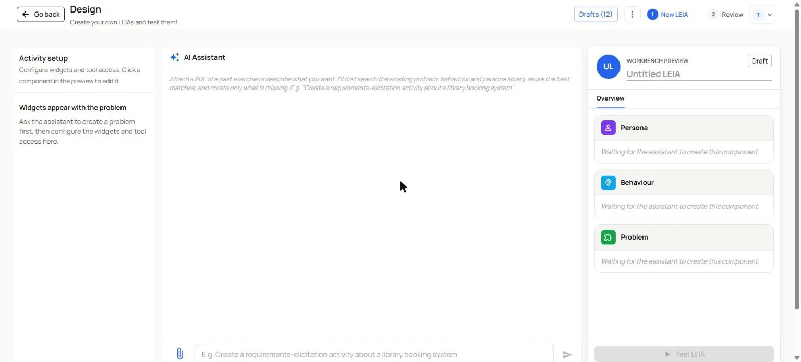

## 2. Load a canvas with Components

1. Press the three dots next to **Drafts**. The **Design menu** opens with the **Assistant settings** and, for administrators, a **Components** button.
2. Press **Components**. The **Select components** dialog shows three columns, **Behaviour**, **Problem** and **Persona**, each with a search box and filters.
3. Pick one item in each column. Which ones does not matter, you will replace every field; short ones are easier to overwrite. This run picked the behaviour `game-conversational`, the problem `secretWord-pizza` and the persona `timmy` of the secret word game.
4. Press **Use selected components**.

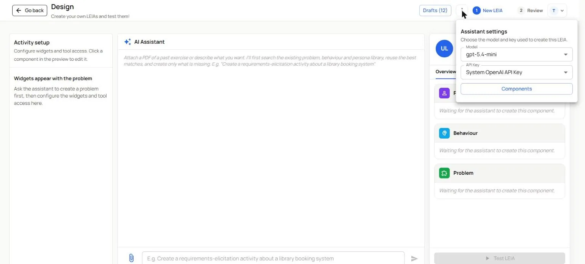

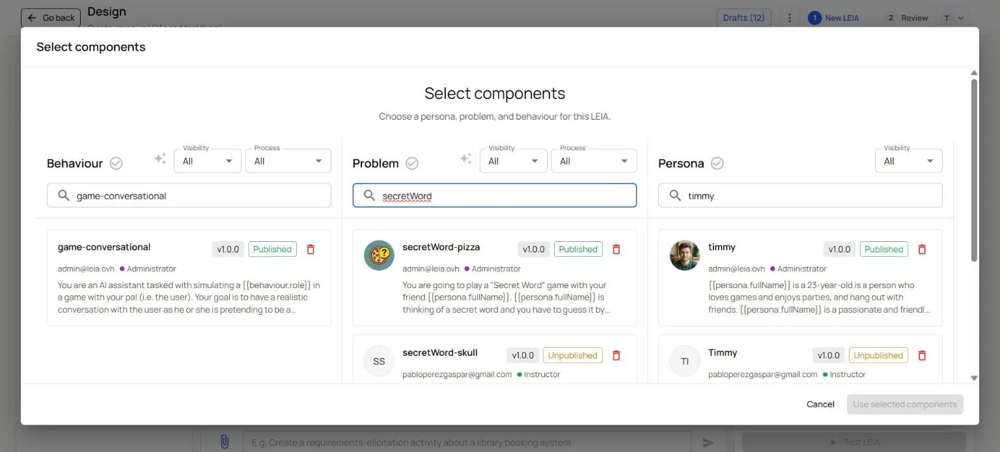

The three cards fill up, the chip changes to **Ready to test** and the title gets a suggestion. From here on the assistant is not involved.

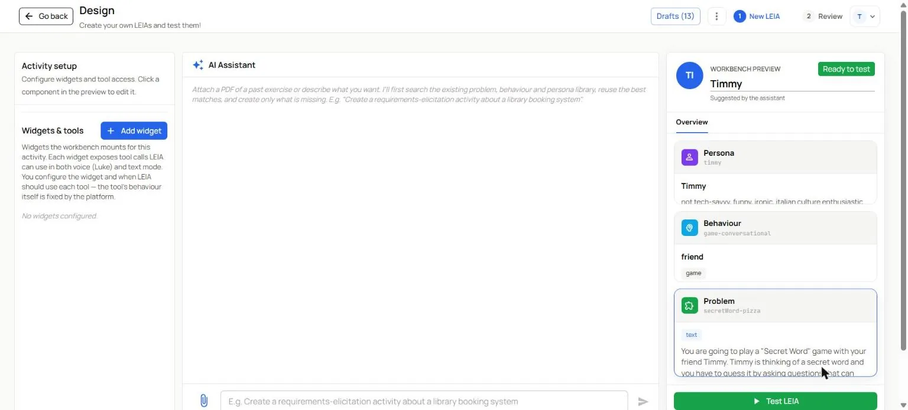

:::caution The sparkle buttons call the assistant
The small sparkle next to **Behaviour** and **Problem** in the dialog reads "Generate similar behaviour with AI". It is a shortcut to the assistant, not part of this path.
:::

## 3. Write the behaviour

Click the **Behaviour** card. **Edit Behaviour** opens on the **Visual Editor** tab. Replace every field.

1. **Behaviour name**: a new identifier, `docs-demo-complaining-guest`. A name that already exists is refused when you finish.
2. **Description**: the instructions for the language model. Say who it plays, what it knows, how it reacts to the student and what it must never do. Use placeholders so the same behaviour works with other personas and problems. This run: "You are an AI assistant playing `{{persona.fullName}}`, a hotel guest with a complaint, in a customer-service role-play. The user is the receptionist on duty. Your personality: `{{persona.personality}}`. About you: `{{persona.description}}`. What happened to you and what you want: `{{problem.details}}`. Behave like a real guest. Start annoyed and firm. Give the facts only when the receptionist asks for them, one or two at a time. Become more insistent if the receptionist ignores your points, blames you or makes excuses. Calm down when the receptionist apologises sincerely, shows that they understood the problem and offers a concrete solution. [...] Never break character and never reveal that you are an AI. Do not solve the problem for the receptionist."
3. **Role**: `hotel guest`. It is what `{{behaviour.role}}` inserts elsewhere.
4. **Tooltip**: the opening line students see under **Try typing**, written as the student would say it: "Good morning, I'm the receptionist on duty. I understand you had a problem with your room. Could you tell me what happened?"
5. **Process**: untick **Game**, tick **Other**. A problem can only be combined with a behaviour of the same process.
6. Leave **LEIA Speaks First** and **Stopping condition** off, and press **Save**.

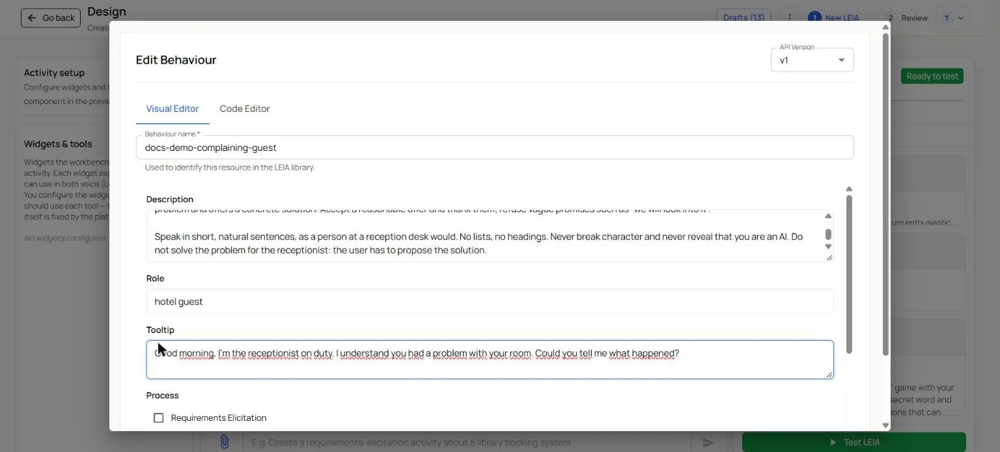

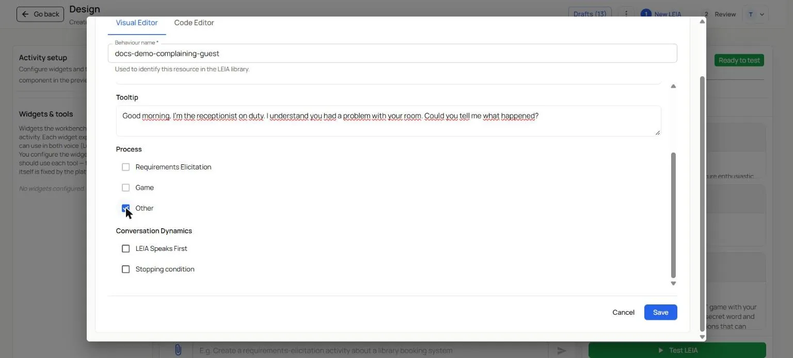

## 4. Write the persona

Click the **Persona** card and replace every field: **Persona name** `docs-demo-hotel-guest`, **Full Name** `Marco Rossi`, **First Name** `Marco`, a **Description** of who he is (a 47-year-old sales manager from Milan who travels two weeks a month, knows hotels, values his sleep before a meeting and is fair once someone takes responsibility), a **Personality** line (`tired, direct, impatient, fair, polite when respected`) and the four pronoun fields. Press **Save**.

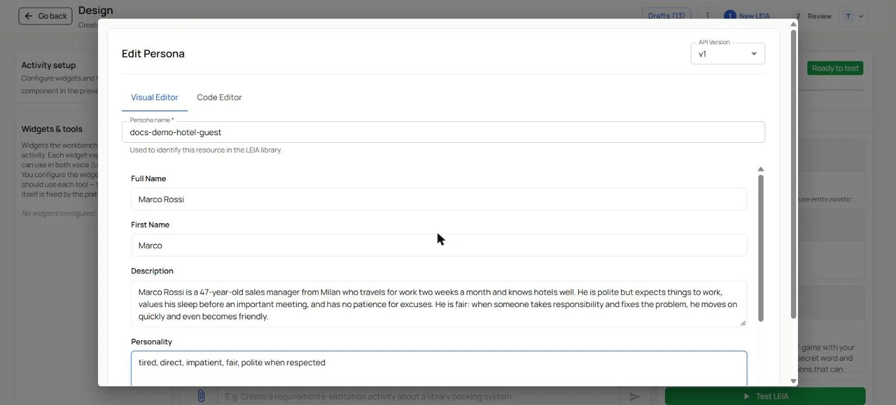

## 5. Write the problem

Click the **Problem** card.

1. **Problem name**: `docs-demo-noise-complaint`.
2. **Description**, what the student reads in the **Instructions** dialog: the situation, the task and the deliverable. Here: receptionist at Hotel Miramar, a guest comes to complain, listen, apologise, offer a solution, then write the follow-up email as plain text.
3. **Persona Background**: the character's situation in this exercise. Two sentences with `{{persona.fullName}}`.
4. **Details**: what only the character knows and the student has to find out. Room 304 faces the street, building work started at 7:00, he had asked for a quiet room, he called reception at 7:10 and nobody answered, his meeting is at 9:30, what he wants and what he will not accept.
5. **Solution**: what a good email contains, as the reference for the grader. **Solution Format** stays on **text**.
6. **Evaluation Prompt**: what to reward and what to penalise.
7. **Process**: untick **Game**, tick **Other**, the same as the behaviour.

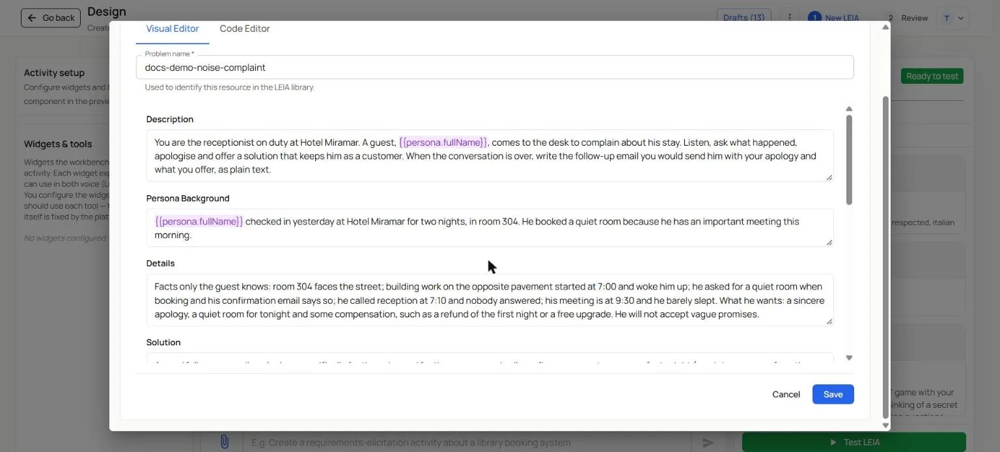

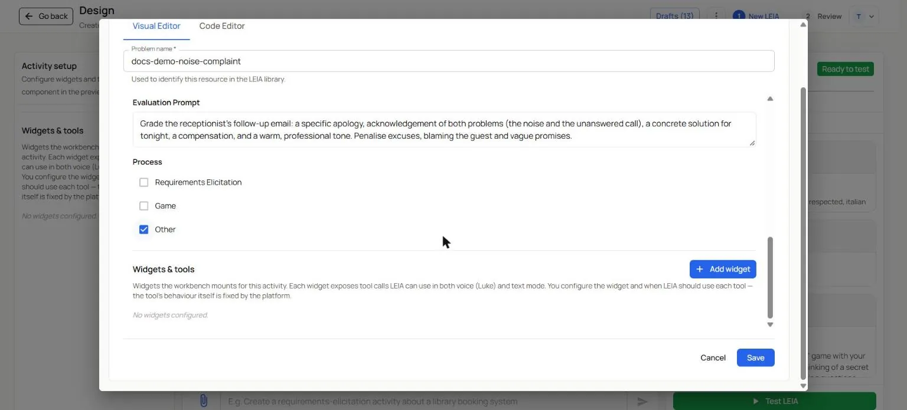

### Clean the Code Editor

The canvas problem may carry blocks that the visual editor does not show: `extends` (extra traits for the persona), `overrides` (a role or a tooltip that replaces the behaviour's) and `constrainedTo`. The secret word problem had both `extends`, which kept adding "italian culture enthusiastic" to Marco's personality, and an `overrides` tooltip about the game. Switch to the **Code Editor** tab, delete those blocks, check that the JSON is still valid and press **Save**. The persona card now shows only your personality line.

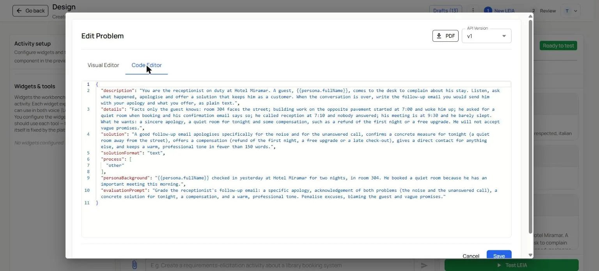

Type a title in the **Workbench preview** panel, `Hotel complaint role-play`; the review step proposes it as the LEIA name.

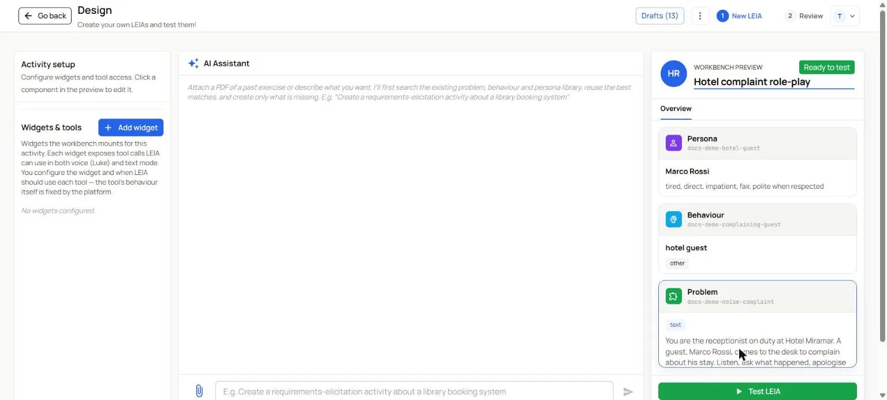

## 6. Test it

Press **Test LEIA**. The **Instructions** are the description you wrote, with the placeholders resolved. Send the tooltip line and check that Marco answers as the behaviour says: annoyed, factual, without solving the problem for you. **Continue Configuration** brings you back.

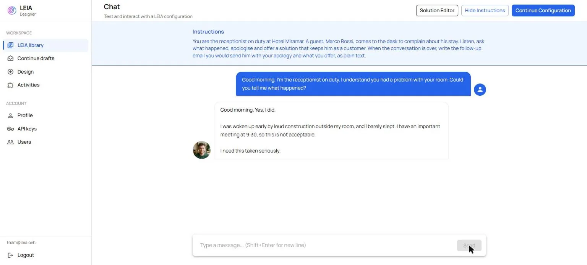

## 7. Name it and finish

Press **Review LEIA**.

1. **New LEIA name**: `docs-demo-hotel-complaint`.
2. **LEIA visibility**: **Private** unless the LEIA is ready for every user. Administrators get **Public** by default.
3. The three component cards show the names you typed. All three are new, each with its own **Visibility**.
4. Press **Finish LEIA**.

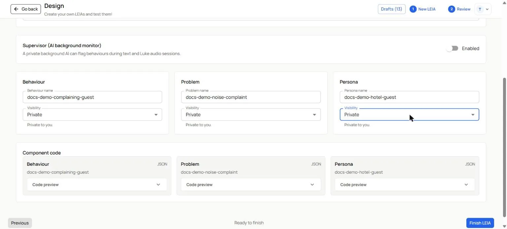

The **LEIA created successfully** dialog offers **Go to LEIAs**, **Add to Activity** and **Quick Replication**.

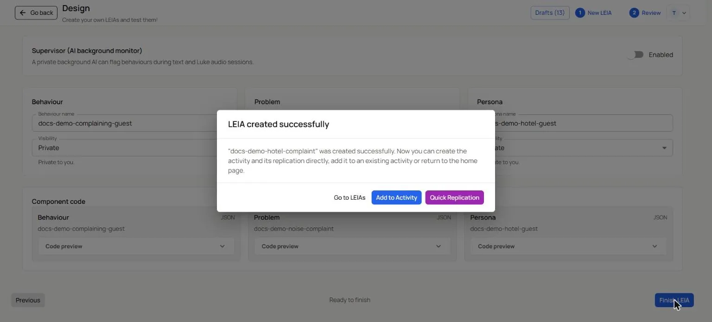

## 8. Open it to students

Press **Quick Replication**. The Workbench opens the new replication on its **General** page with the **Student link**, the **Demo / test link** and the **Code**. Turn on **Active** when the class starts, and check the model and the evaluation switches in the [LEIA settings](../teachers/workbench/leia-settings.md). The [replication settings](../teachers/workbench/replication-settings.md) page explains the rest.

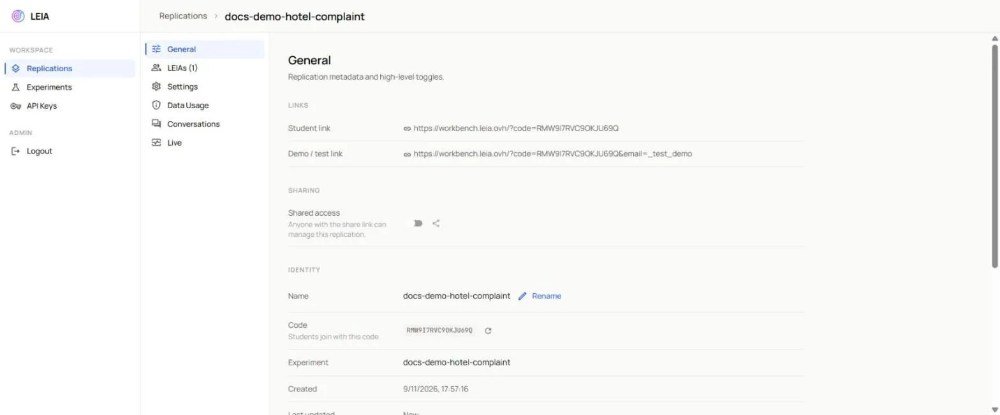

## What you created

- A behaviour `docs-demo-complaining-guest`, a persona `docs-demo-hotel-guest` and a problem `docs-demo-noise-complaint`, all three new and yours.
- A LEIA `docs-demo-hotel-complaint`, version 1.0.0, that combines them.
- The three canvas components, `game-conversational`, `secretWord-pizza` and `timmy`, are exactly as they were.

## What next

- To reuse this behaviour with another guest or another complaint, open the new LEIA in the library and press **Design from this**: change only the persona or the problem. [Your own LEIA from a featured one](create-from-featured.md) shows that path.
- To let the assistant write a first version that you then correct by hand, follow [Create a LEIA with the AI assistant](../teachers/designer/create-leia.md).
- To make students' sessions safer, add a [supervisor](../teachers/designer/supervisor.md) to the LEIA in the review step.
