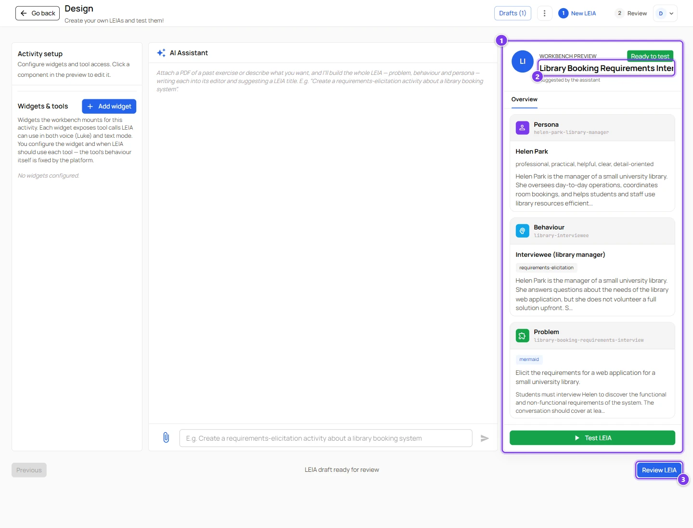
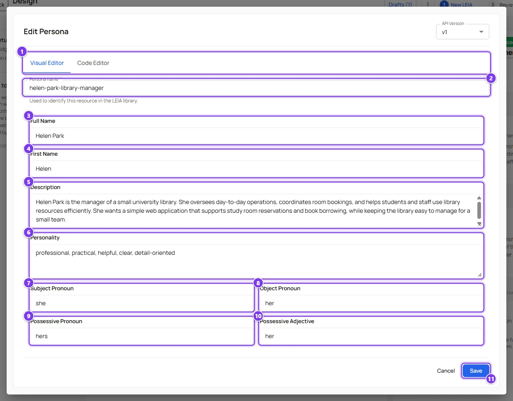
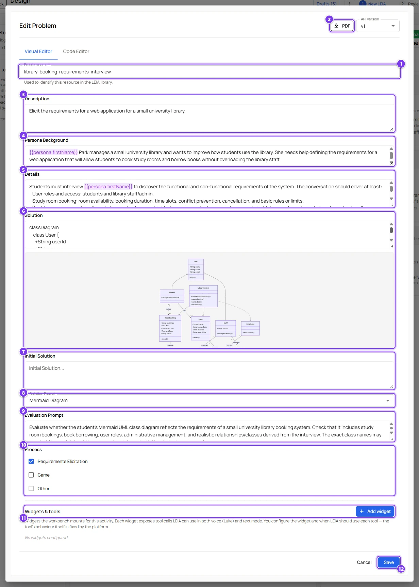
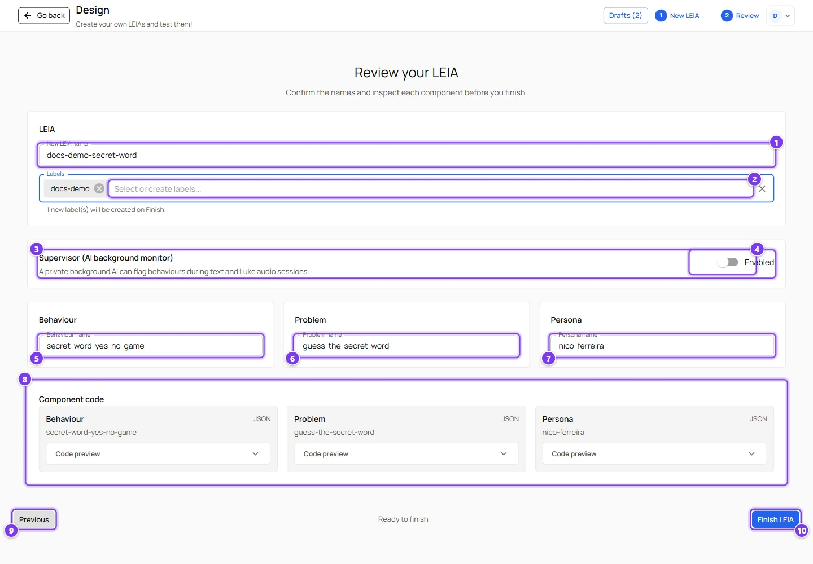
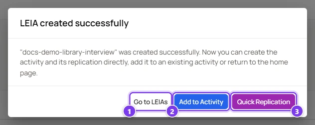

# Quick start, your first LEIA in ten minutes

:::info Who can do this
Every role, including **instructor**. This path reuses the behaviour of an existing LEIA, so it never creates a behaviour.
:::

The fastest way to get a LEIA of your own is to start from one that already exists, change the character and the exercise, and save the result under a new name. You will reuse the behaviour, which is the part that tells the language model how to act, and you will only touch what makes your version different.

## 1. Pick a LEIA to start from

1. Open the [LEIA library](../../teachers/designer/index.md).
2. Set **Visibility** to **Public** to see only the LEIAs published by the LEIA team.
3. Type a word in **Search by name or description**. For an interview exercise look for one whose description mentions requirements. For a game look for a guessing game.
4. Move the mouse over a row to reveal its buttons and press **View** to read its problem and persona. Close the dialog when you have read them.
5. When you have found a good candidate, press **Design from this** on its row.

The design screen opens with the three cards already filled.

| # | What you see | What it means |
|---|---|---|
| 1 | Three filled cards in the preview | The persona, behaviour and problem of the original LEIA are loaded. Nothing has been copied yet. |
| 2 | Title | The name of the original LEIA. You will change it in the last step. |
| 3 | **Review LEIA** | Already enabled, because the three components combine. |

## 2. Change the character

1. Click the **Persona** card. The persona editor opens.
2. Type a new **Persona name** (2), for example `maria-lopez-bookshop-owner`. A persona name that already exists is refused when you finish.
3. Change **Full Name** (3) and **First Name** (4).
4. Rewrite **Description** (5), who the character is and what they want.
5. Write a few adjectives in **Personality** (6).
6. If the character's pronouns change, update the four pronoun fields (7 to 10).
7. Press **Save** (11).

The **Persona** card of the preview now shows your character.

## 3. Change the exercise

1. Click the **Problem** card. The problem editor opens.
2. Type a new **Problem name** (1).
3. Rewrite **Description** (3), what the student sees.
4. Rewrite **Details** (5), what only the character knows.
5. Rewrite **Solution** (6), the reference answer in the chosen **Solution Format** (8).
6. Adjust **Evaluation Prompt** (9) if you want the grader to focus on something. The server refuses an empty prompt when you finish, so keep at least one line.
7. Leave **Process** (10) as it is. The behaviour you are reusing expects that process.
8. Press **Save** (12).

The **Problem** card of the preview now shows your exercise.

:::tip Placeholders keep working
If the original behaviour uses `{{persona.firstName}}` or `{{problem.details}}`, your new persona and problem are inserted automatically. See [Placeholders](../../teachers/designer/components-reference.md#placeholders).
:::

## 4. Try it

1. Press **Test LEIA** in the preview panel. The draft is saved before the chat opens.
2. Have a short conversation and check that the character behaves as you expect.
3. Press **Continue Configuration** to come back to the design screen.

Details in [Test a LEIA](../../teachers/designer/test-leia.md).

## 5. Name it and finish

1. Press **Review LEIA**.
2. Type the **New LEIA name** (1).
3. Add a label in **Labels** (2) if you want to find it quickly later.
4. Check the **Persona name** (7) and the **Problem name** (6). Leave the **Behaviour name** (5) as it is, since you reuse it.
5. Press **Finish LEIA** (10). The success dialog opens.
6. Press **Go to LEIAs** (1 in the success dialog).

Your LEIA is in the library, private to your account, with the **Test LEIA** button ready.

## What next

- Advanced and admin accounts can press **Quick replication** on the new row to open it for students at once. See [Workbench overview](../../teachers/workbench/index.md).
- Instructor accounts cannot run replications yet. Ask the LEIA team at [team@leia.ovh](mailto:team@leia.ovh) for the advanced role, or ask a colleague with that role to replicate your LEIA.
- To build a LEIA from scratch with the AI assistant, follow [Create a LEIA with the AI assistant](../../teachers/designer/create-leia.md).
