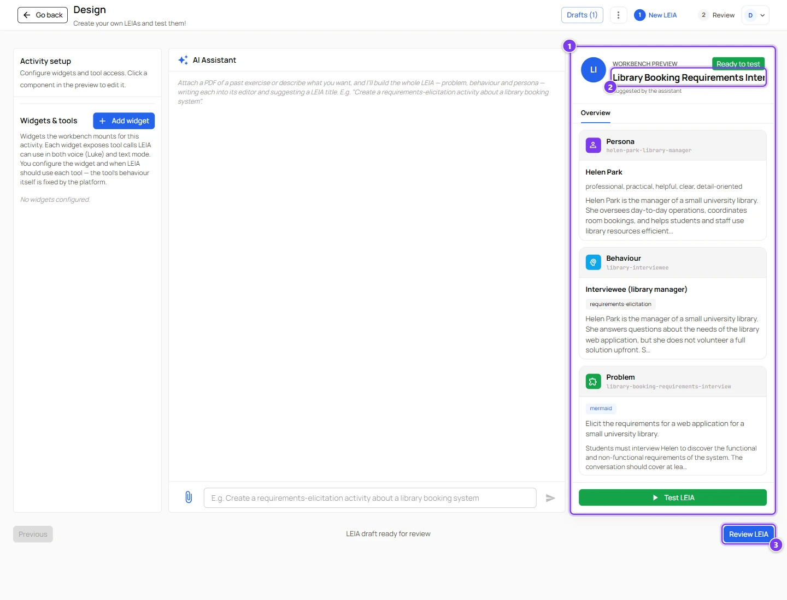

# Quick start, your first LEIA in ten minutes

:::info Who can do this
Every role, including **instructor**. This path reuses the behaviour of an existing LEIA, so it never creates a behaviour.
:::

The fastest way to get a LEIA of your own is to start from one that already exists, change the character and the exercise, and save the result under a new name. You will reuse the behaviour, which is the part that tells the language model how to act, and you will only touch what makes your version different.

## 1. Pick a LEIA to start from

Open the [LEIA library](../../teachers/designer/index.md) and find a public LEIA close to what you want. Set **Visibility** to **Public** to see only the LEIAs published by the LEIA team. For an interview exercise pick one whose description mentions requirements. For a game pick a guessing game.

Press **View** on the row to read its problem and persona. When you have found a good candidate, move the mouse over the row and press **Design from this**.

| # | What you see | What it means |
|---|---|---|
| 1 | Three filled cards in the preview | The persona, behaviour and problem of the original LEIA are loaded. Nothing has been copied yet. |
| 2 | Title | The name of the original LEIA. You will change it in the last step. |
| 3 | **Review LEIA** | Already enabled, because the three components combine. |

## 2. Change the character

Click the **Persona** card. The persona editor opens.

Change at least these fields.

- **Persona name** (2), a new identifier, for example `maria-lopez-bookshop-owner`. A persona name that already exists is refused when you finish.
- **Full Name** (3) and **First Name** (4).
- **Description** (5), who the character is and what they want.
- **Personality** (6), a few adjectives.
- The four pronoun fields (7 to 10) if the character's gender changed.

Press **Save** (11).

## 3. Change the exercise

Click the **Problem** card.

Change at least these fields.

- **Problem name** (1), a new identifier.
- **Description** (3), what the student sees.
- **Details** (5), what only the character knows.
- **Solution** (6), the reference answer in the chosen **Solution Format** (8).
- **Evaluation Prompt** (9) if you want the grader to focus on something.

Leave **Process** (10) as it is. The behaviour you are reusing expects that process. Press **Save** (12).

:::tip Placeholders keep working
If the original behaviour uses `{{persona.firstName}}` or `{{problem.details}}`, your new persona and problem are inserted automatically. See [Placeholders](../../teachers/designer/components-reference.md#placeholders).
:::

## 4. Try it

Press **Test LEIA** in the preview panel and have a short conversation. The draft is saved before the chat opens, and **Continue Configuration** brings you back. Details in [Test a LEIA](../../teachers/designer/test-leia.md).

## 5. Name it and finish

Press **Review LEIA**.

- Type the **New LEIA name** (1).
- Add a **Label** (2) if you want to find it quickly later.
- Check the **Persona name** (7) and the **Problem name** (6). The **Behaviour name** (5) stays as it is, since you reuse it.
- Press **Finish LEIA** (10).

Press **Go to LEIAs**. Your LEIA is in the library, private to your account, with the **Test LEIA** button ready.

## What next

- Advanced and admin accounts can press **Quick replication** on the new row to open it for students at once. See [Workbench overview](../../teachers/workbench/index.md).
- Instructor accounts cannot run replications yet. Ask the LEIA team at [team@leia.ovh](mailto:team@leia.ovh) for the advanced role, or ask a colleague with that role to replicate your LEIA.
- To build a LEIA from scratch with the AI assistant, follow [Create a LEIA with the AI assistant](../../teachers/designer/create-leia.md).
