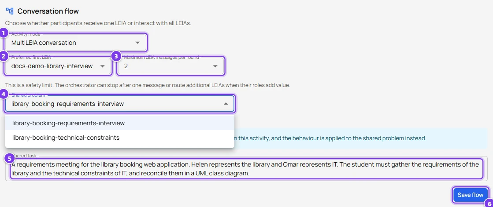

# Scenario, a group simulation with several LEIAs

In a MultiLEIA activity the student talks to several characters in the same chat. An orchestrator decides which character answers each message, so a meeting with a client and an IT manager, a focus group of users or a team retrospective become possible. The example puts Helen Park, the library manager, and Omar Haddad, the IT manager of the university, in one requirements meeting.

## What you need

- An account with the advanced role.
- An OpenAI key or a system key.
- Two or more LEIAs with the **same process**. They may share the problem or not, only one problem is used.

## 1. Design the characters

Design one LEIA per character with the assistant. Each needs its own persona and behaviour. The problem matters only for the LEIA you will choose as the **Shared problem**, so for the others a short placeholder problem with the same process is enough.

For the meeting example the two briefs were

> Create a requirements-elicitation activity about a library booking system. The persona is Helen Park, the manager of a small university library ... (the LEIA of the [requirements interview scenario](requirements-elicitation.md))

> Create a requirements-elicitation activity for a meeting about a library booking system. The persona is Omar Haddad, the IT manager of the university, who cares about security, single sign-on and hosting costs and often disagrees with the library manager about priorities.

Give the behaviours short answers. In a group conversation long monologues are tiring.

## 2. Build the activity

1. Open **Activities** and press **New Activity**. Name it, for example `Library booking requirements meeting`.
2. In the library press **Add to activity** on each LEIA and choose the activity.
3. Expand the activity and open **Conversation flow**.

| Field | Value for this scenario |
|---|---|
| **Activity mode** | **MultiLEIA conversation** |
| **Preferred first LEIA** | Helen, the client who opens the meeting |
| **Maximum LEIA messages per round** | 2, so both characters may react to one question |
| **Shared problem** | Helen's LEIA, whose problem has the solution and the evaluation |
| **Shared task** | "A requirements meeting for the library booking web application. Helen represents the library, Omar represents IT. The student must gather the requirements and the constraints of both sides." |

Press **Save flow**, check that no warning remains and press **Publish**. See [Activities](../teachers/designer/activities.md#conversation-flow).

## 3. Replicate and configure

Open the Workbench, create a replication of the activity and open its **LEIAs** section. A **MultiLEIA activity** banner summarises the flow and offers **Test MultiLEIA**. Set a model and a key for every LEIA, otherwise the replication cannot be activated. Voice is not available in MultiLEIA, so leave **Audio mode** on **None**. See [LEIA settings in a replication](../teachers/workbench/leia-settings.md).

Try the meeting with **Test MultiLEIA** before activating.

## 4. What students experience

Each answer carries the name of the character who speaks. After one student message the orchestrator lets one or two characters answer, then waits for the student. If a character fails to answer, an amber notice says the round ended early and the conversation continues normally.

At the end the student submits the solution of the shared problem and the evaluation uses that problem's solution and evaluation prompt.

## Tips

- Keep the number of characters small. Three is already a lot for a student to manage.
- Give the characters visible disagreements. The orchestrator uses roles to decide who speaks, and conflicting roles make for a richer meeting.
- The supervisor is configured per LEIA, not per activity. If you rely on its flags, run a **Test MultiLEIA** session first and check that they appear in the Live dashboard.
- The conversation flow and the list of LEIAs freeze when you publish. Prepare a second activity if you want to try another combination.
