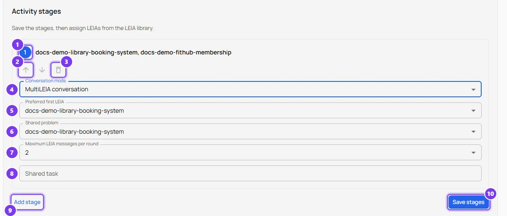
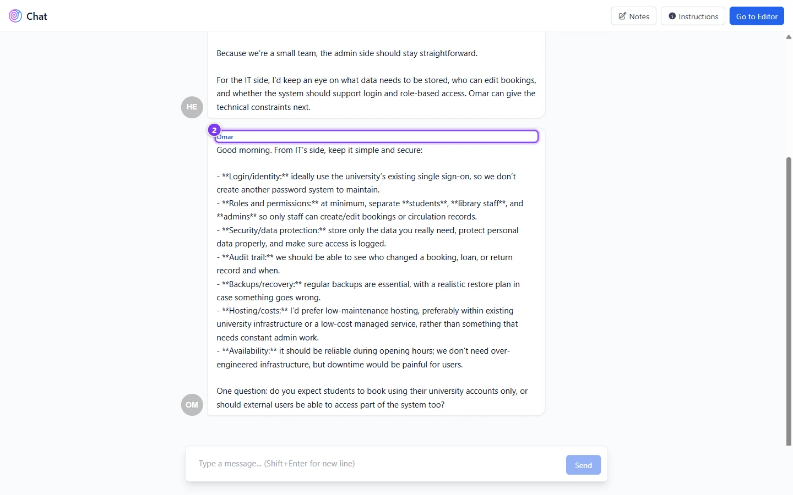

# Scenario, a group simulation with several LEIAs

:::info Start from a featured LEIA
If you want a new exercise similar to one that already exists, start from a [featured LEIA](../featured-leias/index.md) with **Design from this**. The tutorial [Your own LEIA from a featured one](create-from-featured.md) shows every step.
:::

In a MultiLEIA activity the student talks to several characters in the same chat. An orchestrator decides which character answers each message, so a meeting with a client and an IT manager, a focus group of users or a team retrospective become possible. The example puts Helen Park, the library manager, and Omar Haddad, the IT manager of the university, in one requirements meeting.

## What you need

- An account with the advanced role.
- An OpenAI key or a system key.
- Two or more LEIAs whose behaviours have the **same process** as the problem you will share. They may share the problem or not, only one problem is used.

## 1. Design the characters

Design one LEIA per character with the assistant. Each needs its own persona and behaviour. The problem matters only for the LEIA you will choose as the **Shared problem**, so for the others a short placeholder problem with the same process is enough.

1. Press **Design** in the sidebar of the Designer and send the brief of the first character. For the meeting example it was

   > Create a requirements-elicitation activity about a library booking system. The persona is Helen Park, the manager of a small university library ... (the LEIA of the [requirements interview scenario](requirements-elicitation.md))

2. Click the **Behaviour** card and ask for short answers in **Description**. In a group conversation long monologues are tiring. Press **Save**.
3. Press **Review LEIA**, type the **New LEIA name** and press **Finish LEIA**.
4. Press **Go to LEIAs**, then **Design** again, and repeat with the next character. For the meeting example the second brief was

   > Create a requirements-elicitation activity for a meeting about a library booking system. The persona is Omar Haddad, the IT manager of the university, who cares about security, single sign-on and hosting costs and often disagrees with the library manager about priorities.

The library lists one LEIA per character.

## 2. Build the activity

1. Open **Activities** and press **New Activity**. Name it, for example `Library booking requirements meeting`. Names are unique across all users.
2. In the library press **Add to activity** on each LEIA, choose the activity and keep **Stage 1**.
3. Back in **Activities**, expand the activity. Under **Activity stages**, stage 1 lists both LEIAs.
4. Set the **Conversation mode** of the stage to **MultiLEIA conversation** and fill in the fields with the values below.
5. Press **Save stages** and check that no error appears.

The activity is ready to replicate. Administrators may also press **Publish** so that every advanced user can replicate it; there is no confirmation and it cannot be undone. See [Put every LEIA in one conversation](../teachers/designer/activities.md#put-every-leia-in-one-conversation).

| Field | Value for this scenario |
|---|---|
| **Conversation mode** | **MultiLEIA conversation** |
| **Preferred first LEIA** | Helen, the client who opens the meeting |
| **Maximum LEIA messages per round** | 2, so both characters may react to one question |
| **Shared problem** | Helen's LEIA, whose problem has the solution and the evaluation. The list shows LEIA names |
| **Shared task** | "A requirements meeting for the library booking web application. Helen represents the library, Omar represents IT. The student must gather the requirements and the constraints of both sides." |

## 3. Replicate and configure

1. Press **Replicate** on the activity. The Workbench opens it in a new tab.
2. Press **Create Replication**, type the **Replication Name** and press **Create**.
3. Choose **LEIAs** in the sub-menu of the replication. A **MultiLEIA activity** banner summarises the flow.
4. Open each LEIA, set its **Model** and **API key**, leave **Audio mode** on **None** and press **Save**. Without a model and a key on every LEIA the replication cannot be activated, and voice is not available in MultiLEIA.
5. Press **Test MultiLEIA** on the banner and try the meeting.
6. Choose **General** in the sub-menu and turn on **Active**.
7. Copy the **Student link** and give it to your students.

See [LEIA settings in a replication](../teachers/workbench/leia-settings.md).

## 4. What students experience

Each answer carries the name of the character who speaks. After one student message the orchestrator lets one or two characters answer, then waits for the student. If a character fails to answer, an amber notice says the round ended early and the conversation continues normally.

At the end the student submits the solution of the shared problem and the evaluation uses that problem's solution and evaluation prompt.

## Tips

- Keep the number of characters small. Three is already a lot for a student to manage.
- Give the characters visible disagreements. The orchestrator uses roles to decide who speaks, and conflicting roles make for a richer meeting.
- The supervisor is configured per LEIA, not per activity. If you rely on its flags, run a **Test MultiLEIA** session first and check that they appear in the Live dashboard.
- A replication is a copy of the activity at the moment you create it. Later changes to the stages or the LEIAs of the activity do not reach it, so create a new replication after changing them. A published activity cannot change at all; prepare a second one to try another combination.
- In a MultiLEIA stage, **LEIA Speaks First**, the stopping condition and the widgets of the problem are ignored.
