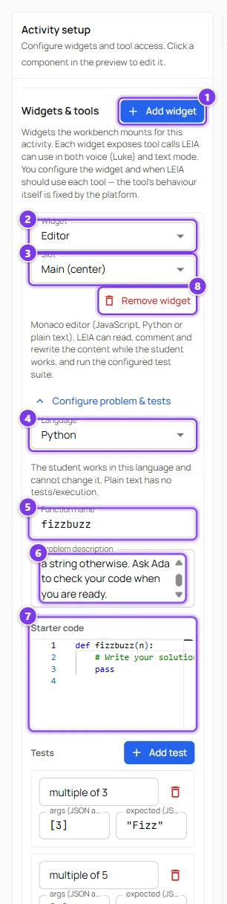
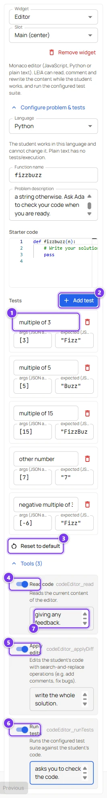
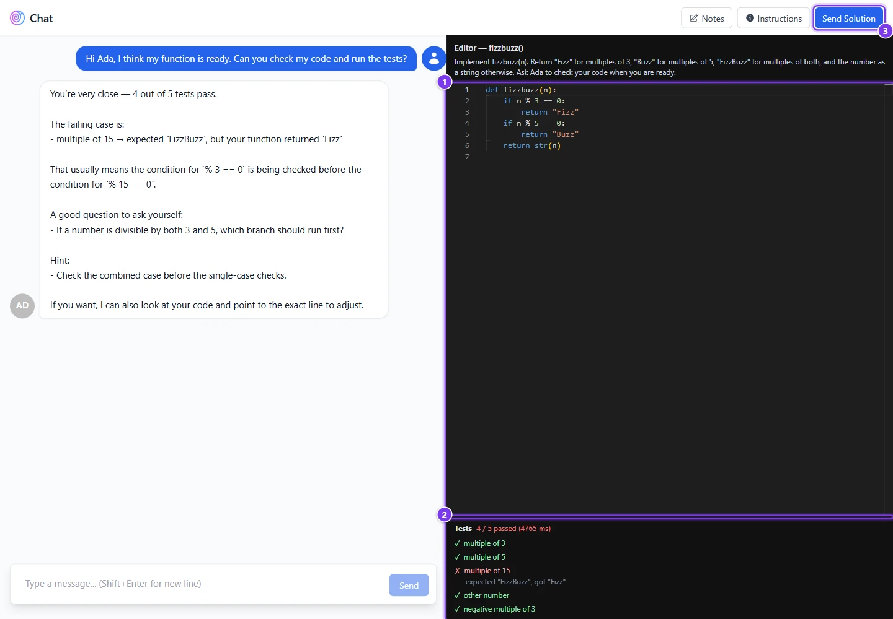

# Scenario, a programming exercise with the code editor

A LEIA with the **Editor** widget becomes a programming tutor. The student writes code in an editor next to the chat, the LEIA reads it, comments on it and runs the tests you defined. The example is the FizzBuzz function in Python with Ada Okafor, a patient tutor who asks guiding questions instead of giving the answer.

## What you need

- An account with the advanced role.
- An **OpenAI** key or a system key. The editor's tools only work with OpenAI models.

## 1. Design the LEIA

Open **Design** and describe the exercise. Mention the language, the function name and what the tutor must and must not do.

> Create a Python programming exercise for first-year students. The persona is Ada Okafor, a patient programming tutor who never gives the full solution but asks guiding questions. The student must implement a function fizzbuzz(n) that returns the string Fizz for multiples of 3, Buzz for multiples of 5, FizzBuzz for multiples of both and the number itself as a string otherwise. The student writes the code in the editor and asks Ada to check it. The solution format is plain text.

The assistant writes the three components and usually adds the **Editor** widget by itself, with a set of tests. Check the widget in the **Activity setup** panel.

- **Language** (4) must be **Python**. The assistant sometimes leaves JavaScript selected.
- **Function name** (5) is `fizzbuzz`.
- **Problem description** (6) is what the student reads above the editor.
- **Starter code** (7) is the content of the editor when the student arrives. A function signature with `pass` is a good start.

Review the tests (1). Each one calls the function with the **args** list and compares the result with **expected**. `[3]` and `"Fizz"`, `[5]` and `"Buzz"`, `[15]` and `"FizzBuzz"`, `[7]` and `"7"`. Add edge cases with **Add test** (2).

Keep the three tools on (4 to 6) and write when Ada should use them (7). "Run the tests when the student asks you to check the code" prevents the tutor from running them after every message.

Full reference in [Code editor widget](../teachers/designer/widgets.md).

## 2. Check the problem

Open the **Problem** card. **Solution Format** is **Plain Text**, since the student's deliverable is the code itself. Write a reference implementation in **Solution** so the automatic evaluation has something to compare with, and a signature in **Initial Solution**. The field must not be empty.

Finish the LEIA with a name and a label.

## 3. Test it

Test from the library. The editor appears on the right. Write a wrong implementation, ask Ada to check it and watch the test strip update. Then ask for a hint and make sure Ada does not paste the full solution. See [Test a LEIA](../teachers/designer/test-leia.md).

## 4. Replicate

Use **Quick replication** and configure the replication.

| Setting | Suggested value | Why |
|---|---|---|
| **Model** | an OpenAI model | Required by the widget tools. The list only shows OpenAI models for this LEIA. |
| **Ask for student solution** | on | The code in the editor is sent as the solution. |
| **Automatic evaluation** | on | The grader compares the code with your reference solution. |
| **Audio mode** | **None** or **Luke** | The legacy realtime voice does not support widgets. |
| **Duration** | 20 to 30 minutes | |

See [LEIA settings in a replication](../teachers/workbench/leia-settings.md).

## 5. What students see

The editor sits next to the chat. There is no run button. Students ask Ada to check their code, Ada runs the tests and the results appear under the editor. The **Send Solution** button at the top sends the editor content when they are done.

## Tips

- Give three to six tests. Too many tests make the feedback noisy.
- Name the tests by behaviour, "multiple of 3" rather than "test 1". Ada mentions test names when explaining failures.
- Tell the behaviour how much to help. "Never write more than one line of code" is a clear rule.
- Python needs a few seconds to load the first time a student runs the tests. Warn them.
