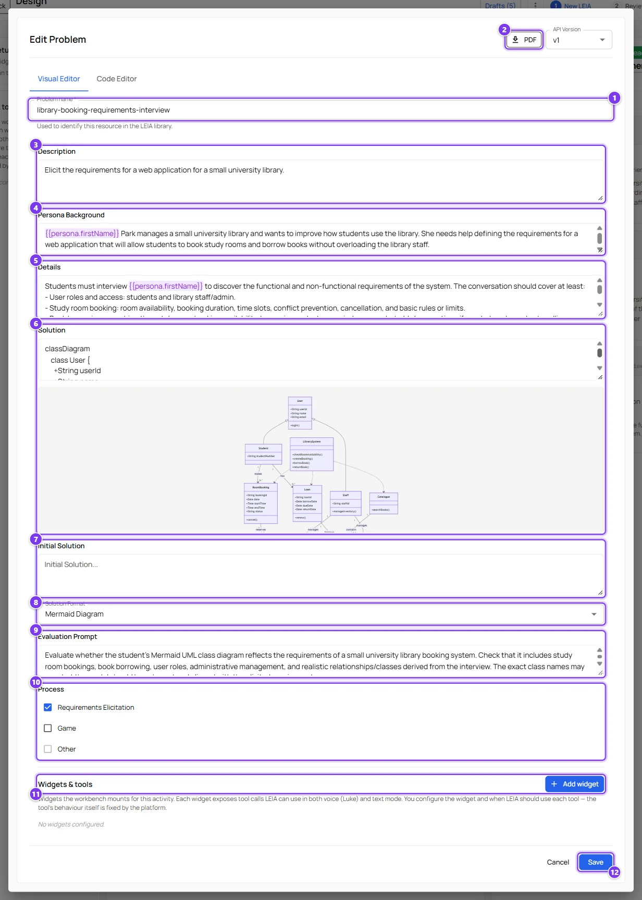
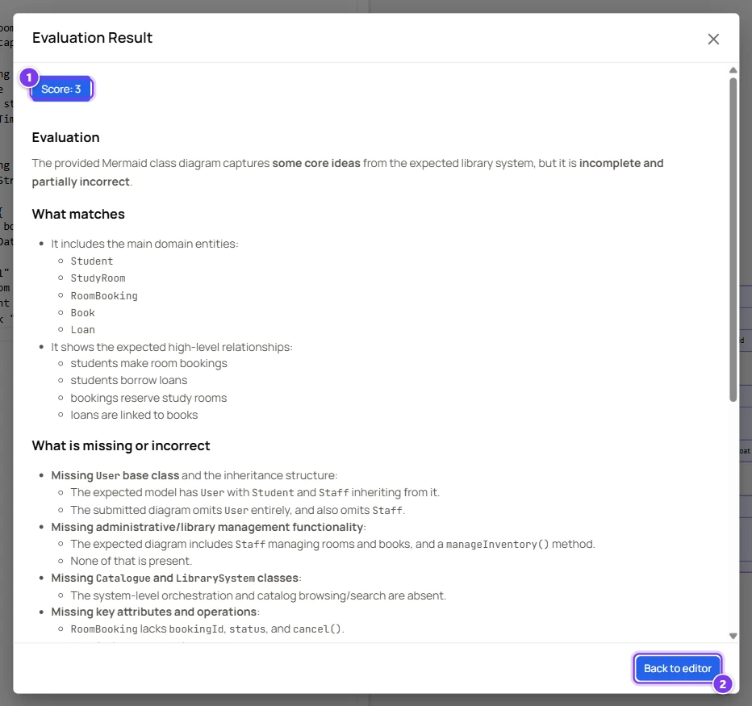

# Scenario, a requirements elicitation interview

The classic LEIA. The student plays the analyst, the LEIA plays a client who knows what they need but does not know how to say it, and the deliverable is a model of what the student discovered. The example used throughout the teacher guide is Helen Park, the manager of a small university library who wants a room booking and lending application.

## What you need

- An account with the advanced role.
- An OpenAI key or a system key.
- A reference solution in mind. For a class diagram, sketch the classes and relationships you expect before you start.

## 1. Design the LEIA

1. Press **Design** in the sidebar of the Designer.
2. Type the description of the interview in the message box and press **Send message**. The brief used here was

   > Create a requirements-elicitation activity about a library booking system. The persona is Helen Park, the manager of a small university library. She wants a web application so students can book study rooms and borrow books. Students must interview Helen to discover the requirements and deliver a UML class diagram in Mermaid syntax as their solution.

3. Wait for the green confirmation lines. The assistant produces a persona, a behaviour that answers questions without volunteering the whole picture, and a problem with a Mermaid solution.
4. Click the **Problem** card to shape the exercise.
5. In **Description** (3) write the brief students read. Say who they are meeting and what they must deliver.
6. In **Details** (5) list the facts the client knows. The more concrete the list, the more consistent the interview. Mention the facts the client should only reveal when asked.
7. In **Solution** (6) write the reference class diagram. The preview under the field shows it, so you can check the Mermaid syntax.
8. In **Evaluation Prompt** (9) tell the grader what matters. For example "Check that the diagram contains bookings, rooms, books, loans and users, with sensible multiplicities. Do not penalise different class names if the meaning is the same".
9. In **Initial Solution** (7) write a skeleton such as `classDiagram` with one class, so students start from valid syntax.
10. Press **Save** (12).
11. Click the **Behaviour** card and read **Description**. A good client behaviour answers only what is asked, stays in role, gives realistic answers and never produces a list of requirements on request.
12. Write an opening line in **Tooltip**, for example "Hello Helen, could you tell me about your library?". Press **Save**.
13. Press **Review LEIA**, type a clear **New LEIA name**, add a label for your course in **Labels** and press **Finish LEIA**.

The success dialog confirms that the LEIA exists.

## 2. Test the interview and the grading

1. Press **Go to LEIAs** in the success dialog.
2. Move the mouse over the row of your LEIA and press **Test LEIA**.
3. Ask open questions and check that the character reveals the facts in **Details** gradually.
4. Press **Solution Editor**, paste a partial diagram and press **Evaluate Solution**. Note the score and press **Back to editor**.
5. Replace the text with the full reference solution and press **Evaluate Solution** again.

The two scores should be clearly different. See [Test a LEIA](../teachers/designer/test-leia.md).

## 3. Replicate

1. In the library, press **Quick replication** on the row. The replication opens in the Workbench in a new tab. To prepare the activity yourself instead, follow [Activities](../teachers/designer/activities.md).
2. Choose **LEIAs** in the sub-menu of the replication and open your LEIA.
3. Check that **Model** and **API key** are set. If you change them, press **Save**.
4. Set **Ask for student solution**, **Automatic evaluation** and **Show during exercise** with the values below.
5. Choose **General** in the sub-menu and set **Duration**, **Repeatable** and **Language** with the values below.
6. Turn on **Active**.
7. Copy the **Student link** or the **Code** and give it to your students.

| Setting | Suggested value | Why |
|---|---|---|
| **Ask for student solution** | on | The diagram is the deliverable. |
| **Automatic evaluation** | on | Students get feedback at once and you get a score. |
| **Duration** | 30 to 45 minutes | Enough for an interview and a diagram. |
| **Repeatable** | off | One interview per student. Turn it on for practice sessions. |
| **Language** | the language of your class | The client answers in it and the evaluation is written in it. |
| **Show during exercise** | on, if you generated the student infographic | Students can re-read the brief without leaving the chat. |

See [Replication settings](../teachers/workbench/replication-settings.md) and [LEIA settings in a replication](../teachers/workbench/leia-settings.md).

## 4. During the class

1. Choose **Live** in the sub-menu of the replication and press **Open live dashboard**.
2. Check who has started, how many messages each student has exchanged and the supervisor flags if you enabled one.
3. To read a conversation as it happens, select the session and press **Watch live**. If you get "Failed to generate spectate link", read it in **Conversations** instead.

See [Live dashboard and spectating](../teachers/workbench/live-and-spectate.md).

## 5. Grade

1. Choose **Conversations** in the sub-menu of the replication and press **Open conversations**.
2. Click a session and read the transcript, the evaluation and the submitted diagram, which is rendered.
3. If you have an administrator account and disagree with the grader, click the **Score** chip and type another score. Other accounts keep their own grades outside LEIA.
4. Press **Download CSV** for your records.

See [Results, grading and export](../teachers/workbench/results-and-export.md).

## Voice variant

The same LEIA can be run as a spoken interview.

1. Choose **LEIAs** in the sub-menu of the replication and open your LEIA.
2. Set **Audio mode** to **Luke** or **Legacy (OpenAI Realtime)**.
3. Pick a voice that matches the persona's pronouns.
4. Press **Save**.

Students then talk to Helen through the microphone and still write the diagram in the editor at the end. Voice uses the platform's keys and the transcript is saved like a text conversation, unless you enable **Hide audio transcription**. See [LEIA settings in a replication](../teachers/workbench/leia-settings.md#runner).

## Variations

- Two clients with conflicting needs in one activity with **MultiLEIA conversation**. See [Scenario, a group simulation with several LEIAs](multi-leia-simulation.md).
- A transcript to analyse instead of an interview to conduct. Put the LEIA in **transcription** mode in the activity and let the platform generate the conversation. See [Activities](../teachers/designer/activities.md#transcription-mode).
- A process discovery interview. Change the deliverable to a Mermaid flowchart or sequence diagram and adapt the evaluation prompt.
